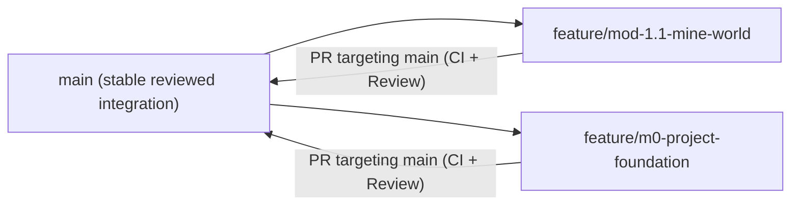

# Contributing Guidelines & Developer Workflow

Welcome to the **Decentralized Multi-Robot Mine Inspection Platform**. This document defines the engineering standards, contribution workflow, solo founder review governance, and branching policies for all project contributors.

---

## 1. Core Engineering Invariants

1. **Documentation Before Implementation**: Architectural documentation, interface definitions, requirement traceability, and test specifications must be reviewed and merged *before* writing production code.
2. **Never Claim Unimplemented Features**: Submodules and features must reflect their true lifecycle state (`PLANNED`, `IN_PROGRESS`, `BLOCKED`, `IMPLEMENTED`, `TESTED`, `VERIFIED`). Never mark planned functionality as implemented.
3. **No Unverified Benchmarks**: Performance metrics must be documented as `[PROPOSED TARGET]` until validated through reproducible simulation or hardware test benches.
4. **Local Safety Autarchy**: No code contribution may bypass, preempt, or weaken the planned Layer 1 Local Safety Manager component (scheduled for implementation under Module 1.5 in Milestone M3). Local safety retains ultimate authority over motor actuation.
5. **Decoupled Architecture**: Layer 2 (Autonomy) must not depend on concrete hardware implementations; Layer 3 (Operations) must never command robot actuators directly.
6. **Interface Schema Immutability**: All shared data models (`interfaces/`) are locked. Changes require an approved Architectural RFC.

---

## 2. Solo Founder Governance & Review Model

As the project scales from a solo founder to multiple independent contributors:
- **Principal Systems Architect (Founder)**: Holds sole merge authority on the `main` branch.
- **Branch Protection**: Direct pushes to `main` are strictly prohibited. All changes must arrive via Pull Request.
- **Single Approver Gate**: Every Pull Request requires explicit review and approval by the Founder using the [Code Review Checklist](docs/07_development_standards/CODE_REVIEW_CHECKLIST.md).
- **Module Assignment**: Incoming contributors must be assigned a module using the [Module Assignment Template](docs/07_development_standards/MODULE_ASSIGNMENT_TEMPLATE.md) and adhere to the [Module Ownership Matrix](docs/07_development_standards/MODULE_OWNERSHIP_AND_INTERFACES.md).

---

## 3. Git Workflow & Branching Strategy

Our agreed Git workflow maintains a clean, linear, and strictly verified repository history:
- **`main`**: Stable reviewed integration branch representing verified milestones and production-ready code.
- **Feature branches**: Individual development branches branched directly from `main`.
- **Pull Requests (PRs)**: All PRs target `main` directly.



### Branch Naming Conventions
- **`main`**: Stable reviewed integration branch.
- **`feature/<module-id>-<description>`**: Scoped feature work branched from `main` (e.g., `feature/mod-1.1-tunnel-gen`, `feature/m0-project-foundation`).
- **`fix/<issue-id>-<description>`**: Bug and hotfix branches branched from `main`.
- **`docs/<topic>`**: Documentation and architectural enhancements branched from `main`.

### Commit Conventions (Conventional Commits v1.0.0)
All commit messages must strictly adhere to the [Conventional Commits](https://www.conventionalcommits.org/) format:
```text
<type>(<scope>): <short description>

[optional body]

[optional footer(s)]
```

Allowed types:
- `feat`: A new user-facing or architectural capability.
- `fix`: A bug fix or defect correction.
- `docs`: Documentation additions or revisions only.
- `arch`: Architectural decision records or design revisions.
- `test`: Unit, integration, or fault-injection test implementations.
- `refactor`: Code restructuring without functional behavior modification.
- `ci`: Continuous integration or build configuration adjustments.

---

## 4. Pull Request (PR) Process

1. **Branch**: Create a feature branch from the latest `main` branch.
2. **Implement & Test**: Write code within your assigned module directory. Ensure unit tests achieve >= 80% coverage.
3. **Run Local Verification**:
   ```bash
   # Verify repository link integrity and documentation schemas
   python3 tools/verify_repository.py
   
   # Run C++ / Python linters
   flake8 src/ tests/
   black --check src/ tests/
   ament_flake8
   ```
4. **Submit PR**: Open a PR targeting `main` using the project's [Pull Request Template](.github/PULL_REQUEST_TEMPLATE.md).
5. **Founder Review**: The Founder reviews the PR against the [Code Review Checklist](docs/07_development_standards/CODE_REVIEW_CHECKLIST.md).
6. **Rebase & Merge**: Once approved and CI passes, the PR is squash-merged or rebase-merged into `main`.

---

## 5. Architectural Standards References

- [Three-Layer System Architecture](docs/01_system_architecture/THREE_LAYER_ARCHITECTURE.md)
- [System Requirements Specification](docs/02_requirements/SYSTEM_REQUIREMENTS.md)
- [Shared Interface Definitions](docs/06_interfaces_and_protocols/SHARED_INTERFACE_DEFINITIONS.md)
- [Module Ownership & Interfaces](docs/07_development_standards/MODULE_OWNERSHIP_AND_INTERFACES.md)
- [Module Assignment Template](docs/07_development_standards/MODULE_ASSIGNMENT_TEMPLATE.md)
- [Code Review Checklist](docs/07_development_standards/CODE_REVIEW_CHECKLIST.md)
- [Architecture Decision Records (ADRs)](docs/10_architecture_decision_records/README.md)
