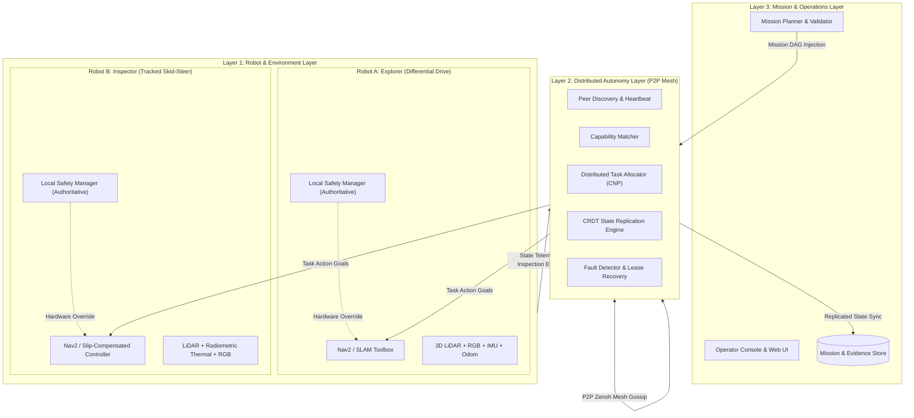

# Decentralized Multi-Robot Mine Inspection Platform

A robust, decentralized multi-robot autonomy and coordination architecture designed for underground mine mapping, inspection, and hazard assessment in communications-degraded subterranean environments.

---

## 1. Executive Summary

Underground mining environments present severe challenges for autonomous systems: complete absence of GPS, severe radio-frequency (RF) attenuation, complex geometry, non-line-of-sight acoustics, dust, moisture, and extreme safety risks. Conventional centralized multi-robot systems fail when tether or wireless command links break down.

The **Decentralized Multi-Robot Mine Inspection Platform** solves this fundamental operational bottleneck through a **Three-Layer Decoupled Architecture**:
1. **Layer 1: Robot and Environment Layer** &mdash; High-fidelity simulation (Gazebo Sim), ROS 2 Humble perception, SLAM, Nav2 mobility, authoritative local safety reflexes, and standardized robot agent interfaces for heterogeneous robots.
2. **Layer 2: Distributed Autonomy Layer** &mdash; Peer-to-peer discovery, capability-aware Contract Net Protocol (CNP) task auctioning, CRDT-based distributed state replication, and decentralized fault recovery with zero single points of failure.
3. **Layer 3: Mission and Operations Layer** &mdash; Mission authoring, inspection evidence management (visual and radiometric thermal), health observability, and external enterprise API gateways.

The platform coordinates two initial heterogeneous robotic archetypes:
- **Robot A (Differential-Drive Explorer)**: Rapid tunnel traversal, 3D LiDAR SLAM, frontier exploration, topological map generation, and inspection target discovery.
- **Robot B (Tracked Inspection Specialist)**: Heavy payload carrier, high-traction tracked locomotion, high-definition RGB imaging, and radiometric thermal inspection for structural and thermal anomaly characterization.

---

## 2. High-Level Architecture

The platform enforces strict unidirectional dependency and separation of concerns across its three primary layers:

---

## 3. Key Architectural Tenets

1. **Local Safety Autarchy**: Physical safety is governed strictly within Layer 1 of each individual robot. No distributed consensus, remote lease, or operator command can override local collision reflexes, cliff detection, or thermal cutoffs.
2. **Zero Central Mission Controller**: Distributed task allocation, peer coordination, and state reconciliation execute peer-to-peer over an ad-hoc gossip mesh (Eclipse Zenoh / ROS 2 DDS). Robots continue executing committed missions during total communication partition.
3. **Decoupled Robot-Agent Interface**: Heterogeneous kinematic models and hardware specifics are encapsulated behind a uniform Robot Agent abstraction. Autonomy layers allocate tasks based on declarative semantic capabilities rather than hardcoded machine identifiers.
4. **Eventual Consistency over Intermittent Links**: Distributed mission state is maintained through Conflict-Free Replicated Data Types (CRDTs) and causal vector clocks, allowing seamless delta-reconciliation when robots regain radio contact.

---

## 4. Repository Navigation

The repository is organized into distinct, modular functional trees:

| Directory | Description | Documentation Link |
|---|---|---|
| `docs/00_project_overview/` | Vision, problem statement, core objectives, scope, and technical glossary | [Overview](docs/00_project_overview/PROJECT_VISION.md) |
| `docs/01_system_architecture/` | In-depth 3-layer architecture, diagrams, data flow, control flow, ADRs | [Architecture](docs/01_system_architecture/SYSTEM_ARCHITECTURE.md) |
| `docs/02_requirements/` | Functional, non-functional, system, software requirements & criteria | [Requirements](docs/02_requirements/FUNCTIONAL_REQUIREMENTS.md) |
| `docs/03_layer1_robot_environment/` | Simulation, robot models, perception, SLAM, Nav2, safety, agent interfaces | [Layer 1 Docs](docs/03_layer1_robot_environment/README.md) |
| `docs/04_layer2_distributed_autonomy/` | P2P discovery, capabilities, task allocation, CRDT state, fault tolerance | [Layer 2 Docs](docs/04_layer2_distributed_autonomy/README.md) |
| `docs/05_layer3_mission_operations/` | Mission planning, inspection evidence, visualization, database, SDK | [Layer 3 Docs](docs/05_layer3_mission_operations/README.md) |
| `docs/06_interfaces_and_protocols/` | Interface contracts, ROS 2 IDLs, JSON schemas, protocol specs | [Interfaces](docs/06_interfaces_and_protocols/README.md) |
| `docs/07_development_standards/` | Developer environment setup, coding standards, build workflows, git rules | [Development](docs/07_development_standards/DEVELOPMENT_SETUP.md) |
| `docs/08_testing_and_validation/` | Verification strategy, unit, integration, simulation, fault injection tests | [Testing](docs/08_testing_and_validation/TEST_STRATEGY.md) |
| `docs/09_roadmap/` | Milestones M0 through M13, actionable task backlog, architectural changelog | [Roadmap](docs/09_roadmap/DEVELOPMENT_ROADMAP.md) |
| `docs/10_architecture_decision_records/` | Formal Architectural Decision Records (ADR-001 through ADR-006) | [ADRs](docs/10_architecture_decision_records/README.md) |
| `docs/11_technology_references/` | Formal technical investigations of 13 open-source foundational libraries | [Tech References](docs/11_technology_references/README.md) |

---

## 5. Technology Stack Summary

- **Core OS & Middleware**: Ubuntu 22.04 LTS, ROS 2 Humble Hawksbill, Eclipse Zenoh.
- **Simulation**: Gazebo Sim (Garden / Fortress) with custom subterranean underground world generation and simulated RF attenuation plugins.
- **Mobility & SLAM**: Nav2 (Smac Global Planner, MPPI Local Controller), SLAM Toolbox (asynchronous subterranean 2D/3D lidar mapping), `ros2_control`.
- **Computer Vision & Sensor Analytics**: OpenCV 4.x, Point Cloud Library (PCL 1.12), radiometric thermal image parser.
- **Distributed Autonomy**: Custom lightweight Contract Net Protocol (CNP) allocator, OR-Set / LWW-Element-Set CRDT state engine.
- **Operations & Visualization**: RViz2, Web-based mission dashboard, PostgreSQL 14 relational store with MinIO evidence object storage.

---

## 6. Implementation Status & Development Rules

> [!IMPORTANT]
> **Documentation-First Phase**: This repository is currently in **Milestone M0 (Architecture and Documentation Setup)**. No robotic control nodes, simulation models, or autonomy algorithms are marked as implemented until verified against the formal testing criteria.
> All proposed targets and metrics are explicitly marked with `[PROPOSED TARGET]`.

---

## 7. License & Contributions

- **License**: Licensed under the Apache License, Version 2.0. Refer to [LICENSE](LICENSE) for details.
- **Contributing**: All contributions must adhere to the formal documentation and code review standards outlined in [CONTRIBUTING.md](CONTRIBUTING.md).
