# Project Vision: Decentralized Multi-Robot Mine Inspection

## 1. Vision Statement
To establish an autonomous, resilient, decentralized multi-robot autonomy platform capable of subterranean exploration, structural mapping, and thermal hazard assessment in underground mines without reliance on persistent infrastructure or centralized command controllers.

---

## 2. Operational Domain & Problem Environment
Underground mine networks present some of the most unforgiving operational environments encountered by mobile robotics:
- **RF Deprivation & Multipath**: Solid rock bulkheads, winding drifts, and metal supports cause extreme radio frequency attenuation, rendering continuous centralized C2 (Command and Control) impossible.
- **GPS-Denied Navigation**: Subterranean drifts prevent satellite-based positioning, requiring multi-robot cooperative SLAM and odometry fusion.
- **Harsh Terrain**: Flooded sections, loose scree, steep ramps, rail tracks, and narrow cross-cuts demand heterogeneous mobility profiles.
- **High-Stakes Hazards**: Structural instability, roof fall risks, toxic gas buildup, and overheating mining equipment require rapid, reliable inspection before human personnel enter.

---

## 3. The Heterogeneous Robot Team

The platform leverages two complementary, heterogeneous robotic platforms operating through a unified abstraction layer:

```mermaid
graph LR
    subgraph Explorer["Robot A: Differential-Drive Explorer"]
        RA_Mob["High Speed Diff-Drive Locomotion"]
        RA_Lidar["3D LiDAR + 6-DOF IMU"]
        RA_Map["Frontier Exploration & SLAM"]
        RA_Role["Topological Mapping & Anomaly Detection"]
    end

    subgraph Inspector["Robot B: Tracked Inspection Specialist"]
        RB_Mob["High Traction Tracked Chassis"]
        RB_Sens["High-Res RGB + Radiometric Thermal"]
        RB_Task["Detailed Asset & Hotspot Inspection"]
        RB_Role["Structural Integrity & Thermal Logging"]
    end

    Explorer -.->|Discovers Targets & Shares Topological Map| Inspector
    Inspector -.->|Verifies Integrity & Reports Validated Hazards| Explorer
```

### Robot A: Exploration & Mapping Archetype
- **Chassis**: Differential-drive mobile base optimized for speed, agile maneuvering in smooth drifts, and extended battery endurance.
- **Primary Mission**: Enter unmapped tunnels, project 3D occupancy maps, identify clear corridors, pinpoint candidate inspection points, and establish initial topological hazard graphs.
- **Sensor Suite**: 360-degree 3D LiDAR, forward wide-angle RGB camera, 9-DOF industrial IMU, wheel encoders.

### Robot B: Detailed Inspection Archetype
- **Chassis**: Rugged tracked chassis with high obstacle clearance, capable of overcoming mud, rock piles, and steep grades.
- **Primary Mission**: Navigate along corridors scouted by Robot A, perform multi-angle high-resolution visual inspection, collect calibrated radiometric thermal imagery of electrical substations, conveyer bearings, and roof bolt clusters.
- **Sensor Suite**: Solid-state LiDAR, dual pan-tilt-zoom optical RGB camera, long-wave infrared (LWIR) radiometric thermal camera, IMU, track velocity encoders.

---

## 4. Architectural Tenets

- **True Decentralization**: No central server or master node governs mission progress. Robots negotiate task allocations peer-to-peer using distributed auction protocols.
- **Asynchronous Resilience**: Robots operate safely and productively when isolated from their peers, executing committed tasks and re-synchronizing mission state upon encountering peers at rendezvous points.
- **Authoritative Local Safety**: The local safety manager on each physical platform has supreme authority over motor commands. High-level autonomy can never override a local safety reflex.
