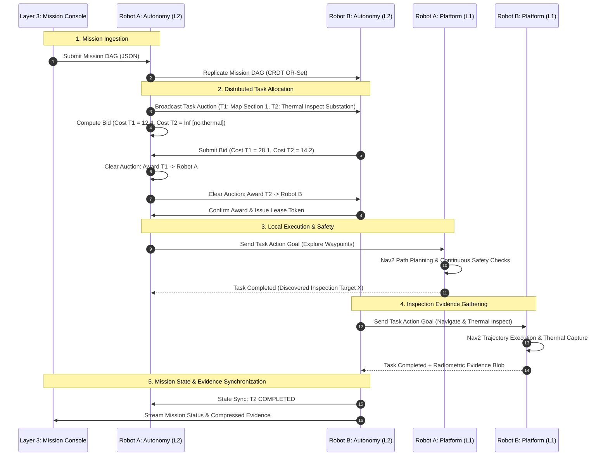

# Data Flow Architecture

## 1. End-to-End Data Flow

Data flows through three distinct communication planes within the system:
1. **Intra-Robot Sensor-Control Plane** (High frequency, local ROS 2 DDS, 10&ndash;100 Hz).
2. **Inter-Robot Autonomy Plane** (Asynchronous, event-driven, bandwidth-constrained Zenoh gossip, 1&ndash;5 Hz).
3. **Operations & Observability Plane** (Low frequency, delay-tolerant telemetry and bulk evidence sync, 0.1&ndash;1 Hz).

