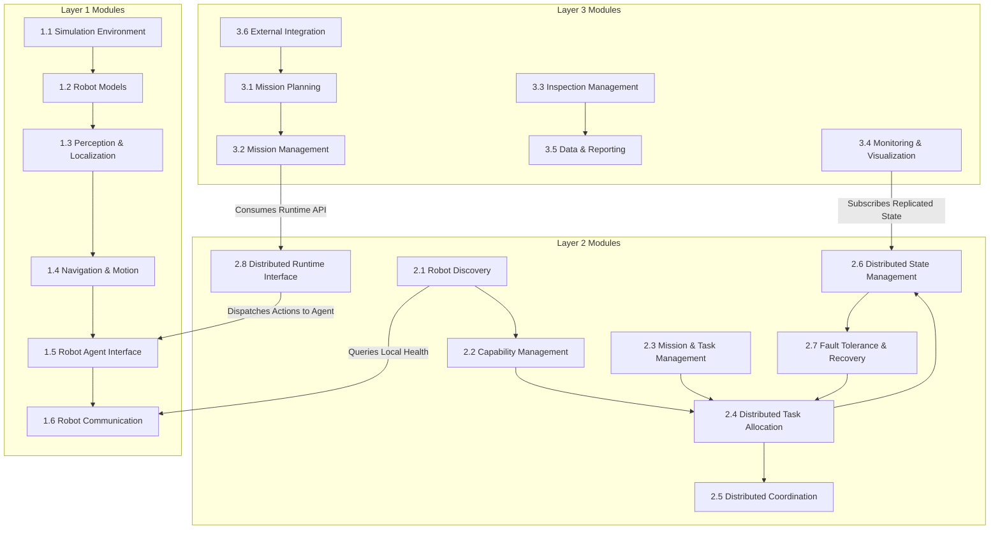

# Module Dependencies and Layer Boundaries

## 1. Strict Layering Dependency Rules

1. **Rule 1 (Top-Down Dependency)**: Dependencies point strictly downwards. Layer 3 depends on Layer 2 interfaces; Layer 2 depends on Layer 1 interfaces.
2. **Rule 2 (No Upward Coupling)**: Layer 1 must have zero references to Layer 2 or Layer 3 modules, headers, or ROS topics.
3. **Rule 3 (Peer Isolation)**: Physical platforms communicate exclusively via Layer 2 distributed protocols. Robot A's Nav2 stack cannot directly send ROS 2 commands to Robot B's motor controllers.

---

## 2. Dependency Graph

