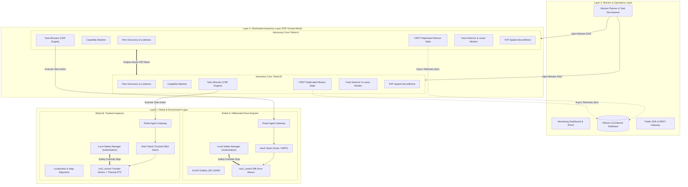

# System Architecture Specification

## 1. Architectural Philosophy
The Decentralized Multi-Robot Mine Inspection Platform is architected to survive and excel in communication-degraded subterranean operations. It replaces fragile centralized client-server paradigms with an autonomous, layered, peer-to-peer distributed systems model.

---

## 2. Core Architectural Principles

1. **Unidirectional Layered Abstraction**: Layer 3 relies on Layer 2; Layer 2 relies on Layer 1. Lower layers never import or depend on upper layers.
2. **Local Safety Autarchy**: Physical safety is autonomous and un-preemptible. A remote command can never override an active local safety reflex.
3. **Decentralized Consensus**: Task assignment and mission progression proceed through local peer negotiation without requiring global cluster quorum.
4. **Partition Tolerance (CAP Theorem Priority)**: The platform prioritizes Availability and Partition Tolerance (AP), utilizing CRDTs to achieve eventual consistency.
5. **Hardware Agnosticism**: Heterogeneous locomotion and payloads are normalized through declarative capability descriptors.

---

## 3. High-Level System Architecture Diagram

