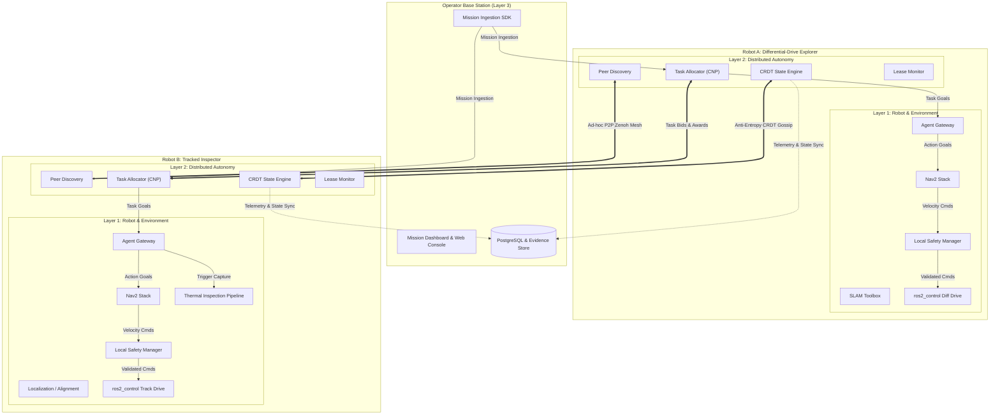

# System Block Diagram

## 1. Intra-Robot and Inter-Robot Block Diagram

The block diagram below illustrates the exact structural layout of components onboard each robot and their inter-layer interfaces:

