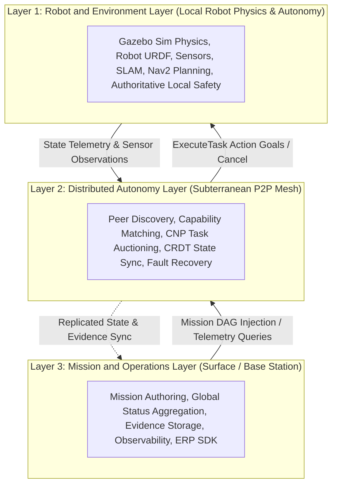

# Three-Layer System Architecture Specification

## 1. Architectural Model & Guiding Invariants

The Decentralized Multi-Robot Mine Inspection Platform enforces a strict, decoupled Three-Layer Architecture:

### Unidirectional Dependency Rule
1. **Downwards Dependency Only**: Layer 3 depends on Layer 2 interfaces; Layer 2 depends on Layer 1 interfaces.
2. **Zero Upward Coupling**: Layer 1 has zero imports or dependencies on Layer 2 or Layer 3. Layer 2 has zero imports or dependencies on Layer 3.
3. **No Direct Actuator Control from Layer 3**: Layer 3 cannot publish to `/cmd_vel` or directly manipulate motors. All robot movements are mediated through Layer 2 task allocation and Layer 1 Nav2 planning.
4. **Local Safety Autarchy**: Layer 1 physical safety reflexes operate independently at `[PROPOSED TARGET: 50 Hz]` and cannot be preempted or overridden by Layer 2 or Layer 3.

---

## 2. Layer 1: Robot and Environment Layer

### 2.1 Purpose
To manage all physical and simulated environmental interactions, sensor data acquisition, ego-motion state estimation, subterranean SLAM, obstacle costmaps, local trajectory execution, and un-preemptible physical safety reflexes.

### 2.2 Responsibilities
- Simulating subterranean mine drifts, friction dynamics, rock scree, and RF signal drop in Gazebo Sim.
- Providing kinematic, dynamic, and sensor models for **Robot A** (differential drive) and **Robot B** (tracked skid-steer).
- Ingesting, synchronizing, and filtering 3D LiDAR point clouds, RGB camera feeds, radiometric thermal matrices, and IMU data.
- Maintaining continuous 50 Hz localization via dual Extended Kalman Filters (`robot_localization`) and lifelong 2D SLAM (`slam_toolbox`).
- Planning and tracking local collision-free paths using Nav2 (Smac 2D Global Planner and MPPI Local Controller).
- Enforcing authoritative local safety watchdog limits (collision stop within `[PROPOSED TARGET: < 50 ms]`, tip-over halt at `[PROPOSED TARGET: > 25 degrees]`, executing at `[PROPOSED TARGET: 50 Hz]`).
- Exposing the standardized ROS 2 `ExecuteTask.action` server to Layer 2.

### 2.3 Modules
- **1.1 Simulation Environment**: Mine world SDF, procedural tunnels, obstacle modeling, hazard emitters, and RF attenuation.
- **1.2 Robot Models**: Robot A (diff-drive), Robot B (tracked), URDF/Xacro macros, sensor plugins, `ros2_control` velocity controllers.
- **1.3 Perception and Localization**: Sensor sync (`message_filters`), LiDAR PCL filtering, OpenCV camera/thermal parsing, SLAM Toolbox, dual EKF localization, and map alignment.
- **1.4 Navigation and Motion**: Multi-layered Costmap2D, Smac global planner, MPPI trajectory controller, obstacle avoidance, velocity smoother, and recovery behaviors.
- **1.5 Robot Agent**: Unique identity (UUID), declarative capability description, FSM lifecycle state manager, `ExecuteTask.action` server, and Authoritative Local Safety Manager.
- **1.6 Robot Communication Interface**: Namespaced ROS 2 topics (`/robot_a/...`, `/robot_b/...`), state publisher (5 Hz telemetry), task subscriber, and communication health monitor.

### 2.4 Inputs and Outputs
- **Inputs**:
  - `ExecuteTask.action` goals from Layer 2 (Target waypoint, task type, sensor requirements, lease token).
  - Simulated physics contacts and sensor rays from Gazebo Sim.
  - Emergency abort signals (`/emergency_abort`).
- **Outputs**:
  - Real-time telemetry (`/robot_name/telemetry` at 5 Hz): Pose, velocity, battery SoC, FSM state.
  - Diagnostic health (`/robot_name/safety/status` at 50 Hz): Distance to obstacle, tilt angles, override flag.
  - `ExecuteTask.action` feedback (progress %, distance remaining) and results (`STATUS_SUCCESS`, `STATUS_FAILED`, evidence URIs).
  - Local 2D occupancy grid maps (`/robot_name/map`) and sub-maps.

### 2.5 Dependencies
- Upstream: None (Foundational layer).
- Downstream: Consumed exclusively by Layer 2 via ROS 2 Action and Topic interfaces.
- System Software: Ubuntu 22.04 LTS, ROS 2 Humble, Gazebo Sim, Nav2, SLAM Toolbox, `ros2_control`, PCL 1.12, OpenCV 4.

### 2.6 Communication Mechanisms
- Intra-robot high-frequency ROS 2 DDS transport (10 Hz - 100 Hz).
- Strictly namespaced topics (`/robot_a/*`, `/robot_b/*`) isolated by separate `ROS_DOMAIN_ID`s (Domain 10 for Robot A, Domain 11 for Robot B).

### 2.7 Interfaces with Other Layers
- Standardized ROS 2 Action: `interfaces/action/ExecuteTask.action`.
- Telemetry Topic: `interfaces/msg/RobotTelemetry.msg`.
- Safety Topic: `interfaces/msg/SafetyStatus.msg`.

### 2.8 Testing Boundaries
- **Unit Testing**: Kinematic forward/inverse kinematics, sensor noise models, safety watchdog threshold logic.
- **Integration Testing**: Local EKF state estimation, Nav2 path tracking around obstacles, local safety override assertion.
- **Simulation Testing**: Autonomous drift traversal in Gazebo; verify zero physical collisions during obstacle injection.

---

## 3. Layer 2: Distributed Autonomy Layer

### 3.1 Purpose
To provide decentralized collective intelligence, peer discovery, capability-aware task allocation, spatiotemporal coordination, partition-tolerant mission state replication, and autonomous fault recovery without a single point of failure.

### 3.2 Responsibilities
- Discovering peer robots across the ad-hoc subterranean wireless mesh without central discovery brokers.
- Maintaining a live peer roster and tracking peer availability via adaptive $\phi$-accrual failure detection.
- Exchanging declarative capability profiles and filtering candidate tasks against robot modalities.
- Decomposing mission DAGs into atomic tasks and resolving prerequisite in-degree dependency constraints.
- Executing Contract Net Protocol (CNP) auctions using multi-factor cost evaluation ($D_{travel}, E_{battery}, T_{risk}, C_{fit}$).
- Granting time-bounded lease tokens to prevent duplicate task execution.
- Coordinating right-of-way in single-lane mine drifts (inspecting robot priority over exploring scout).
- Replicating mission state using delta-CRDTs (LWW-Element-Set and OR-Set) with causal vector clocks.
- Detecting peer crashes or timeouts, revoking stale leases, and autonomously re-auctioning tasks to surviving robots.

### 3.3 Modules
- **2.1 Robot Discovery**: Agent registration, P2P scouting, 2 Hz gossip heartbeat, and $\phi$-accrual availability detector.
- **2.2 Capability Management**: Capability data model, P2P queryable exchange, bitmask constraint matcher, and resource monitor.
- **2.3 Mission and Task Management**: DAG representation, task decomposition, in-degree dependency resolver, multi-tier priority queue, and task lifecycle FSM.
- **2.4 Distributed Task Allocation**: CNP bidding worker, multi-factor cost evaluator, ephemeral auctioneer, two-phase commit assignment, and duplicate prevention.
- **2.5 Distributed Coordination**: Spatiotemporal intent sharing, temporary coordinator election (Bully/Raft), drift conflict resolution, and barrier synchronization.
- **2.6 Distributed State Management**: In-memory replicated store with Write-Ahead Log (WAL), delta-CRDT engine, vector clock manager, LWW conflict resolver, and reconnection reconciliation.
- **2.7 Fault Tolerance and Recovery**: Multi-tier failure detector, offline blackout execution policy, last-gasp crash handler, lease revocation/reassignment loop, and recovery coordination.
- **2.8 Distributed Runtime Interface**: Robot Agent Gateway (L2 to L1 bridge), Mission API, distributed event bus, and OpenTelemetry tracing.

### 3.4 Inputs and Outputs
- **Inputs**:
  - Declarative Mission DAG manifests from Layer 3 (via Zenoh / REST).
  - Layer 1 robot telemetry and task action feedback.
  - Peer heartbeats, capability queries, auction bids, and CRDT state deltas over P2P mesh.
- **Outputs**:
  - `ExecuteTask.action` commands dispatched to local Layer 1 Robot Agent.
  - Inter-robot P2P gossip: Heartbeats, task announcements, bids, lease tokens, and state deltas.
  - Replicated cluster state summaries and events streamed to Layer 3.

### 3.5 Dependencies
- Upstream: Consumes Layer 1 Robot Agent interfaces (`ExecuteTask.action`, `/telemetry`).
- Downstream: Consumed by Layer 3 via asynchronous mission APIs and state streams.
- Core Middleware: Eclipse Zenoh (P2P mesh protocol), C++17/20, Python 3.10.

### 3.6 Communication Mechanisms
- Inter-robot peer-to-peer gossip over Eclipse Zenoh (`zenoh-c` / `zenoh-python`) using ad-hoc wireless mesh (802.11s).
- Zenoh Key Expressions: `mine/discovery/**`, `mine/peers/**`, `mine/auctions/**`, `mine/state/**`, `mine/events/**`.

### 3.7 Interfaces with Other Layers
- Inward from Layer 3: Mission ingestion service (`SubmitMission.srv` / `mine/mission/submit`).
- Outward to Layer 1: Action client invoking `interfaces/action/ExecuteTask.action`.

### 3.8 Testing Boundaries
- **Unit Testing**: CRDT mathematical convergence (associativity, commutativity, idempotency), Kahn's DAG cycle detection, multi-factor cost scoring, vector clock partial ordering.
- **Integration Testing**: Contract Net Protocol bidding rounds between simulated Robot A and B processes; two-phase commit lease locking.
- **Fault-Injection Testing**: Synthetic packet drop (30%, 50%, 80%) over inter-robot links; killing Robot A and verifying Robot B claims tasks within < 8.0s.

---

## 4. Layer 3: Mission and Operations Layer

### 4.1 Purpose
To provide human operators, mine safety engineers, and enterprise maintenance systems with intuitive mission authoring, real-time situational observability, multi-modal evidence cataloging, automated compliance reporting, and external enterprise API integrations.

### 4.2 Responsibilities
- Providing a visual web-based DAG authoring studio and pre-flight validation engine.
- Managing mission submissions, tracking high-level percent-complete and critical-path ETA metrics.
- Ingesting, organizing, and indexing visual RGB and radiometric thermal inspection evidence.
- Persisting structured mission metadata in relational storage (PostgreSQL 14) and time-series observations in TimescaleDB.
- Storing high-volume binary evidence (photos, 14-bit radiometric matrices, point clouds) in MinIO S3 object storage.
- Rendering real-time 2D/3D mine maps, live robot breadcrumb trails, Gantt auction timelines, and network mesh topologies.
- Compiling automated MSHA-compliant PDF and interactive HTML inspection reports.
- Exposing a Python Public SDK and OpenAPI 3.0 REST/WebSocket gateway for enterprise dispatch and ERP integration (IBM Maximo, SAP PM).

### 4.3 Modules
- **3.1 Mission Planning**: Mission creation studio, asset inspection objectives, atomic task parameterizer, and pre-flight DAG validator.
- **3.2 Mission Management**: Mission submission gateway, progress aggregator, top-level lifecycle FSM, and immutable audit history.
- **3.3 Inspection Management**: Inspection point registry (PostGIS), visual evidence manager, radiometric thermal evidence manager, hazard logger, and asset scorecard evaluator.
- **3.4 Monitoring and Visualization**: Deck.gl 2D/3D mine map canvas, live robot position tracker, Gantt task allocation inspector, health diagnostics dashboard, and mesh status graph.
- **3.5 Data Management and Reporting**: PostgreSQL relational database, TimescaleDB hypertable schema, MinIO S3 evidence store, and automated Jinja2/WeasyPrint report generator.
- **3.6 External Integration and SDK**: Python Public SDK (`antigravity_mine_sdk`), OpenAPI 3.0 REST/WebSocket gateway, Robot Manufacturer Adapters (HAL), and Enterprise Asset Management connectors (Maximo/SAP).

### 4.4 Inputs and Outputs
- **Inputs**:
  - Human operator mission specifications via web UI or Python SDK.
  - Replicated state deltas, telemetry vectors, and inspection evidence streamed from Layer 2.
  - Enterprise asset catalogs from external ERP systems.
- **Outputs**:
  - Validated mission DAG manifests dispatched to subterranean robots.
  - Real-time interactive web dashboard rendering maps, robot poses, and auction timelines.
  - Automated PDF/HTML compliance inspection reports.
  - Automated maintenance corrective work orders dispatched to IBM Maximo / SAP PM.

### 4.5 Dependencies
- Upstream: Submits missions to Layer 2 and consumes replicated telemetry streams.
- Downstream: None (Top-level operations and presentation layer).
- Backend & Storage: PostgreSQL 14+, PostGIS 3, TimescaleDB, MinIO, FastAPI, Python 3.10.
- Frontend: React 18+, TypeScript, Deck.gl, Tailwind CSS.

### 4.6 Communication Mechanisms
- WebSockets for 5 Hz live telemetry and event streaming to browser clients.
- OpenAPI 3.0 REST endpoints over HTTPS for CRUD operations.
- S3 API (Port 9000) for pre-signed binary evidence uploads and downloads.

### 4.7 Interfaces with Other Layers
- Connects to Layer 2 via Zenoh / REST gateway queryables (`mine/mission/submit`, `mine/state/digest`).
- Strictly decoupled from Layer 1 (zero direct network sockets to robot motor controllers).

### 4.8 Testing Boundaries
- **Unit Testing**: FastAPI route validation, Pydantic schema serialization, scorecard grading rule evaluation, Jinja2 template rendering.
- **Integration Testing**: End-to-end evidence ingestion into MinIO and PostgreSQL indexing; pre-signed URL retrieval.
- **System Testing**: Complete operator workflow: Author mission -> Submit -> Monitor live execution -> Download compiled PDF report.
