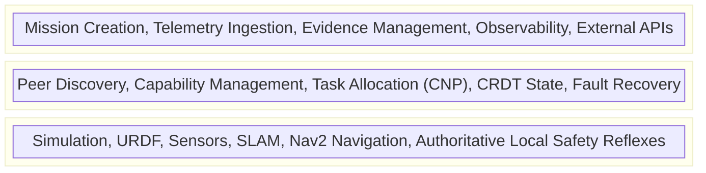

# Three-Layer System Architecture

## 1. Architectural Decomposition

The system is rigorously partitioned into three decoupled functional layers:

---

## 2. Layer 1: Robot and Environment Layer

### Purpose
To manage all physical and simulated hardware interactions, sensor data processing, state estimation, path execution, and instantaneous safety reflexes.

### Core Boundaries & Invariants
- **Runs Locally**: Layer 1 instances run directly on the physical/simulated robot compute onboard.
- **Safety Authority**: The `local_safety_manager` has unconditional authority over motor commands. If an obstacle appears within safety margins, Layer 1 executes an emergency stop regardless of active Layer 2 tasks.
- **Hardware Isolation**: Layer 1 exposes a standardized ROS 2 Action interface (`ExecuteTask.action`) so upper layers never invoke hardware drivers directly.

---

## 3. Layer 2: Distributed Autonomy Layer

### Purpose
To provide decentralized collective intelligence, allowing heterogeneous robots to discover peers, allocate tasks dynamically, deconflict spatial movements, and maintain mission state under communication loss.

### Core Boundaries & Invariants
- **No Central Master**: Every robot executes an identical Layer 2 autonomy engine with symmetric capabilities.
- **Contract Net Protocol**: Work is distributed via competitive bidding based on travel distance, sensor capabilities, battery budget, and operational risk.
- **Eventual Consistency**: Mission state is replicated using Conflict-Free Replicated Data Types (CRDTs). Re-establishing contact after a partition triggers automated delta reconciliation.

---

## 4. Layer 3: Mission and Operations Layer

### Purpose
To provide human operators and enterprise systems with mission planning tools, live monitoring dashboards, evidence analytics, and compliance reporting.

### Core Boundaries & Invariants
- **Non-Authoritative during Partitions**: Layer 3 provides situational awareness. If the link between Layer 3 and the robots disconnects, the multi-robot fleet continues autonomous mission execution.
- **No Direct Actuation**: Layer 3 submits high-level mission specifications to Layer 2; it cannot directly publish to `/cmd_vel` or bypass Layer 1 safety.
