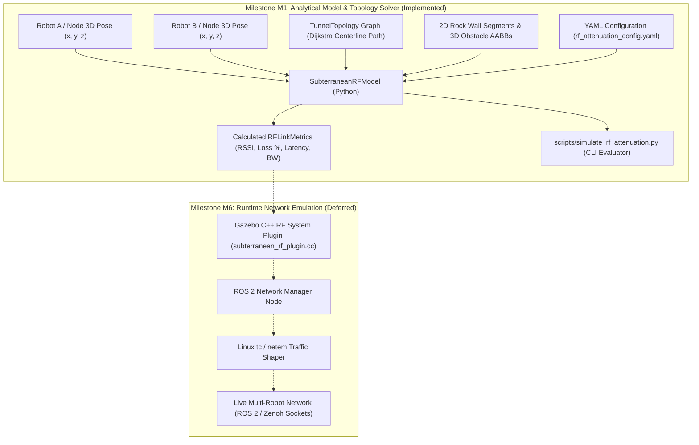

# Submodule 1.1.5: Communication Environment Simulation

## 1. Purpose
- **Implemented M1 Scope**: Provides an analytical subterranean radio-frequency (RF) propagation, waveguide, and obstacle attenuation model to evaluate peer-to-peer link quality (received signal strength, packet drop rate, latency, jitter, effective bandwidth) between arbitrary 3D positions in underground mine tunnel topologies.
- **Deferred M6 Scope**: Provides runtime multi-robot network emulation injecting dynamic packet drops, latency, and link blackouts into active ROS 2 and Zenoh communication stacks during closed-loop mission simulation.

## 2. Responsibility
Emulate subterranean wireless network behavior between Robot A, Robot B, and the mine portal / base station based on spatial distance, tunnel waveguide topology, corner diffraction, and obstacle obstructions.

## 3. Scope
### Implemented M1 Scope (Completed)
- Pure-Python analytical RF propagation and waveguide attenuation library (`src/layer1_robot_environment/communication_simulation/subterranean_rf_model.py`).
- Configurable `TunnelTopology` graph model using Dijkstra shortest path along tunnel centerlines and discrete bend detection ($\ge 45^\circ$) for arbitrary tunnel layouts.
- Exact 2D rock wall raycasting (`_segments_intersect`) and 3D bounding box obstacle intersection (`_segment_intersects_aabb_3d`).
- Log-distance path loss, corner diffraction loss (provisional 18 dB/bend), obstacle shadow loss (provisional 12 dB/obstacle), sigmoid packet loss curve, latency with Gaussian jitter, effective bandwidth calculation, and manual blackout injection.
- Standalone CLI link evaluation tool (`scripts/simulate_rf_attenuation.py`) driven by YAML configuration (`config/simulation/rf_attenuation_config.yaml`).
- Comprehensive unit test suite (`tests/unit/test_rf_attenuation.py`).

### Deferred M6 Scope (Planned for Milestone M6)
- Gazebo Sim C++ communication system plugin (`subterranean_rf_plugin.cc`).
- Linux kernel `tc`/`netem` traffic shaping and live packet dropping between robot network namespaces or container virtual Ethernet interfaces.
- ROS 2 runtime nodes, dynamic services (`/sim/inject_network_fault`, `/sim/set_network_conditions`), and peer link quality topics (`/sim/rf_quality`).
- Live integration with multi-robot middleware (Zenoh, ROS 2) and live network socket testing (`ping`, `iperf`).

### Out-of-Scope (All Milestones)
- Full 3D Maxwell electromagnetic wave equation numerical solvers (FDTD/FEM).

## 4. System Architecture

## 5. Internal Submodules
### Implemented M1 Submodules
- **Tunnel Topology & Waveguide Route Solver**: `TunnelTopology` class representing tunnel centerlines as an undirected graph, projecting arbitrary 3D coordinates onto tunnel segments, finding shortest along-corridor paths via Dijkstra's algorithm, and identifying discrete bends ($\ge 45^\circ$) without hard-coded coordinates.
- **Tunnel Line-of-Sight & Obstacle Raycaster**: Vector math routines checking 2D line segment intersection with rock walls and 3D slab ray-box intersection with obstacle axis-aligned bounding boxes (rock piles, timber frames, standing water).
- **Analytical RF Attenuation Evaluator**: Computes received power via log-distance path loss, waveguide attenuation, corner diffraction loss, obstacle shadowing, sigmoid packet drop probability, jittered latency, and effective bandwidth.
- **CLI Link Evaluator**: Standalone script (`simulate_rf_attenuation.py`) taking endpoint coordinates and printing link metrics for design verification and scenario analysis.

### Deferred M6 Submodules
- **Gazebo Sim C++ Plugin**: Native Gazebo system plugin polling model ground-truth poses from ECM (Entity Component Manager) and publishing link state over Gazebo transport.
- **Kernel Network Bridge Shaper**: Linux `tc` / `netem` controller dynamically adjusting delay, jitter, packet loss, and rate limits on virtual network interfaces connecting robot containers.
- **ROS 2 Fault Injection Service**: Runtime ROS 2 service handlers for dynamic network partitioning and degradation testing.

## 6. Functional Requirements
- **REQ-1.1-010**: Simulate complete communication loss when robots exceed 60m line-of-sight or turn two 90-degree tunnel corners.
  - *M1 Implementation*: Verified analytically via `SubterraneanRFModel` and unit tests in `tests/unit/test_rf_attenuation.py`; link drops to $\approx 100\%$ packet loss and RSSI $< -95\text{ dBm}$ beyond 60m waveguide distance or after two $90^\circ$ bends.
  - *M6 Scope*: Enforce actual packet dropping and socket disconnection on live ROS 2 / Zenoh communication channels during simulation execution.
- **REQ-1.1-011**: Provide dynamic ROS 2 service to force link partition for fault injection testing.
  - *M1 Implementation*: Analytical model provides manual blackout flag (`force_blackout` in `evaluate_link()`) returning 100% loss, infinite latency, 0 bandwidth, and `-120.0 dBm` RSSI.
  - *M6 Scope*: Expose ROS 2 service `/sim/inject_network_fault` to dynamically trigger network partition during multi-robot collaborative missions.

## 7. Technical Approach
- **M1 Implemented Approach**:
  The mine tunnel network is modeled as a topological centerline graph. Arbitrary 3D coordinates of transmitting and receiving nodes are orthogonally projected onto the nearest tunnel segment. The shortest waveguide path distance along tunnel corridors is computed using Dijkstra's algorithm, combining remaining segment distances with graph edge weights.
  - *Path Distance Definition*: `path_distance_m` represents the longitudinal waveguide propagation distance along tunnel centerlines between projected endpoints. Perpendicular/lateral offsets from the centerline represent transverse positions within the corridor cross-section (which are bounded by rock walls) and do not add to longitudinal waveguide propagation distance.
  - *Bend Counting Definition*: Physical tunnel bends ($\ge 45^\circ$) along the chosen route are computed strictly from the sequence of physical corridor edge headings (unit direction vectors) traversed by the selected graph route. Lateral endpoint offsets from the centerline are not physical tunnel corners and do not alter the bend count.
  - *Obstacle & Wall Intersections*: Direct 3D line-of-sight rays are tested against 2D rock wall segments and 3D obstacle bounding boxes. Path loss, diffraction, and shadowing are combined into RSSI, mapped to packet loss through a configurable sigmoid function, and output as structured metrics.
- **M6 Deferred Approach**:
  A C++ Gazebo system plugin (`subterranean_rf_plugin.cc`) will track entity positions, query the RF model, and issue Linux `tc` commands or Zenoh router filter updates to throttle and drop live network traffic between robot containers in real time.

## 8. Open-Source Resources
### Linux Netem / Traffic Control (tc)
- **What it provides**: Kernel-level network emulation.
- **Why it is relevant**: Accurate jitter, packet loss, and rate limiting for live network traffic.
- **Milestone association**: Deferred to Milestone M6.
- **What we can reuse**: Linux `netem` command-line invocation and `iproute2` tooling.
- **What we must develop ourselves**: Dynamic daemon mapping RF model metrics to `tc qdisc` rules.

## 9. Prerequisites
- **M1 Prerequisites**: Python 3.10+, PyYAML, NumPy.
- **M6 Prerequisites**: Linux network admin capabilities (`CAP_NET_ADMIN`), Docker/LXC network namespaces, Gazebo Sim C++ SDK.

## 10. Dependencies
- **Upstream Dependencies**: Submodule 1.1.1 Mine World.
- **Downstream Dependencies**: Module 2.1 Robot Discovery, Module 2.7 Fault Tolerance.
- **Interfaces with Other Modules**:
  - M1: Python module `src/layer1_robot_environment/communication_simulation/subterranean_rf_model.py`.
  - M6: Service `/sim/set_network_conditions`, Service `/sim/inject_network_fault`, Topic `/sim/rf_quality`.

## 11. Development Phases
### Phase 1: Analytical RF Model & Topology Solver (Milestone M1 - Completed)
- **Objective**: Author and validate pure-Python analytical RF propagation, waveguide routing, corner diffraction, obstacle attenuation, and CLI evaluation tool.
- **Status**: Completed in M1.
- **Deliverables**: `subterranean_rf_model.py`, `simulate_rf_attenuation.py`, `rf_attenuation_config.yaml`, unit test suite.
- **Validation**: 33 automated unit tests in `tests/unit/test_rf_attenuation.py` verifying straight tunnel LOS, 1 bend, 2 bends, wall collisions, obstacle intersections, intermediate edge projections, custom layouts, and lateral endpoint offset invariance.

### Phase 2: Runtime Network Emulation & Middleware Integration (Milestone M6 - Planned)
- **Objective**: Real-time traffic shaping on virtual network interfaces and dynamic ROS 2 fault injection.
- **Status**: Deferred to Milestone M6.
- **Deliverables**: Gazebo C++ plugin (`subterranean_rf_plugin.cc`), Linux `tc`/`netem` controller, ROS 2 services and topics, live ping/iperf verification.

## 12. Interfaces
### M1 Implemented Python API
- `SubterraneanRFModel.evaluate_link(pos_a, pos_b, wall_segments=None, obstacles=None, force_blackout=False) -> RFLinkMetrics`
- `TunnelTopology.shortest_path(pos_a, pos_b) -> (distance, bend_count, path_nodes)`
- CLI: `python3 scripts/simulate_rf_attenuation.py --pos-a X Y Z --pos-b X Y Z [--config PATH] [--blackout]`

### M6 Deferred ROS 2 Runtime Interfaces
- Service `/sim/inject_network_fault`: Force immediate network partition for specified duration.
- Service `/sim/set_network_conditions`: Dynamic override of link latency, loss rate, or bandwidth.
- Topic `/sim/rf_quality`: Publishes current RSSI (dBm), packet drop rate (%), and latency per peer link.

## 13. Testing Strategy
- **M1 Testing (Completed)**:
  - Unit tests in `tests/unit/test_rf_attenuation.py` (33 tests) validating:
    - Path loss formulas, reference distance $d_0$, and free-space exponents.
    - Single-edge projection and along-corridor distance calculation.
    - Multi-corridor Dijkstra routing and discrete bend counting ($90^\circ$ turns) from corridor headings.
    - Lateral endpoint offset invariance (transverse offsets do not generate artificial bends).
    - Alternative routes (shortest path selection).
    - Disconnected topologies (infinite distance, 100% loss).
    - Ray-casting line segment intersections with tunnel rock walls.
    - 3D ray-box intersection with obstacles at varying clearance heights.
    - Sigmoid packet loss curves, latency with Gaussian jitter, and bandwidth shaping.
    - Manual blackout state injection.
  - Overall M1 local test execution suite: 59 unit tests across 7 test modules and 2 headless Gazebo system tests (61 total local tests). Remote GitHub Actions CI executes the repository and documentation audit (`tools/verify_repository.py`).
- **M6 Testing (Deferred)**:
  - Multi-container ping / iperf test between Robot A and Robot B in Gazebo simulation while navigating across tunnel corners; verify observed socket packet loss and throughput match model predictions.

## 14. Known Challenges
- **Accurate Subterranean RF Modeling**: Underground tunnels exhibit complex waveguide effects; simplified geodesic distance models must balance realism with compute overhead. Attenuation parameters (18 dB/corner, 12 dB/obstacle) are provisional engineering simulation assumptions pending physical mine site calibration.

## 15. Implementation Status
`IN_PROGRESS`

- **Milestone M1 Implementation (Completed)**:
  - Analytical subterranean RF communication attenuation and waveguide model implemented in `src/layer1_robot_environment/communication_simulation/subterranean_rf_model.py`.
  - Configurable `TunnelTopology` graph model computing waveguide path distance and detecting tunnel bends ($\ge 45^\circ$) for arbitrary mine layouts without hard-coded coordinates.
  - Exact 2D rock wall raycasting and 3D slab AABB intersection for subterranean obstacles (`_segments_intersect`, `_segment_intersects_aabb_3d`).
  - Distance-dependent path loss, corner diffraction loss (18 dB/corner provisional assumption), obstacle shadow loss (12 dB provisional assumption), sigmoid packet loss rate, jittered latency, bandwidth shaping, and forced blackout mode.
  - Interactive CLI link evaluation tool in `scripts/simulate_rf_attenuation.py` consuming dynamic parameters from `config/simulation/rf_attenuation_config.yaml`.
  - Comprehensive unit test suite in `tests/unit/test_rf_attenuation.py` (33 tests) covering LOS straight corridors, 1 bend, 2 bends, wall obstruction, obstacle penetration/elevation clearances, custom topologies, and lateral endpoint offset invariance.

- **Milestone M6 Scope (Deferred / Planned)**:
  - Gazebo C++ system plugin (`subterranean_rf_plugin.cc`).
  - Real-time Linux kernel `tc`/`netem` packet filtering and live socket traffic shaping between active robot containers.
  - Runtime ROS 2 service `/sim/inject_network_fault` integrated with live ROS 2 communications stack.

## 16. References
- [Underground Mine Wireless Propagation Studies (NIOSH)](https://www.cdc.gov/niosh/mining)
