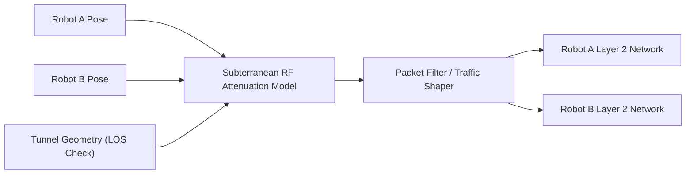

# Submodule 1.1.5: Communication Environment Simulation

## 1. Purpose
Simulates realistic radio-frequency (RF) attenuation, packet loss, transmission latency, and complete link blackout in underground mine drifts.

## 2. Responsibility
Emulate subterranean wireless network behavior between Robot A, Robot B, and the operator station based on spatial distance and tunnel line-of-sight obstructions.

## 3. Scope
### In-Scope
Synthetic packet drop injector, network latency and jitter simulator, distance-based attenuation model, and tunnel corner RF shadow emulation.

### Out-of-Scope
Full 3D Maxwell electromagnetic wave equation numerical solvers.

## 4. System Architecture

## 5. Internal Submodules
- **Tunnel Line-of-Sight Raycaster**: Determines if a direct optical/RF path exists between robots or around rock corners.
- **RF Attenuation & Drop Injector**: Computes packet drop probability: $P_{drop} = 1 - e^{-\alpha d} \cdot \beta_{corner}$.
- **Network Bridge Shaper**: Injects artificial delay (10-500 ms) and bandwidth caps (250 kbps) using Linux `tc` / netem or Zenoh router filter.

## 6. Functional Requirements
- **REQ-1.1-010**: Simulate complete communication loss when robots exceed 60m line-of-sight or turn two 90-degree tunnel corners.
- **REQ-1.1-011**: Provide dynamic ROS 2 service to force link partition for fault injection testing.

## 7. Technical Approach
Implement a ROS 2 node tracking robot ground-truth poses from Gazebo. Check tunnel line-of-sight using 2D occupancy grid raycasting. Route inter-robot traffic through a proxy or Zenoh bridge with dynamic packet discarding.

## 8. Open-Source Resources
### Linux Netem / Traffic Control (tc)
- **What it provides**: Kernel-level network emulation.
- **Why it is relevant**: Accurate jitter, packet loss, and rate limiting.
- **What we can reuse**: Linux netem command-line invocation.
- **What we must develop ourselves**: Dynamic controller adjusting netem params based on robot separation.

## 9. Prerequisites
Linux network permissions, Gazebo Sim ground truth pose publisher.

## 10. Dependencies
- **Upstream Dependencies**: Submodule 1.1.1 Mine World.
- **Downstream Dependencies**: Module 2.1 Robot Discovery, Module 2.7 Fault Tolerance.
- **Interfaces with Other Modules**: Service `/sim/set_network_conditions`.

## 11. Development Phases
### Phase 1: Spatial Distance RF Model
- **Objective**: Compute RSSI and packet loss from euclidean and geodesic drift distance.
- **Activities**: Develop Python node computing tunnel path distance and packet drop rate.
- **Required resources**: Python 3, Nav2 costmap API.
- **Input**: Robot poses.
- **Output**: Network quality metric.
- **Dependencies**: None.
- **Validation**: Verify 100% drop when separation > 80m.
- **Completion criteria**: Packet drop conforms to mining propagation curves.

## 12. Interfaces
### Services
- `/sim/inject_network_fault`: Force immediate network partition for specified duration.

### Topics
- `/sim/rf_quality`: Publishes current RSSI (dBm) and packet drop rate (%) per peer link.

## 13. Testing Strategy
Execute ping test between Robot A and B while moving around a 90-degree corner; verify ping packets drop as expected.

## 14. Known Challenges
- **Accurate Subterranean RF Modeling**: Underground tunnels exhibit complex wave-guide effects; simplified geodesic distance models must balance realism with compute overhead.

## 15. Implementation Status
`PLANNED`

## 16. References
- [Underground Mine Wireless Propagation Studies (NIOSH)](https://www.cdc.gov/niosh/mining)
