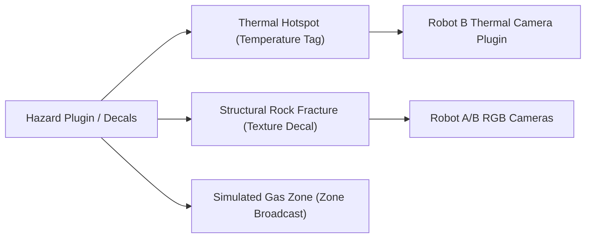

# Submodule 1.1.4: Hazard Modelling

## 1. Purpose
Implements simulated subterranean inspection targets and environmental hazards, specifically thermal hotspots, structural cracks, and simulated toxic gas zones.

## 2. Responsibility
Provide Gazebo plugins and textured asset models that emit radiometric thermal signatures and display visible structural defects for Robot A and B to discover and inspect.

## 3. Scope
### In-Scope
Thermal radiation source models, overheating transformer models, conveyor belt bearing hotspot emitters, visual wall crack decals, and inspection waypoint triggers.

### Out-of-Scope
Physical exothermic chemical reaction simulation.

## 4. System Architecture

## 5. Internal Submodules
- **Thermal Hotspot Emitter Plugin**: Attaches temperature metadata and IR intensity textures to simulated machinery.
- **Structural Crack Asset Decals**: High-contrast visual fault decals applied to mine drift walls.

## 6. Functional Requirements
- **REQ-1.1-008**: Thermal hazards shall support surface temperature configuration between 40°C and 180°C.
- **REQ-1.1-009**: Thermal emitter plugin shall publish Ground Truth temperature for validation.

## 7. Technical Approach
Develop a lightweight Gazebo sensor plugin that maps SDF `<temperature>` tags to an emissive color texture channel consumed by the simulated radiometric thermal camera plugin.

## 8. Open-Source Resources
### gz-sim thermal sensor system
- **What it provides**: Built-in Gazebo thermal camera simulation.
- **Why it is relevant**: Provides camera sensor simulation with custom heat sources.
- **What we can reuse**: Gazebo thermal camera sensor pipeline.
- **What we must develop ourselves**: Configurable mine asset hotspot tags.

## 9. Prerequisites
Submodule 1.1.1 Mine World, Gazebo Sim 7+.

## 10. Dependencies
- **Upstream Dependencies**: None.
- **Downstream Dependencies**: Module 1.2 Robot Models (Thermal sensor), Module 3.3 Inspection Management.
- **Interfaces with Other Modules**: Gazebo topic `/world/mine_world/thermal_heat_sources`.

## 11. Development Phases
### Phase 1: Thermal Plugin Prototype
- **Objective**: Implement thermal emitter plugin in Gazebo.
- **Activities**: Write C++ Gazebo system plugin to expose object temperatures.
- **Required resources**: C++, Gazebo Sim SDK.
- **Input**: Target temperature YAML.
- **Output**: libThermalEmitterPlugin.so.
- **Dependencies**: None.
- **Validation**: Render using Gazebo thermal camera.
- **Completion criteria**: Camera pixel intensity correlates linearly with temperature.

## 12. Interfaces
### Topics
- `/ground_truth/hazards`: geometry_msgs/PoseArray of active hazard positions.

## 13. Testing Strategy
Place 120°C target in tunnel; verify Robot B thermal camera registers peak pixel values matching calibration curve.

## 14. Known Challenges
- **Radiometric Sensor Calibration**: Ensuring pixel values accurately map to temperature floats in degrees Celsius for inspection evidence storage.

## 15. Implementation Status
`IN_PROGRESS`
Milestone M1 physical terrain hazards (`terrain_gravel_patch`, `terrain_mud_patch`, `standing_water`, `low_clearance_hazard`) implemented in `simulation/models/`. Thermal hotspot sensor plugins and radiometric targets are scheduled for Milestone M2.

## 16. References
- [Gazebo Thermal Camera Tutorial](https://gazebosim.org/docs/garden/thermal_camera)
