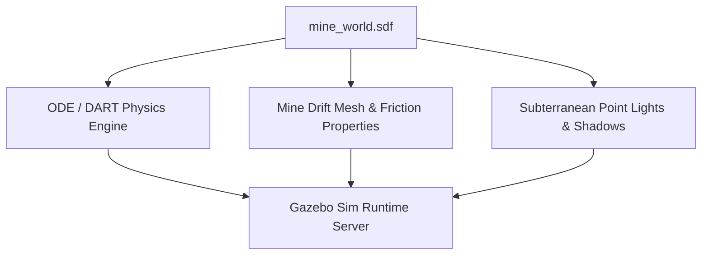

# Submodule 1.1.1: Mine World

## 1. Purpose
Defines the overarching Gazebo Sim world configuration, physics engine parameters, subterranean atmospheric attenuation, and gravity models for underground mine simulation.

## 2. Responsibility
Instantiate a physically accurate subterranean multi-drift mine world in Gazebo Sim, configuring ODE/Bullet physics solvers, contact friction coefficients, zero-ambient illumination, and coordinate reference frames.

## 3. Scope
### In-Scope
Gazebo world SDF file, physics solver configuration, subterranean lighting models, ground friction parameters, world spawn coordinates.

### Out-of-Scope
Individual robot URDF models, robot sensor plugins, and procedural generation scripts.

## 4. System Architecture

## 5. Internal Submodules
- **Physics Engine Configurator**: Configures step size (1ms), real-time update rate (1000 Hz), and contact solvers.
- **Lighting & Visual Setup**: Implements realistic dark mine environments with directional spot-lights attached to robots.
- **Coordinate Anchor Manager**: Maintains local Cartesian coordinate frames relative to mine portal origin.

## 6. Functional Requirements
- **REQ-1.1-001**: The mine world shall simulate a minimum of 200 meters of interconnected underground drifts with slopes up to 15%.
- **REQ-1.1-002**: Ambient light shall be configured to near-zero (< 1 lux) to require active robot illumination payloads.
- **REQ-1.1-003**: Physics step size shall maintain real-time factor >= 0.8 on recommended simulation host hardware.

## 7. Technical Approach
Utilize Gazebo Sim (Garden/Fortress) with SDF 1.9 specification. Configure the DART or ODE physics engine for stable tracked locomotion contacts. Surface friction parameters (mu1=0.8, mu2=0.7) will simulate damp fractured rock surfaces.

## 8. Open-Source Resources
### Gazebo Sim (Garden/Fortress)
- **What it provides**: Core robotics simulation engine with physically based rendering (PBR).
- **Why it is relevant**: Standard modern simulation platform for ROS 2 Humble.
- **What we can reuse**: Sensor plugins, physics solver loop, world parsing.
- **What we must develop ourselves**: Underground drift SDF environment and subterranean lighting profiles.

## 9. Prerequisites
Gazebo Sim installed and integrated with `ros_gz_bridge`.

## 10. Dependencies
- **Upstream Dependencies**: None (Foundational simulation module).
- **Downstream Dependencies**: Module 1.2 Robot Models, Module 1.3 Perception.
- **Interfaces with Other Modules**: ROS 2 Clock topic `/clock` and Gazebo transport topics.

## 11. Development Phases
### Phase 1: Basic World Definition
- **Objective**: Create static world SDF with realistic lighting and physics.
- **Activities**: Define SDF with ODE solver, ground plane, and zero ambient light.
- **Required resources**: Gazebo Sim, Text editor.
- **Input**: Physics parameters.
- **Output**: mine_world.sdf.
- **Dependencies**: None.
- **Validation**: Spawn empty world; confirm 1000 Hz step size.
- **Completion criteria**: Gazebo runs without physics warnings.

### Phase 2: Terrain Mesh Integration
- **Objective**: Import 3D mine tunnel mesh.
- **Activities**: Integrate collada/OBJ tunnel meshes with high-friction collision models.
- **Required resources**: Blender, Gazebo.
- **Input**: Tunnel 3D meshes.
- **Output**: Integrated mine world SDF.
- **Dependencies**: Phase 1.
- **Validation**: Drop test rigid sphere to verify collision mesh.
- **Completion criteria**: Zero mesh interpenetration.

## 12. Interfaces
### Topics
- `/clock`: Simulated system clock published by Gazebo Sim at 1000 Hz.

## 13. Testing Strategy
Load world in Gazebo Sim; monitor real-time factor (RTF); verify collision bounding boxes with `gz visual` flags.

## 14. Known Challenges
- **Complex Collision Meshes**: High polygon rock faces can drastically degrade physics real-time factors; requires simplified convex decomposition for collision hulls.

## 15. Implementation Status
`IN_PROGRESS`
Milestone M1 subterranean mine simulation world implemented in `simulation/worlds/mine_world.sdf` featuring > 125 meters of interconnected tunnels, portal staging, 15-degree test ramp, dim lighting, and DART physics configuration. Validated via `gz sdf -k` and headless simulation runs.

## 16. References
- [Gazebo Sim Documentation](https://gazebosim.org/docs)
- [DARPA Subterranean Challenge Worlds](https://github.com/osrf/subt)
