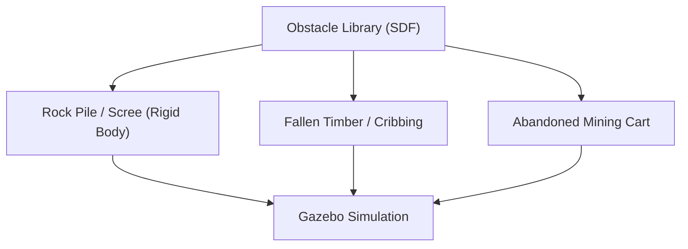

# Submodule 1.1.3: Obstacle Modelling

## 1. Purpose
Defines static and dynamic subterranean obstacles to challenge robot perception, local path planning, and physical traversability.

## 2. Responsibility
Provide realistic physical obstacles including rock piles, fallen roof timber, abandoned mining equipment, ventilation pipes, and loose rubble.

## 3. Scope
### In-Scope
SDF models of mine debris, rubble piles, static utility pipes, and movable obstacle boulders with physics mass properties.

### Out-of-Scope
Dynamic human pedestrian simulation.

## 4. System Architecture

## 5. Internal Submodules
- **Traversable Rubble Models**: Small gravel and rocks that test tracked chassis traction and suspension dynamics.
- **Non-Traversable Barrier Models**: Massive boulders and structural blockades requiring path replanning.

## 6. Functional Requirements
- **REQ-1.1-006**: Obstacle models shall have physically accurate masses and inertial matrices.
- **REQ-1.1-007**: Non-traversable obstacles shall be detected by 3D LiDAR at a minimum distance of 5.0 meters.

## 7. Technical Approach
Model obstacles in CAD/Blender with convex collision hulls. Assign realistic densities (rock = 2600 kg/m³, timber = 700 kg/m³) to ensure realistic dynamic response if nudged by robots.

## 8. Open-Source Resources
### OSRF Fuel Models
- **What it provides**: Open Gazebo simulation asset database.
- **Why it is relevant**: Source of rubble, pipes, and barrel models.
- **What we can reuse**: Public domain rock and industrial prop meshes.
- **What we must develop ourselves**: Mine-specific roof fall and rail track models.

## 9. Prerequisites
Submodule 1.1.1 Mine World.

## 10. Dependencies
- **Upstream Dependencies**: None.
- **Downstream Dependencies**: Module 1.4 Navigation & Motion.
- **Interfaces with Other Modules**: SDF model references.

## 11. Development Phases
### Phase 1: Obstacle Asset Creation
- **Objective**: Build obstacle library with collision meshes.
- **Activities**: Generate 6 unique obstacle types with inertia and friction configs.
- **Required resources**: Blender, Gazebo.
- **Input**: Material properties.
- **Output**: Obstacle SDF models.
- **Dependencies**: None.
- **Validation**: Spawn in Gazebo; apply force to verify stability.
- **Completion criteria**: Obstacles rest realistically without jitter.

## 12. Interfaces
### SDF Models
- `models/mine_rock_pile/model.sdf`: Collapsed rock pile barrier.

## 13. Testing Strategy
Simulate robot collision at 0.5 m/s; verify appropriate friction resistance and costmap inflation.

## 14. Known Challenges
- **Physics Jitter in Mesh Contacts**: Complex contact meshes between rubble rocks can trigger ODE solver instability; resolve via convex decomposition.

## 15. Implementation Status
`PLANNED`

## 16. References
- [Mining Safety and Health Administration (MSHA) Hazard Library](https://www.msha.gov)
