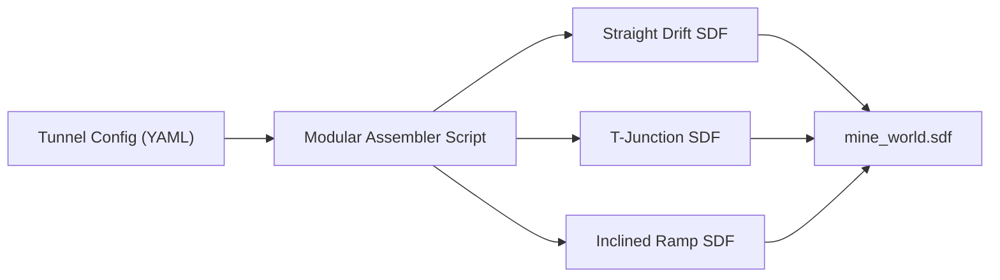

# Submodule 1.1.2: Tunnel Generation

## 1. Purpose
Provides modular and semi-procedural 3D underground tunnel meshes representing realistic mining drifts, cross-cuts, adits, and intersections.

## 2. Responsibility
Generate modular 3D SDF tunnel segments (straight, 90-degree bend, T-junction, inclined ramp) with irregular rock wall textures and collision geometries.

## 3. Scope
### In-Scope
Modular SDF tunnel models, 3D meshes (OBJ/DAE), texture maps (diffuse, normal, roughness), and segment connection manifests.

### Out-of-Scope
Dynamic world reconfiguration during active mission runtime.

## 4. System Architecture

## 5. Internal Submodules
- **Modular Segment Library**: Curated set of 10m straight drifts, 90-deg turns, 4-way intersections, and 12-deg ramps.
- **Procedural Rock Displacement Shader**: Adds surface roughness and jagged rock profiles to tunnel walls.

## 6. Functional Requirements
- **REQ-1.1-004**: Tunnel dimensions shall maintain clearance between 2.5m and 4.0m width and 2.5m to 3.5m height.
- **REQ-1.1-005**: Segments shall snap together without seam gaps greater than 0.005m to prevent LiDAR beam leakage.

## 7. Technical Approach
Develop modular 3D tunnel tiles in Blender with standardized connection flanges. Export low-poly collision models and visual models with PBR rock textures. Use Python script to assemble layouts from ASCII grid definitions.

## 8. Open-Source Resources
### Blender 3.x
- **What it provides**: Open-source 3D modeling and mesh generation.
- **Why it is relevant**: Authoring clean subterranean drift meshes.
- **What we can reuse**: Mesh export tools.
- **What we must develop ourselves**: Modular mining tunnel assets.

## 9. Prerequisites
Gazebo Sim asset loading paths configured.

## 10. Dependencies
- **Upstream Dependencies**: None.
- **Downstream Dependencies**: Submodule 1.1.1 Mine World.
- **Interfaces with Other Modules**: SDF model inclusion directives.

## 11. Development Phases
### Phase 1: Segment Design
- **Objective**: Model 4 core drift modules in Blender.
- **Activities**: Model straight, corner, junction, and ramp with standardized bounding portals.
- **Required resources**: Blender.
- **Input**: Mine geometry specs.
- **Output**: DAE/OBJ files.
- **Dependencies**: None.
- **Validation**: Import into Gazebo and inspect joints.
- **Completion criteria**: Zero joint gaps in LiDAR scans.

## 12. Interfaces
### Files
- `models/tunnel_straight/model.sdf`: Standard 10-meter straight tunnel module.

## 13. Testing Strategy
Automated ray-cast test along tunnel joints to verify zero ray penetration outside collision bounds.

## 14. Known Challenges
- **LiDAR Glitches at Seams**: Imperfect mesh alignment causes virtual laser beams to penetrate to infinity, corrupting SLAM occupancy grids.

## 15. Implementation Status
`IN_PROGRESS`
Procedural tunnel generator implemented in `scripts/generate_mine_tunnels.py` with support for straight, 90-degree turn, T-junction, and ramp segments across arched, rectangular, and trapezoidal cross-sections. Validated via `tests/unit/test_tunnel_generator.py`.

## 16. References
- [DARPA SubT Tunnel Assets](https://github.com/osrf/subt/tree/master/submitted_models)
