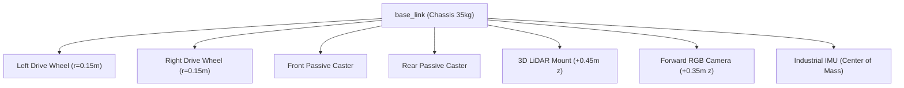

# Submodule 1.2.1: Robot A (Differential-Drive Explorer)

## 1. Purpose
Defines the mechanical specifications, physical kinematics, weight distribution, and functional role of Robot A as the high-speed exploration and mapping scout.

## 2. Responsibility
Specify the differential-drive kinematic parameters, track width, wheel radius, payload mounting points, ground clearance, and battery operational budget for Robot A.

## 3. Scope
### In-Scope
Differential-drive kinematic parameters, mechanical envelope dimensions, mass properties (35 kg total), wheel traction properties, and sensor rigging.

### Out-of-Scope
Motor drive firmware source code, battery cell chemistry engineering.

## 4. System Architecture

## 5. Internal Submodules
- **Kinematic Model**: Two-wheel differential drive with dual passive omni-directional stabilization casters.
- **Power Budget Model**: 48V 20Ah LiFePO4 battery pack model providing 4.5 hours of continuous exploration runtime.

## 6. Functional Requirements
- **REQ-1.2-001**: Robot A chassis shall support maximum forward linear velocity of 1.2 m/s and angular velocity of 1.5 rad/s.
- **REQ-1.2-002**: Ground clearance shall be >= 0.10 m with approach and departure angles >= 25 degrees for negotiating mine drift debris.
- **REQ-1.2-003**: Chassis mass including sensors and onboard compute shall not exceed 40.0 kg.

## 7. Technical Approach
Model the differential drive kinematics in ROS 2 Xacro format. Integrate realistic continuous joints for left and right drive wheels driven by `diff_drive_controller` in `ros2_control`.

## 8. Open-Source Resources
### ros2_controllers / diff_drive_controller
- **What it provides**: Standard ROS 2 differential drive controller.
- **Why it is relevant**: Provides odometry computation and cmd_vel execution.
- **What we can reuse**: C++ controller plugin.
- **What we must develop ourselves**: Tuning acceleration limits and wheel slip parameters for mine floor rock surfaces.

## 9. Prerequisites
Gazebo Sim, `ros2_control`.

## 10. Dependencies
- **Upstream Dependencies**: Submodule 1.1.1 Mine World.
- **Downstream Dependencies**: Submodule 1.3.4 SLAM, Submodule 1.4.5 Motion Control.
- **Interfaces with Other Modules**: URDF `robot_a.urdf.xacro`.

## 11. Development Phases
### Phase 1: Kinematic & Visual Xacro
- **Objective**: Create visual and collision meshes for Robot A.
- **Activities**: Build Xacro tree, define inertial tensors, add wheel joints.
- **Required resources**: Xacro, RViz2.
- **Input**: CAD bounding dimensions.
- **Output**: robot_a.urdf.xacro.
- **Dependencies**: None.
- **Validation**: Check TF tree in RViz2.
- **Completion criteria**: Zero TF errors, all links connected to base_link.

## 12. Interfaces
### Parameters
- `wheel_separation`: 0.52 meters between drive wheels.
- `wheel_radius`: 0.15 meters wheel radius.

## 13. Testing Strategy
Spawn Robot A in Gazebo; command 1.0 m/s linear velocity for 10 meters; verify actual displacement matches odometry within 2%.

## 14. Known Challenges
- **Caster Wheel Jitter**: Passive caster wheels often experience numerical chatter in physics engines; solve using low-friction spherical collision approximations.

## 15. Implementation Status
`PLANNED`

## 16. References
- **Siegwart et al., Introduction to Autonomous Mobile Robots**: MIT Press
