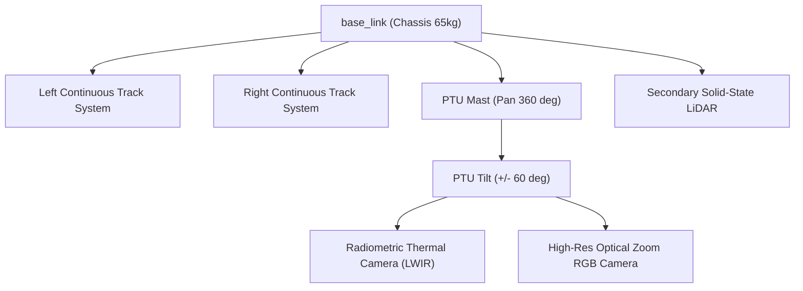

# Submodule 1.2.2: Robot B (Tracked Inspection Specialist)

## 1. Purpose
Defines the mechanical specifications, physical kinematics, tracked mobility dynamics, and inspection payload integration for Robot B.

## 2. Responsibility
Specify the continuous rubber-track chassis, high-torque skid-steer kinematics, pan-tilt inspection mast, optical zoom camera, and radiometric thermal camera mounting.

## 3. Scope
### In-Scope
Tracked chassis dimensions, track ground contact dynamics, skid-steer kinematic equations, 2-DOF pan-tilt unit (PTU) kinematics, and total mass (65 kg).

### Out-of-Scope
Track tread wear fatigue modeling.

## 4. System Architecture

## 5. Internal Submodules
- **Tracked Locomotion Model**: Dual continuous rubber tracks with skid-steer velocity kinematics and slip compensation.
- **Pan-Tilt Inspection Mast**: 2-DOF articulated turret carrying optical and thermal inspection payloads.
- **Thermal Shielding Model**: Ruggedized environmental enclosure protecting sensitive inspection cameras from dust and dripping acidic water.

## 6. Functional Requirements
- **REQ-1.2-004**: Robot B chassis shall negotiate obstacles up to 0.20 m height and continuous inclines up to 30% (17 degrees).
- **REQ-1.2-005**: Pan-tilt unit shall position inspection sensors with angular accuracy better than 0.5 degrees.
- **REQ-1.2-006**: Maximum traversal speed shall be 0.6 m/s, prioritizing stability and traction over velocity.

## 7. Technical Approach
Model tracks in Gazebo Sim using multi-wheel sprocket approximations or Gazebo track plugins with configurable longitudinal and lateral friction coefficients. Control PTU via `joint_trajectory_controller`.

## 8. Open-Source Resources
### gz-sim TrackController plugin
- **What it provides**: Gazebo simulation for continuous tracked vehicles.
- **Why it is relevant**: Accurate tracked locomotion without excessive ODE link joints.
- **What we can reuse**: Plugin binary.
- **What we must develop ourselves**: Track slip parameterization for wet mine rock.

## 9. Prerequisites
Submodule 1.1.1 Mine World, `ros2_control`.

## 10. Dependencies
- **Upstream Dependencies**: Submodule 1.1.1 Mine World.
- **Downstream Dependencies**: Submodule 1.4.5 Motion Control, Submodule 3.3 Inspection Management.
- **Interfaces with Other Modules**: URDF `robot_b.urdf.xacro`.

## 11. Development Phases
### Phase 1: Track Kinematic Model
- **Objective**: Define Xacro and Gazebo track plugin configuration.
- **Activities**: Configure track geometry, PTU joints, and camera frames.
- **Required resources**: Xacro, Gazebo.
- **Input**: Track mechanical CAD.
- **Output**: robot_b.urdf.xacro.
- **Dependencies**: None.
- **Validation**: Spawn in Gazebo; verify incline climbing ability.
- **Completion criteria**: Climbs 25% incline without track detachment.

## 12. Interfaces
### Actions
- `/robot_b/ptu_controller/follow_joint_trajectory`: Controls PTU pan and tilt angles.

### Topics
- `/robot_b/thermal_camera/image_raw`: 16-bit radiometric thermal image stream at 15 Hz.

## 13. Testing Strategy
Command PTU pan/tilt to track target waypoint while chassis traverses uneven rock terrain; verify gimbal stabilization.

## 14. Known Challenges
- **Tracked Skid-Steer Lateral Slip**: Turning in place causes significant lateral track scrub and odometry drift, requiring tightly coupled EKF sensor fusion.

## 15. Implementation Status
`PLANNED`

## 16. References
- **Wong, J. Y., Theory of Ground Vehicles**: John Wiley & Sons
