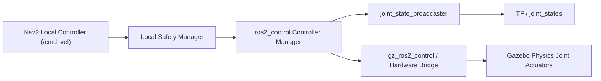

# Submodule 1.2.5: Robot Controllers

## 1. Purpose
Configures low-level motor actuation, wheel/track velocity closed loops, and hardware interfaces through `ros2_control`.

## 2. Responsibility
Provide real-time velocity controllers, hardware interface plugins, odometry computation, and trajectory tracking for Robot A and B.

## 3. Scope
### In-Scope
`ros2_control` manager configuration, `diff_drive_controller` for Robot A, custom skid-steer controller for Robot B, joint state broadcaster, and command limits.

### Out-of-Scope
Motor drive power electronics PCB design.

## 4. System Architecture

## 5. Internal Submodules
- **Differential Drive Controller (Robot A)**: Velocity controller translating linear $v$ and angular $\omega$ into wheel angular velocities.
- **Skid-Steer Track Controller (Robot B)**: Track velocity controller with dynamic ICR (Instantaneous Center of Rotation) slip compensation.
- **Joint State Broadcaster**: Publishes 100 Hz joint positions, velocities, and efforts to `/joint_states`.

## 6. Functional Requirements
- **REQ-1.2-011**: Controller update loop shall execute deterministically at 100 Hz with jitter < 1 ms.
- **REQ-1.2-012**: Hardware interface shall support emergency brake stop commands within 10 ms.

## 7. Technical Approach
Deploy `ros2_control` framework with `gz_ros2_control` hardware abstraction layer. Configure velocity command interfaces with strict acceleration limits to prevent wheel slippage on rocky mine terrain.

## 8. Open-Source Resources
### ros2_control / ros2_controllers
- **What it provides**: Standard real-time motor control architecture for ROS 2.
- **Why it is relevant**: Provides robust controller lifecycle, joint state publishing, and abstraction.
- **What we can reuse**: Controller manager and diff_drive_controller.
- **What we must develop ourselves**: Slip-compensated tracked skid-steer controller plugin.

## 9. Prerequisites
`ros2_control`, `gz_ros2_control`, Submodule 1.2.3.

## 10. Dependencies
- **Upstream Dependencies**: Submodule 1.2.3 Robot Description.
- **Downstream Dependencies**: Module 1.4 Navigation & Motion, Module 1.5 Robot Agent Interface.
- **Interfaces with Other Modules**: ROS 2 Control command interfaces.

## 11. Development Phases
### Phase 1: Controller Configuration
- **Objective**: Configure YAML controllers and gz_ros2_control tags.
- **Activities**: Write controller YAML, tune PID gains, verify in Gazebo.
- **Required resources**: ros2_control.
- **Input**: Joint names from Xacro.
- **Output**: controllers.yaml.
- **Dependencies**: Submodule 1.2.3.
- **Validation**: Send command to `/cmd_vel`; verify robot moves in Gazebo.
- **Completion criteria**: Zero controller lag; smooth acceleration profile.

## 12. Interfaces
### Topics
- `/robot_a/cmd_vel`: geometry_msgs/Twist target velocity command.
- `/robot_a/odom`: nav_msgs/Odometry wheel odometry estimate.
- `/robot_a/joint_states`: sensor_msgs/JointState joint positions and velocities.

## 13. Testing Strategy
Execute step response test from 0 to 1.0 m/s; record rise time, overshoot, and steady-state error.

## 14. Known Challenges
- **Tracked Skid-Steer Slip**: Skid steering suffers from highly non-linear ground friction; uncompensated wheel odometry drifts rapidly without IMU fusion.

## 15. Implementation Status
`PLANNED`

## 16. References
- [ros2_control Documentation](https://control.ros.org)
