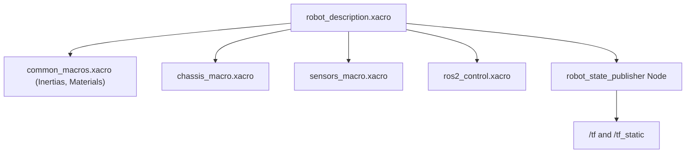

# Submodule 1.2.3: Robot Description

## 1. Purpose
Provides clean, modular, parameterizable Xacro/URDF definitions, sensor frames, joint limits, and coordinate tree transformations for all robots in compliance with REP-105.

## 2. Responsibility
Maintain parametric Xacro macros for chassis bodies, drive joints, wheel mounts, sensor brackets, and coordinate transforms conforming to `base_link`, `base_footprint`, and `odom` conventions.

## 3. Scope
### In-Scope
URDF/Xacro macros, joint limits, collision bounding boxes, inertias, materials, and Gazebo material plugins.

### Out-of-Scope
Runtime dynamic model morphing.

## 4. System Architecture

## 5. Internal Submodules
- **Common Mechanical Macros**: Standardized cylinder, box, and hollow tube moment-of-inertia calculation macros.
- **REP-105 Compliance Checker**: Automated script verifying `earth` -> `map` -> `odom` -> `base_footprint` -> `base_link` frame relationships.

## 6. Functional Requirements
- **REQ-1.2-007**: All link inertial tensors must be physically valid (satisfying triangle inequalities $I_{xx} + I_{yy} \ge I_{zz}$).
- **REQ-1.2-008**: All sensor frames must adhere to ROS REP-103 optical frame conventions (z forward, x right, y down for optical sensors).

## 7. Technical Approach
Use modular Xacro architecture separating base chassis, drivetrain, sensor brackets, and `ros2_control` hardware tags. Build continuous integration check with `check_urdf`.

## 8. Open-Source Resources
### xacro / robot_state_publisher
- **What it provides**: XML macro processor and 3D coordinate transform broadcaster.
- **Why it is relevant**: Fundamental ROS 2 TF publishing infrastructure.
- **What we can reuse**: Standard ROS 2 packages.
- **What we must develop ourselves**: Parametric sensor attachment macros.

## 9. Prerequisites
ROS 2 Humble `robot_state_publisher`, `xacro`.

## 10. Dependencies
- **Upstream Dependencies**: None.
- **Downstream Dependencies**: All Layer 1 perception and navigation modules.
- **Interfaces with Other Modules**: Publishes `/tf` and `/tf_static`.

## 11. Development Phases
### Phase 1: Macro Standardization
- **Objective**: Create reusable sensor and chassis Xacro macros.
- **Activities**: Write common_macros.xacro and validate with check_urdf.
- **Required resources**: xacro tool.
- **Input**: Sensor frame specs.
- **Output**: Tested Xacro library.
- **Dependencies**: None.
- **Validation**: Run `xacro robot.urdf.xacro > /dev/null`.
- **Completion criteria**: Zero syntax or parsing errors.

## 12. Interfaces
### Topics
- `/tf_static`: Static transforms between base_link and all sensor frames.

## 13. Testing Strategy
Automated CI test executing `check_urdf` on all generated robot descriptions; verify frame tree connectivity with `tf2_tools view_frames`.

## 14. Known Challenges
- **Sensor Calibration Offsets**: Small angular misalignment in Xacro between LiDAR and camera frames causes severe projection errors in colored point clouds.

## 15. Implementation Status
`PLANNED`

## 16. References
- [ROS REP-105: Coordinate Frames for Mobile Platforms](https://www.ros.org/reps/rep-0105.html)
- [ROS REP-103: Standard Units and Coordinate Conventions](https://www.ros.org/reps/rep-0103.html)
