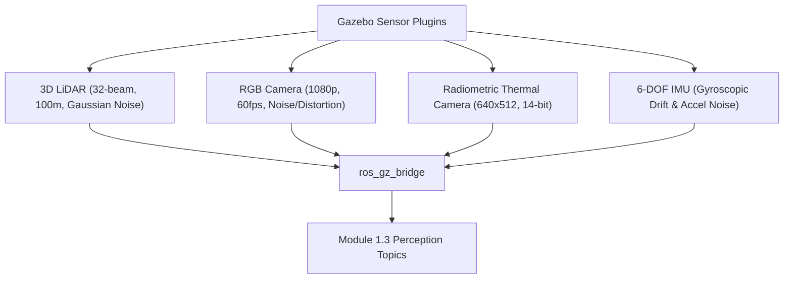

# Submodule 1.2.4: Sensor Models

## 1. Purpose
Defines simulation sensor plugins and realistic noise characteristics for 3D LiDAR, RGB cameras, radiometric thermal cameras, IMUs, and odometry encoders.

## 2. Responsibility
Implement and configure Gazebo sensor plugins with Gaussian noise, bias drift, dropouts, and subterranean dust attenuation profiles.

## 3. Scope
### In-Scope
Gazebo sensor plugin configurations, optical distortion parameters, IMU Allan variance noise models, LiDAR beam divergence and dust backscatter simulation.

### Out-of-Scope
Custom physical silicon sensor manufacturing specs.

## 4. System Architecture

## 5. Internal Submodules
- **3D LiDAR Sensor Model**: 32-channel, 360-degree horizontal FOV, +15°/-15° vertical FOV, 10 Hz scan rate, 0.02m range noise.
- **Optical RGB Camera Model**: 1920x1080 resolution, 90-degree FOV, exposure adaptation for dark mine drifts.
- **Simulated Thermal Camera Model**: 640x512 uncooled microbolometer simulation with radiometric output (Kelvin/Celsius).
- **Industrial IMU Model**: High-stability MEMS IMU with modeled in-run bias stability and angular random walk.

## 6. Functional Requirements
- **REQ-1.2-009**: LiDAR simulation shall publish `sensor_msgs/PointCloud2` at 10 Hz with >= 300,000 points per second.
- **REQ-1.2-010**: IMU simulation shall publish `sensor_msgs/Imu` at 100 Hz with realistic subterranean vibration noise.

## 7. Technical Approach
Leverage Gazebo Sim built-in sensors (`gpu_lidar`, `camera`, `thermal_camera`, `imu`) bridged via `ros_gz_bridge`. Tune Gaussian noise standard deviations to match physical sensor datasheets (e.g., Velodyne VLP-16, FLIR Boson 640, MicroStrain 3DM-GX5).

## 8. Open-Source Resources
### ros_gz_bridge
- **What it provides**: Bidirectional bridge between Gazebo Sim transport and ROS 2 topics.
- **Why it is relevant**: Translates simulated sensor packets directly into ROS 2 standard messages.
- **What we can reuse**: Standard bridge executable.
- **What we must develop ourselves**: Bridge YAML mapping configuration.

## 9. Prerequisites
Gazebo Sim, ROS 2 Humble.

## 10. Dependencies
- **Upstream Dependencies**: Submodule 1.2.3 Robot Description.
- **Downstream Dependencies**: Module 1.3 Perception & Localization.
- **Interfaces with Other Modules**: Publishes standard `sensor_msgs`.

## 11. Development Phases
### Phase 1: Sensor Configuration & Noise Tuning
- **Objective**: Configure and test all sensor plugins on robot chassis.
- **Activities**: Add sensor Xacro tags, set noise parameters, configure bridge.
- **Required resources**: Gazebo Sim, ros_gz_bridge.
- **Input**: Datasheet noise values.
- **Output**: sensor_models.xacro.
- **Dependencies**: Submodule 1.2.3.
- **Validation**: Inspect topics with `ros2 topic hz` and `ros2 topic echo`.
- **Completion criteria**: All sensors publish at target frequencies.

## 12. Interfaces
### Topics
- `/robot_a/lidar/points`: sensor_msgs/PointCloud2 3D laser scan.
- `/robot_a/camera/image_raw`: sensor_msgs/Image RGB camera feed.
- `/robot_b/thermal_camera/image_raw`: sensor_msgs/Image radiometric thermal stream.
- `/robot_a/imu/data`: sensor_msgs/Imu calibrated linear acceleration and angular velocity.

## 13. Testing Strategy
Execute sensor noise characterization script; compute sample mean and variance over 60 seconds; verify match with configured parameters.

## 14. Known Challenges
- **GPU Load with Multi-Robot Sensors**: Simulating multiple 3D LiDARs and thermal cameras concurrently can saturate GPU ray-tracing buffers; requires careful vertical beam count optimization.

## 15. Implementation Status
`PLANNED`

## 16. References
- [Velodyne VLP-16 User Manual](https://velodynelidar.com)
- [FLIR Boson Radiometric Camera Datasheet](https://www.flir.com)
