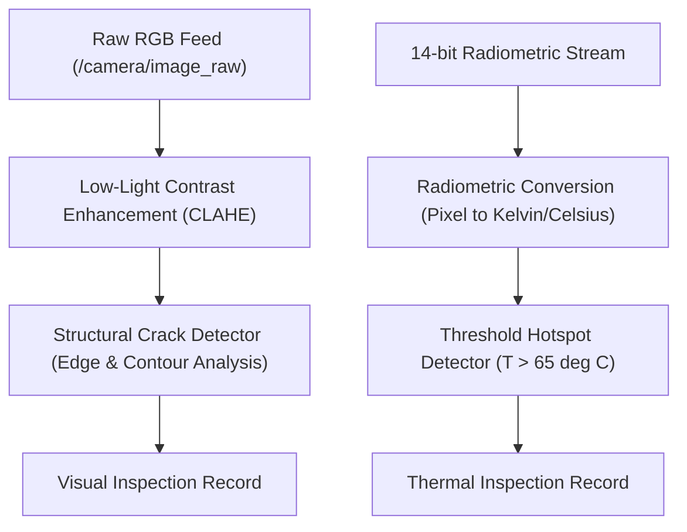

# Submodule 1.3.3: Camera Processing

## 1. Purpose
Performs computer vision image enhancement, feature extraction, visual inspection defect detection, and radiometric thermal image temperature mapping.

## 2. Responsibility
Enhance low-light optical RGB frames, detect structural rock fractures/cracks, parse 14-bit radiometric thermal images into calibrated temperature matrices, and extract hotspot anomalies.

## 3. Scope
### In-Scope
Contrast-Limited Adaptive Histogram Equalization (CLAHE), edge detection for structural fracture mapping, radiometric conversion ($T_{Celsius} = raw \cdot 0.04 - 273.15$), and hotspot segmentation.

### Out-of-Scope
Deep learning model training and cloud neural network inference.

## 4. System Architecture

## 5. Internal Submodules
- **Low-Light Visual Enhancer**: Applies adaptive gamma correction and CLAHE to reveal details in dark mine tunnels.
- **Radiometric Thermal Parser**: Converts raw microbolometer sensor values into floating-point temperature matrices.
- **Anomaly Extractor**: Extracts bounding boxes, peak temperatures, and area dimensions of structural and thermal defects.

## 6. Functional Requirements
- **REQ-1.3-005**: Thermal parser shall compute maximum, minimum, and mean temperatures for designated inspection regions with accuracy +/- 1.0°C.
- **REQ-1.3-006**: Image enhancement pipeline shall maintain minimum 15 fps throughput at 1080p resolution.

## 7. Technical Approach
Develop modular OpenCV 4.x pipeline in C++/Python. Use CUDA-accelerated OpenCV primitives if NVIDIA GPU is present, falling back gracefully to optimized CPU SIMD instructions.

## 8. Open-Source Resources
### OpenCV 4.x (opencv_contrib)
- **What it provides**: Comprehensive image processing and computer vision library.
- **Why it is relevant**: Standard framework for image filtering, histogram equalization, and contour detection.
- **What we can reuse**: cv::createCLAHE, cv::threshold, cv::findContours.
- **What we must develop ourselves**: Radiometric thermal parsing and anomaly scoring engine.

## 9. Prerequisites
Submodule 1.3.1, OpenCV 4.x.

## 10. Dependencies
- **Upstream Dependencies**: Submodule 1.3.1 Sensor Acquisition.
- **Downstream Dependencies**: Module 3.3 Inspection Management.
- **Interfaces with Other Modules**: Publishes inspection evidence messages.

## 11. Development Phases
### Phase 1: Radiometric Parser Development
- **Objective**: Implement thermal conversion and thresholding node.
- **Activities**: Write Python/C++ node parsing 14-bit thermal image into float32 temperature grid.
- **Required resources**: OpenCV, ROS 2.
- **Input**: /thermal/image_raw.
- **Output**: /thermal/temperature_map.
- **Dependencies**: None.
- **Validation**: Verify temperature values match calibrated Gazebo ground truth.
- **Completion criteria**: Temperature error < 0.5°C across 20°C-150°C range.

## 12. Interfaces
### Topics
- `/robot_b/perception/thermal_anomalies`: Custom inspection message reporting detected hot spots with coordinates and temperatures.
- `/robot_a/perception/visual_enhanced`: sensor_msgs/Image CLAHE-enhanced RGB feed.

## 13. Testing Strategy
Feed calibrated thermal test pattern containing 90°C hotspot; verify detector publishes anomaly message with accurate peak temperature.

## 14. Known Challenges
- **Low Dynamic Range in Dark Tunnels**: Standard camera sensors produce heavy noise in near-total darkness; requires synchronized LED strobe control.

## 15. Implementation Status
`PLANNED`

## 16. References
- [OpenCV Radiometric Calibration](https://docs.opencv.org)
