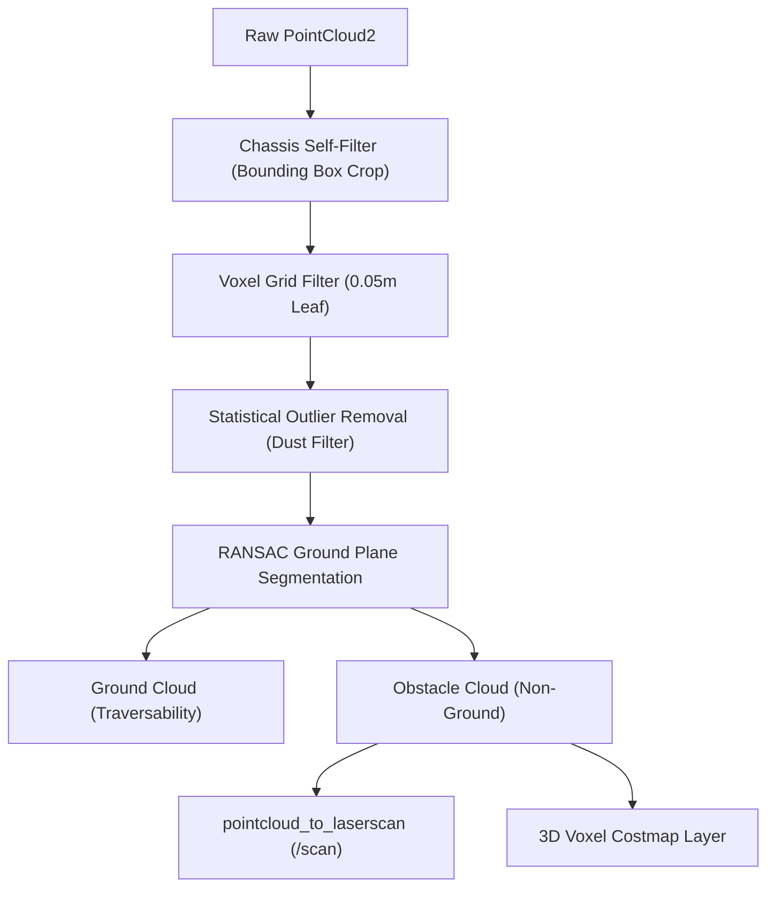

# Submodule 1.3.2: LiDAR Processing

## 1. Purpose
Performs point cloud preprocessing, filtering, ground plane segmentation, and obstacle clustering to generate clean spatial inputs for navigation and mapping.

## 2. Responsibility
Filter raw 3D LiDAR point clouds: crop robot chassis reflections, remove airborne dust artifacts, extract ground plane, and convert 3D obstacles into 2D laser scans and 3D voxel grids.

## 3. Scope
### In-Scope
Pass-through filtering, voxel grid downsampling, statistical outlier removal (SOR), RANSAC ground plane extraction, and `pointcloud_to_laserscan` projection.

### Out-of-Scope
High-level object semantic categorization (e.g., distinguishing rock types).

## 4. System Architecture

## 5. Internal Submodules
- **Self-Filter & Voxel Downsampler**: Eliminates robot structural elements from cloud and reduces density for real-time processing.
- **Dust & Particle Filter**: Filters subterranean aerosol dust and water vapor backscatter using intensity and neighbor distance thresholds.
- **Ground Plane Extractor**: Segments uneven tunnel floor from walls and overhead rock hazards.

## 6. Functional Requirements
- **REQ-1.3-003**: Processing latency for a 30,000-point scan shall not exceed 35 ms on onboard compute.
- **REQ-1.3-004**: Ground extraction shall correctly identify tunnel floor gradients up to 25 degrees.

## 7. Technical Approach
Implement PCL (Point Cloud Library) pipeline wrapped in ROS 2 C++ LifecycleNode. Use OpenMP multithreading for voxel grid downsampling and fast RANSAC fitting.

## 8. Open-Source Resources
### Point Cloud Library (PCL 1.12)
- **What it provides**: Comprehensive 3D point cloud processing algorithms.
- **Why it is relevant**: Standard library for geometric filtering and segmentation.
- **What we can reuse**: VoxelGrid, PassThrough, StatisticalOutlierRemoval, SACSegmentation.
- **What we must develop ourselves**: Dust-backscatter filtering heuristic based on laser intensity.

## 9. Prerequisites
Submodule 1.3.1, PCL 1.12.

## 10. Dependencies
- **Upstream Dependencies**: Submodule 1.3.1 Sensor Acquisition.
- **Downstream Dependencies**: Submodule 1.3.4 SLAM, Submodule 1.4.1 Map Management.
- **Interfaces with Other Modules**: Publishes filtered point clouds and `/scan` topic.

## 11. Development Phases
### Phase 1: Filtering Pipeline Implementation
- **Objective**: Implement C++ node for voxel and outlier removal.
- **Activities**: Write node using PCL filters, benchmark CPU utilization.
- **Required resources**: PCL, ROS 2.
- **Input**: /lidar/points.
- **Output**: /lidar/points_filtered.
- **Dependencies**: None.
- **Validation**: Profile processing time on 10 Hz stream.
- **Completion criteria**: Mean processing time < 30 ms.

## 12. Interfaces
### Topics
- `/robot_a/scan`: sensor_msgs/LaserScan projected 2D scan for SLAM Toolbox.
- `/robot_a/perception/obstacle_cloud`: sensor_msgs/PointCloud2 filtered non-ground obstacles.

## 13. Testing Strategy
Inject simulated dust cloud into Gazebo; verify Statistical Outlier Removal rejects > 95% of airborne dust points.

## 14. Known Challenges
- **Dust and Moisture Backscatter**: Underground blasting dust and water mist cause dense false obstacle returns, triggering unnecessary robot emergency stops.

## 15. Implementation Status
`PLANNED`

## 16. References
- [Point Cloud Library Documentation](https://pointclouds.org)
