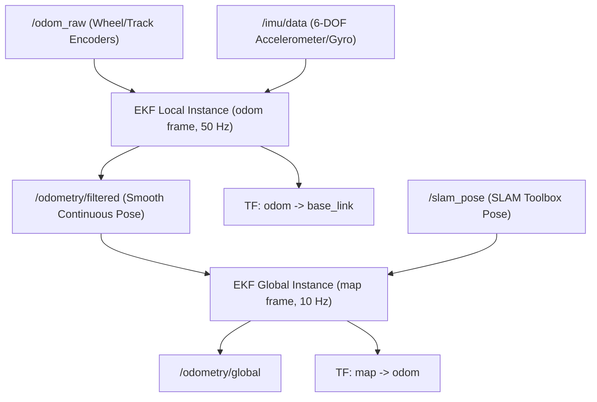

# Submodule 1.3.5: Localization

## 1. Purpose
Fuses multi-modal odometry, inertial measurements, and SLAM corrections using an Extended Kalman Filter (EKF) to compute robust, drift-resilient state estimates.

## 2. Responsibility
Estimate high-frequency (50 Hz) robot pose, linear velocity, angular velocity, and orientation covariance in the `odom` and `map` reference frames.

## 3. Scope
### In-Scope
Dual-instance `robot_localization` EKF nodes, covariance tuning, sensor fault rejection, and frame transformation validation.

### Out-of-Scope
Global GPS / GNSS satellite integration (non-existent underground).

## 4. System Architecture

## 5. Internal Submodules
- **Continuous Local EKF Instance**: Fuses high-frequency wheel odometry and IMU to produce smooth, non-jumping poses for local controllers.
- **Global Map EKF Instance**: Fuses global SLAM corrections, eliminating cumulative long-term drift.

## 6. Functional Requirements
- **REQ-1.3-009**: Local EKF shall output state estimates at >= 50 Hz with latency < 10 ms.
- **REQ-1.3-010**: Local state estimate shall not experience discontinuous position jumps (smooth continuous trajectory).

## 7. Technical Approach
Deploy `robot_localization` package running dual EKF nodes conforming to ROS REP-105 standards. Local EKF fuses continuous odometry and IMU without map feedback; global EKF incorporates SLAM corrections.

## 8. Open-Source Resources
### robot_localization (ekf_node)
- **What it provides**: Nonlinear state estimation using Extended Kalman Filters.
- **Why it is relevant**: Standard ROS 2 package for sensor fusion.
- **What we can reuse**: Core EKF implementation.
- **What we must develop ourselves**: Covariance matrix tuning for slippery mine rock.

## 9. Prerequisites
Submodule 1.2.5 Controllers, Submodule 1.2.4 Sensor Models.

## 10. Dependencies
- **Upstream Dependencies**: Submodule 1.2.5 Robot Controllers.
- **Downstream Dependencies**: Module 1.4 Navigation & Motion.
- **Interfaces with Other Modules**: Publishes `/odometry/filtered` and broadcasts TF.

## 11. Development Phases
### Phase 1: EKF Configuration & Tuning
- **Objective**: Configure dual EKF nodes and calibrate process noise matrices.
- **Activities**: Tune Q and R matrices based on simulated sensor noise profiles.
- **Required resources**: robot_localization.
- **Input**: Wheel odom, IMU data.
- **Output**: ekf.yaml.
- **Dependencies**: None.
- **Validation**: Verify orientation stability during sharp skid turns.
- **Completion criteria**: Heading drift < 1 degree per 10 meters without SLAM.

## 12. Interfaces
### Topics
- `/robot_a/odometry/filtered`: nav_msgs/Odometry 50 Hz continuous state estimate.
- `/robot_a/odometry/global`: nav_msgs/Odometry map-corrected global state.

## 13. Testing Strategy
Drive robot across uneven terrain; record true Gazebo pose vs EKF filtered pose; compute Root Mean Square Error (RMSE).

## 14. Known Challenges
- **Tracked Vehicle Slip in Skid Turns**: Tracked platforms exhibit severe non-holonomic slip when turning; requires dynamic scaling of wheel odometry covariance during rotation.

## 15. Implementation Status
`PLANNED`

## 16. References
- **Moore and Stouch, A Generalized Extended Kalman Filter Implementation for the Robot Operating System**: Proc. of the Conf. on Field and Service Robotics, 2014
