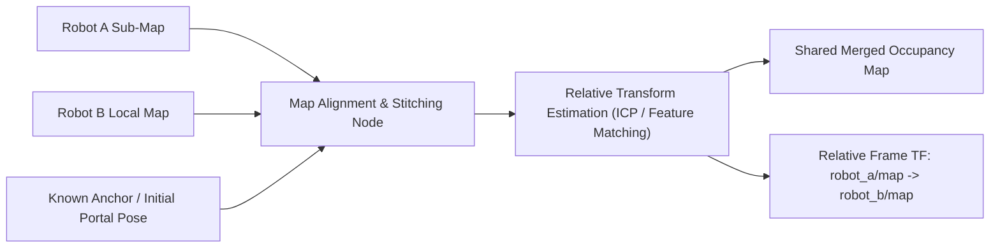

# Submodule 1.3.6: Map Alignment and Sharing

## 1. Purpose
Enables heterogeneous robots to align their local coordinate frames, exchange occupancy sub-maps, and register shared landmark anchors without a central map server.

## 2. Responsibility
Align Robot A's exploration map with Robot B's inspection coordinate system via common visual/geometric anchors or initial portal calibration.

## 3. Scope
### In-Scope
Relative spatial transformation calculation ($T_{B}^{A}$), sub-map serialization and stitching, shared fiducial anchor registration, and overlap detection.

### Out-of-Scope
Monolithic cloud-based point cloud streaming.

## 4. System Architecture

## 5. Internal Submodules
- **Topological Anchor Detector**: Identifies distinctive geometric features (tunnel junctions, survey tags) as shared coordinate anchors.
- **Iterative Closest Point (ICP) Align-er**: Refines relative translation and rotation between overlapping 2D sub-maps.
- **Occupancy Grid Merger**: Fuses probabilistic occupancy cells using log-odds updates.

## 6. Functional Requirements
- **REQ-1.3-011**: Map alignment shall estimate relative transform $T_{B}^{A}$ with rotational error < 2.0 degrees and translational error < 0.2 m.
- **REQ-1.3-012**: Sub-map transfer payload shall not exceed 100 KB per exchange over the wireless mesh.

## 7. Technical Approach
Robots start at known initial portal staging coordinates or identify common surveyed mine fiducials. When robots establish peer-to-peer radio contact, they exchange lightweight serialized sub-maps and refine alignment using 2D scan-to-map ICP.

## 8. Open-Source Resources
### m-explore (multirobot_map_merge)
- **What it provides**: Grid map merging for multi-robot systems.
- **Why it is relevant**: Provides baseline reference for merging occupancy grids.
- **What we can reuse**: Log-odds grid combination algorithms.
- **What we must develop ourselves**: Decentralized P2P trigger and anchor-based transformation initialization.

## 9. Prerequisites
Submodule 1.3.4 SLAM, Module 2.1 Robot Discovery.

## 10. Dependencies
- **Upstream Dependencies**: Submodule 1.3.4 SLAM.
- **Downstream Dependencies**: Module 1.4 Navigation, Module 3.4 Monitoring & Visualization.
- **Interfaces with Other Modules**: ROS 2 Service for sub-map exchange.

## 11. Development Phases
### Phase 1: Anchor-Based Transform Solver
- **Objective**: Compute rigid transform from shared portal anchor.
- **Activities**: Write node publishing relative TF between robot namespaces.
- **Required resources**: C++, TF2.
- **Input**: Known starting coordinates.
- **Output**: Broadcasted inter-robot TF.
- **Dependencies**: None.
- **Validation**: Verify Robot B appears in correct relative position in Robot A RViz.
- **Completion criteria**: Transform error < 0.05m at start position.

## 12. Interfaces
### Services
- `/robot_a/map_alignment/exchange_submap`: Custom service exchanging serialized occupancy grid diffs.

### Topics
- `/shared/merged_map`: nav_msgs/OccupancyGrid composite multi-robot map.

## 13. Testing Strategy
Spawn Robot A and B at opposite ends of a mapped drift; execute map alignment service; verify merged map matches unified ground truth world.

## 14. Known Challenges
- **Perceptual Aliasing in Identical Drifts**: Repetitive tunnel profiles can lead to false positive ICP matches; requires topological anchor verification.

## 15. Implementation Status
`PLANNED`

## 16. References
- **Birk and Carpin, Merging Occupancy Grid Maps From Multiple Robots**: Proc. IEEE, 2006
