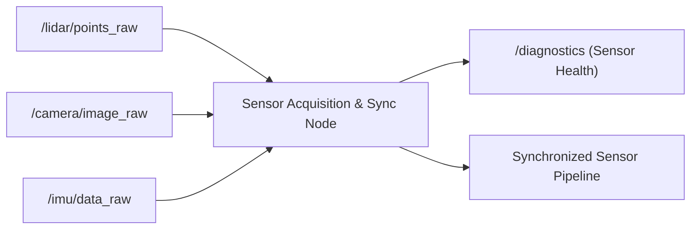

# Submodule 1.3.1: Sensor Acquisition

## 1. Purpose
Provides real-time ingestion, time synchronization, header validation, and coordinate frame transformation for all raw onboard sensor feeds.

## 2. Responsibility
Ingest data from LiDAR, cameras, IMU, and encoders, verify monotonic timestamps, drop malformed packets, and buffer synchronized sensor frames.

## 3. Scope
### In-Scope
Sensor message time synchronization (`message_filters`), timestamp jitter correction, drop detection, and initial diagnostic health reporting.

### Out-of-Scope
Downstream feature extraction and algorithmic perception.

## 4. System Architecture

## 5. Internal Submodules
- **Approximate Time Synchronizer**: Pairs camera frames with closest LiDAR point clouds within a 30 ms tolerance window.
- **Data Integrity & Health Monitor**: Calculates packet drop rate, latency, and timestamp divergence.

## 6. Functional Requirements
- **REQ-1.3-001**: Sensor acquisition node shall detect and flag timestamp regressions or gaps exceeding 100 ms.
- **REQ-1.3-002**: Sensor synchronization latency overhead shall not exceed 10 ms.

## 7. Technical Approach
Utilize ROS 2 `message_filters::Synchronizer` with `ApproximateTime` policy. Implement diagnostic status publishing conforming to `diagnostic_msgs/DiagnosticArray`.

## 8. Open-Source Resources
### ros2/message_filters
- **What it provides**: Time synchronization filters for ROS 2 messages.
- **Why it is relevant**: Aligns multi-modal sensor streams.
- **What we can reuse**: C++ template libraries.
- **What we must develop ourselves**: Mine-specific diagnostic thresholds.

## 9. Prerequisites
Submodule 1.2.4 Sensor Models.

## 10. Dependencies
- **Upstream Dependencies**: Submodule 1.2.4 Sensor Models.
- **Downstream Dependencies**: Submodule 1.3.2 LiDAR Processing, Submodule 1.3.3 Camera Processing.
- **Interfaces with Other Modules**: Subscribes raw sensor topics; publishes synchronized topics.

## 11. Development Phases
### Phase 1: Sync Pipeline Implementation
- **Objective**: Implement ROS 2 C++ sensor sync node.
- **Activities**: Configure message_filters, test with recorded rosbag2.
- **Required resources**: C++, ROS 2 Humble.
- **Input**: Raw sensor topics.
- **Output**: Synchronized topic stream.
- **Dependencies**: None.
- **Validation**: Verify sync topic pairs have timestamp delta < 25ms.
- **Completion criteria**: Zero dropped frame crashes.

## 12. Interfaces
### Topics
- `/robot_a/perception/synced_cloud_image`: Custom synced perception pair topic.

## 13. Testing Strategy
Replay simulated sensor bag with artificial timestamp jitter; verify synchronization node cleanly filters outliers.

## 14. Known Challenges
- **Sensor Clock Drift**: Independent hardware clocks on physical LiDAR and cameras drift over multi-hour inspection missions; requires PTP (IEEE 1588) or hardware sync.

## 15. Implementation Status
`PLANNED`

## 16. References
- [ROS 2 message_filters Tutorial](https://docs.ros.org/en/humble/Tutorials/Intermediate/Message-Filters.html)
