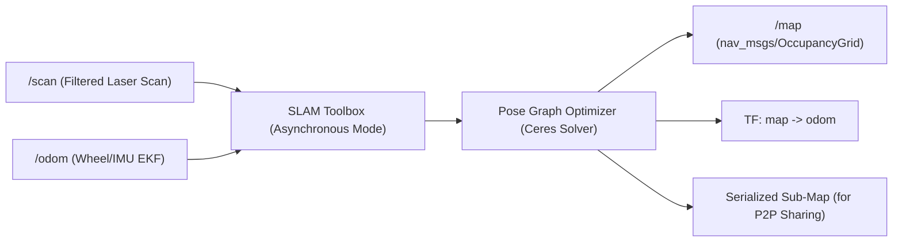

# Submodule 1.3.4: Simultaneous Localization and Mapping (SLAM)

## 1. Purpose
Constructs consistent 2D/3D environmental maps and computes real-time robot pose estimates in GPS-denied subterranean mine tunnels.

## 2. Responsibility
Execute laser scan matching, pose-graph optimization, loop closure detection, and real-time occupancy grid publishing.

## 3. Scope
### In-Scope
SLAM Toolbox asynchronous mapping mode, 2D occupancy grid generation, pose-graph optimization, map serialization, and sub-map export.

### Out-of-Scope
Multi-robot centralized cloud map merger.

## 4. System Architecture

## 5. Internal Submodules
- **Laser Scan Matcher**: Correlates consecutive laser scans to estimate incremental platform displacement.
- **Pose Graph Optimizer**: Maintains graph of historical robot poses and closes loops when revisiting tunnel junctions.
- **Sub-map Serializer**: Extracts compact topological and geometric sub-maps for sharing with peer robots over Layer 2.

## 6. Functional Requirements
- **REQ-1.3-007**: SLAM pose estimate shall maintain translation error < 1.0% of total distance traveled in closed-loop tunnel circuits.
- **REQ-1.3-008**: Occupancy grid map shall be updated and published at >= 2 Hz with resolution of 0.05 m per cell.

## 7. Technical Approach
Deploy `slam_toolbox` in `async_slam_toolbox_node` configuration. Tune scan matcher search window and loop closure threshold for long, featureless underground tunnel geometry.

## 8. Open-Source Resources
### SLAM Toolbox
- **What it provides**: Complete 2D SLAM and life-long mapping package for ROS 2.
- **Why it is relevant**: De-facto standard SLAM package in ROS 2; highly optimized for large indoor/tunnel maps.
- **What we can reuse**: Core SLAM Toolbox binary and nodes.
- **What we must develop ourselves**: Subterranean-tuned configuration parameters and sub-map export service.

## 9. Prerequisites
Submodule 1.3.2 LiDAR Processing, ROS 2 Humble `slam_toolbox`.

## 10. Dependencies
- **Upstream Dependencies**: Submodule 1.3.2 LiDAR Processing.
- **Downstream Dependencies**: Submodule 1.3.5 Localization, Submodule 1.4.1 Map Management.
- **Interfaces with Other Modules**: Publishes `/map` and broadcasts `map -> odom` transform.

## 11. Development Phases
### Phase 1: SLAM Toolbox Integration
- **Objective**: Configure and tune SLAM Toolbox for Robot A in Gazebo mine world.
- **Activities**: Create slam_toolbox_params.yaml, record exploration bag, evaluate map accuracy.
- **Required resources**: slam_toolbox, RViz2.
- **Input**: /robot_a/scan, /robot_a/odom.
- **Output**: High-fidelity 2D occupancy map.
- **Dependencies**: None.
- **Validation**: Complete 150m exploration loop; verify loop closure closes cleanly without double walls.
- **Completion criteria**: Map drift < 0.2m at loop closure point.

## 12. Interfaces
### Topics
- `/robot_a/map`: nav_msgs/OccupancyGrid 2D global occupancy grid map.
- `/robot_a/slam_toolbox/graph`: visualization_msgs/MarkerArray visual pose graph.

### Services
- `/robot_a/slam_toolbox/save_map`: Serializes map to disk.

## 13. Testing Strategy
Drive robot along 200m simulated mine drift with a loop return; check pose-graph residual error before and after loop closure.

## 14. Known Challenges
- **Degenerate Geometry in Long Drifts**: Featureless straight tunnels produce self-similar laser scans causing longitudinal slip in scan matching; requires tight fusion with wheel odometry and IMU.

## 15. Implementation Status
`PLANNED`

## 16. References
- **Macenski et al., SLAM Toolbox: SLAM for the Dynamic World**: Journal of Open Source Software, 2021
