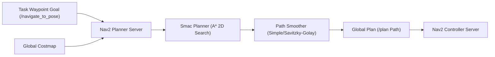

# Submodule 1.4.2: Global Planning

## 1. Purpose
Computes optimal, collision-free global trajectories through subterranean mine drifts from current robot pose to inspection goal waypoints.

## 2. Responsibility
Execute global graph search, find shortest or lowest-risk routes through interconnected tunnels, and handle path queries over hundreds of meters.

## 3. Scope
### In-Scope
Nav2 Smac Planner (2D A* / Dubins / Lattice), route waypoint smoothing, goal tolerance checking, and path feasibility validation.

### Out-of-Scope
Local real-time obstacle avoidance reflexes (handled by local controller).

## 4. System Architecture

## 5. Internal Submodules
- **Smac 2D Global Search**: Computes topologically sound paths along tunnel centerlines avoiding rock walls.
- **Path Smoother**: Eliminates jagged grid-search artifacts, producing continuous curvature paths.

## 6. Functional Requirements
- **REQ-1.4-003**: Global planner shall compute paths over 100 meters of tunnel within `[PROPOSED TARGET: < 150 ms]`.
- **REQ-1.4-004**: Planner shall return failure code if target goal lies within an impassable rock fall or lethal costmap zone.

## 7. Technical Approach
Deploy `nav2_smac_planner::SmacPlanner2D` within the Nav2 Planner Server. Configure heuristic weights and cost penalties to favor tunnel centerlines over wall-adjacent paths.

## 8. Open-Source Resources
### nav2_smac_planner
- **What it provides**: Highly optimized 2D A*, Hybrid-A*, and State Lattice global planners.
- **Why it is relevant**: Provides fast, deterministic path generation without memory leaks.
- **What we can reuse**: SmacPlanner2D plugin.
- **What we must develop ourselves**: Cost-penalty parameter tuning for mine tunnel geometry.

## 9. Prerequisites
Submodule 1.4.1 Map Management, ROS 2 Nav2.

## 10. Dependencies
- **Upstream Dependencies**: Submodule 1.4.1 Map Management.
- **Downstream Dependencies**: Submodule 1.4.3 Local Planning.
- **Interfaces with Other Modules**: ROS 2 Action `nav2_msgs/action/ComputePathToPose`.

## 11. Development Phases
### Phase 1: Planner Server Setup
- **Objective**: Configure Smac Planner 2D in Nav2 pipeline.
- **Activities**: Tune search tolerance and cost weights, benchmark path compute times.
- **Required resources**: Nav2.
- **Input**: Global costmap.
- **Output**: planner_server config.
- **Dependencies**: Submodule 1.4.1.
- **Validation**: Request 150m path query; verify output path.
- **Completion criteria**: Path generated within 150 ms.

## 12. Interfaces
### Actions
- `/robot_a/compute_path_to_pose`: nav2_msgs/action/ComputePathToPose global planning action.

## 13. Testing Strategy
Test path planning across maze of intersecting drifts; verify planner always routes through open drifts and avoids blocked branches.

## 14. Known Challenges
- **Dead-End Drift Stalls**: Robots entering blind headings must plan reverse maneuvers cleanly; requires proper terminal orientation handling.

## 15. Implementation Status
`PLANNED`

## 16. References
- **Macenski et al., Smac Planner: A Family of High Performance Planners**: Proc. IROS 2023
