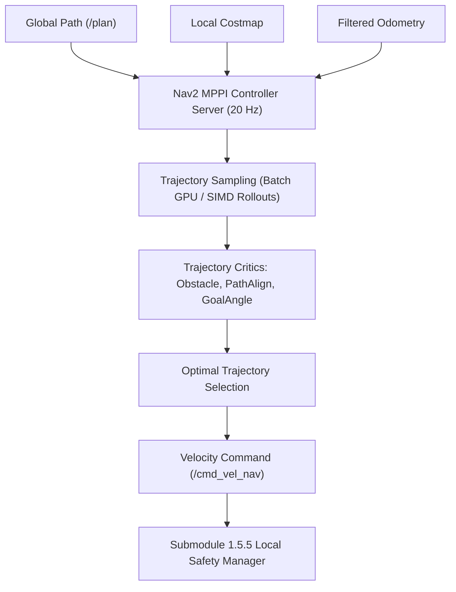

# Submodule 1.4.3: Local Planning

## 1. Purpose
Tracks the global path while dynamically steering around sudden obstacles, rubble, and rough terrain using model-predictive trajectory rollout.

## 2. Responsibility
Compute high-frequency (20 Hz) collision-free linear and angular velocity commands (`/cmd_vel`) that respect chassis kinematic and dynamic limits.

## 3. Scope
### In-Scope
Nav2 Model Predictive Path Integral (MPPI) controller, trajectory rollout evaluation, critic scoring functions, and goal arrival alignment.

### Out-of-Scope
Low-level joint PID loops.

## 4. System Architecture

## 5. Internal Submodules
- **MPPI Trajectory Generator**: Samples thousands of prospective velocity sequences over a 2.5-second time horizon.
- **Trajectory Critic Suite**: Penalizes high-cost cells, path divergence, excessive angular jerk, and track slip.

## 6. Functional Requirements
- **REQ-1.4-005**: Local controller shall generate valid velocity commands at >= 20 Hz.
- **REQ-1.4-006**: The controller shall maintain a minimum clearance of 0.20 m from rock walls during transit.

## 7. Technical Approach
Deploy `nav2_mppi_controller::MPPIController` using C++ vectorized CPU instructions. Configure critics: `ObstacleCritic`, `PathAlignCritic`, `PathFollowCritic`, and `TwistLimitCritic`.

## 8. Open-Source Resources
### nav2_mppi_controller
- **What it provides**: Model Predictive Path Integral local trajectory planner.
- **Why it is relevant**: Handles complex non-linear dynamics, rough terrain, and dynamic obstacles exceptionally well.
- **What we can reuse**: MPPI controller plugin.
- **What we must develop ourselves**: Critic weight tuning for differential vs tracked platforms.

## 9. Prerequisites
Submodule 1.4.1 Map Management, Submodule 1.4.2 Global Planning.

## 10. Dependencies
- **Upstream Dependencies**: Submodule 1.4.2 Global Planning.
- **Downstream Dependencies**: Submodule 1.4.5 Motion Control, Submodule 1.5.5 Local Safety Manager.
- **Interfaces with Other Modules**: Publishes `/cmd_vel_nav` topic.

## 11. Development Phases
### Phase 1: MPPI Controller Tuning
- **Objective**: Tune MPPI controller for smooth corridor navigation in Gazebo.
- **Activities**: Tune batch sample count (500-1000) and critic weights.
- **Required resources**: Nav2.
- **Input**: Robot kinematics, local costmap.
- **Output**: controller_server.yaml.
- **Dependencies**: Submodule 1.4.2.
- **Validation**: Navigate past an unexpected rubble obstacle.
- **Completion criteria**: Robot smoothly circumvents obstacle without stopping.

## 12. Interfaces
### Topics
- `/robot_a/cmd_vel_nav`: geometry_msgs/Twist raw navigation velocity output.

## 13. Testing Strategy
Drive robot at 1.0 m/s toward a suddenly spawned boulder; verify MPPI computes an evasive arc without collision.

## 14. Known Challenges
- **Narrow Tunnel Oscillation**: High wall proximity can cause MPPI to oscillate between left and right rock faces; requires careful `PathAlign` vs `Obstacle` critic balancing.

## 15. Implementation Status
`PLANNED`

## 16. References
- **Williams et al., Information Theoretic MPC for Model-Based Reinforcement Learning**: IEEE ICRA 2017
