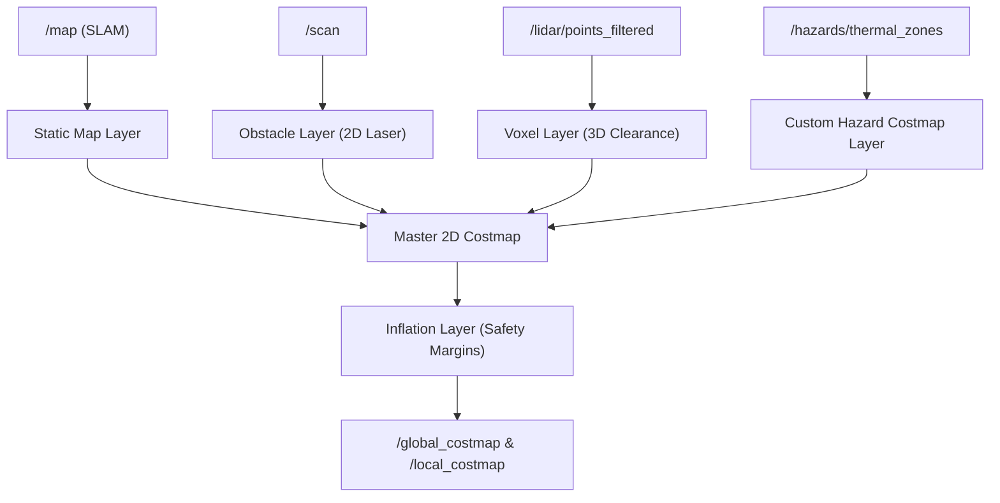

# Submodule 1.4.1: Map Management

## 1. Purpose
Manages multi-layered 2D and 3D costmaps representing traversability, rock walls, clearance zones, and environmental hazard buffers.

## 2. Responsibility
Maintain global and local Costmap2D instances with static map layers, real-time obstacle layers, voxel clearance layers, and safety inflation buffers.

## 3. Scope
### In-Scope
Nav2 costmap configuration, custom hazard costmap plugin, dynamic inflation radii, and rolling window local costmaps.

### Out-of-Scope
Long-term geological rock-strata simulation.

## 4. System Architecture

## 5. Internal Submodules
- **Global Costmap Manager**: Static map with global inflation matching robot radius for long-distance tunnel path planning.
- **Local Rolling Costmap Manager**: High-frequency (10 Hz) 6m x 6m rolling window centered on robot for dynamic obstacle avoidance.
- **Hazard Keep-Out Layer**: Injects artificial high-cost zones around active thermal hotspots or dangerous roof fractures.

## 6. Functional Requirements
- **REQ-1.4-001**: Local costmap shall update at >= 10 Hz with latency < 50 ms.
- **REQ-1.4-002**: Inflation layer shall enforce zero-velocity lethality zone matching physical robot radius plus 0.15m safety cushion.

## 7. Technical Approach
Deploy standard Nav2 `nav2_costmap_2d` plugin architecture. Develop a custom C++ costmap layer plugin (`HazardKeepOutLayer`) subscribing to detected hazard locations.

## 8. Open-Source Resources
### nav2_costmap_2d
- **What it provides**: Layered 2D costmap library for ROS 2.
- **Why it is relevant**: Standard spatial representation for Nav2 planners and controllers.
- **What we can reuse**: Static, obstacle, voxel, and inflation layer plugins.
- **What we must develop ourselves**: Hazard keep-out layer plugin.

## 9. Prerequisites
Submodule 1.3.4 SLAM, Submodule 1.3.2 LiDAR Processing.

## 10. Dependencies
- **Upstream Dependencies**: Submodule 1.3.4 SLAM.
- **Downstream Dependencies**: Submodule 1.4.2 Global Planning, Submodule 1.4.3 Local Planning.
- **Interfaces with Other Modules**: Publishes `/global_costmap/costmap` and `/local_costmap/costmap`.

## 11. Development Phases
### Phase 1: Costmap Tuning
- **Objective**: Configure Nav2 costmap YAML for differential and tracked footprints.
- **Activities**: Tune inflation radius, decay rates, and voxel height limits.
- **Required resources**: Nav2.
- **Input**: Robot footprint CAD.
- **Output**: nav2_costmap_params.yaml.
- **Dependencies**: None.
- **Validation**: Inspect costmap in RViz2 around rock obstacles.
- **Completion criteria**: Cost gradients decay smoothly from obstacle boundaries.

## 12. Interfaces
### Topics
- `/robot_a/local_costmap/costmap`: nav_msgs/OccupancyGrid 10 Hz local costmap.

## 13. Testing Strategy
Place obstacle in path of robot; verify costmap immediately updates and marks cells lethal within 100 ms.

## 14. Known Challenges
- **Overhanging Ceiling Obstacles**: Underground tunnels have irregular roof heights; 2D laser scans might miss low-hanging rock projections; requires 3D voxel layer integration.

## 15. Implementation Status
`PLANNED`

## 16. References
- [Nav2 Costmap2D Concepts](https://navigation.ros.org/configuration/packages/configuring-costmaps.html)
