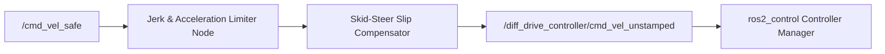

# Submodule 1.4.5: Motion Control

## 1. Purpose
Translates planar velocity commands into smooth, jerk-limited, slip-compensated motor demands for differential and tracked drivetrains.

## 2. Responsibility
Enforce acceleration limits, smooth velocity setpoints, calculate skid-steer wheel/track speeds, and prevent abrupt motor torque transients.

## 3. Scope
### In-Scope
Velocity profiler, jerk limiter, track slip compensator, and `cmd_vel` multiplexer.

### Out-of-Scope
Low-level transistor H-bridge switching.

## 4. System Architecture

## 5. Internal Submodules
- **S-Curve Acceleration Profiler**: Bounds $da/dt$ (jerk) to prevent tipping and track throwing on rough ground.
- **Skid-Steer Kinematic Transformer**: Applies instantaneous center of rotation (ICR) corrections for Robot B.

## 6. Functional Requirements
- **REQ-1.4-009**: Linear acceleration shall not exceed 1.5 m/s²; angular acceleration shall not exceed 2.0 rad/s².
- **REQ-1.4-010**: Motion control latency overhead shall remain < 5 ms.

## 7. Technical Approach
Deploy `twist_mux` for priority multiplexing. Implement a custom C++ velocity smoother node enforcing trapezoidal or S-curve acceleration profiling before sending commands to `ros2_control`.

## 8. Open-Source Resources
### twist_mux
- **What it provides**: Priority-based velocity multiplexer for ROS 2.
- **Why it is relevant**: Allows safety stops, joystick teleop, and autonomy to cleanly arbitrate `/cmd_vel`.
- **What we can reuse**: twist_mux node.
- **What we must develop ourselves**: YAML priority configuration.

## 9. Prerequisites
Submodule 1.2.5 Controllers.

## 10. Dependencies
- **Upstream Dependencies**: Submodule 1.4.3 Local Planning, Submodule 1.5.5 Safety Manager.
- **Downstream Dependencies**: Submodule 1.2.5 Robot Controllers.
- **Interfaces with Other Modules**: Publishes smoothed `/cmd_vel` to controller manager.

## 11. Development Phases
### Phase 1: Twist Multiplexer & Smoother Setup
- **Objective**: Configure twist_mux and velocity smoother.
- **Activities**: Set priorities: Safety > Teleop > Autonomy; tune acceleration limits.
- **Required resources**: twist_mux, nav2_velocity_smoother.
- **Input**: Velocity sources.
- **Output**: Validated cmd_vel stream.
- **Dependencies**: None.
- **Validation**: Command step change; measure output acceleration slope.
- **Completion criteria**: Measured acceleration strictly within configured limits.

## 12. Interfaces
### Topics
- `/robot_a/cmd_vel`: geometry_msgs/Twist final validated motor command.

## 13. Testing Strategy
Apply instantaneous full reverse command (+1.0 m/s to -1.0 m/s); verify robot decelerates smoothly without physical wheel lift or tipping.

## 14. Known Challenges
- **Track Lateral Resistance**: Turning on high-friction rock surfaces requires substantial breakaway torque; controller must prevent stall without causing violent jerks.

## 15. Implementation Status
`PLANNED`

## 16. References
- [ros-teleop/twist_mux Documentation](https://github.com/ros-teleop/twist_mux)
