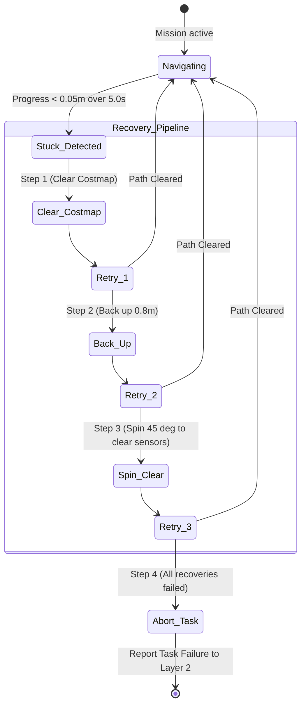

# Submodule 1.4.6: Navigation Recovery

## 1. Purpose
Executes automated fault recovery behaviors when a robot becomes stuck, entrapped, or blocked by unexpected obstacles in mine tunnels.

## 2. Responsibility
Execute structured recovery routines: costmap clearing, in-place spin maneuvers, backing up along previous path, and replanning.

## 3. Scope
### In-Scope
Nav2 Recovery Server behaviors (ClearCostmap, Spin, BackUp, Wait), escalation state machine, and stuck-detector heuristics.

### Out-of-Scope
Physical winch or crane dispatching.

## 4. System Architecture

## 5. Internal Submodules
- **Stuck & Entrapment Detector**: Monitors commanded velocity vs actual odometry displacement; triggers recovery if progress stalls.
- **Hierarchical Recovery Sequencer**: Escalates through progressively larger recovery maneuvers.

## 6. Functional Requirements
- **REQ-1.4-011**: Stuck condition shall be detected within 5.0 seconds of uncommanded zero-motion.
- **REQ-1.4-012**: BackUp recovery shall reverse the platform along its collision-free history trajectory up to 1.0 meter.

## 7. Technical Approach
Configure the Nav2 Recovery Server and integrate Behavior Tree recovery nodes (`ClearEntireCostmap`, `BackUp`, `Spin`, `Wait`). If all recoveries fail, cleanly abort the Nav2 action and notify Layer 2.

## 8. Open-Source Resources
### nav2_recoveries
- **What it provides**: Standard recovery behaviors for Nav2.
- **Why it is relevant**: Provides robust recovery actions.
- **What we can reuse**: BackUp, Spin, ClearCostmap plugins.
- **What we must develop ourselves**: Narrow tunnel-constrained spin and reverse limits.

## 9. Prerequisites
Submodule 1.4.3 Local Planning, Nav2 Recovery Server.

## 10. Dependencies
- **Upstream Dependencies**: Submodule 1.4.3 Local Planning.
- **Downstream Dependencies**: Module 1.5 Robot Agent Interface.
- **Interfaces with Other Modules**: Nav2 Action interfaces.

## 11. Development Phases
### Phase 1: Recovery Server Configuration
- **Objective**: Configure Nav2 recovery behaviors in behavior tree.
- **Activities**: Write recovery BT XML, tune backup distance (0.5m) and spin speed (0.3 rad/s).
- **Required resources**: Nav2.
- **Input**: Behavior tree XML.
- **Output**: Tested recovery pipeline.
- **Dependencies**: None.
- **Validation**: Trap robot with simulated obstacles; observe recovery sequence.
- **Completion criteria**: Executes Clear -> Backup -> Spin -> Abort sequence deterministically.

## 12. Interfaces
### Actions
- `/robot_a/backup`: nav2_msgs/action/BackUp recovery action.

## 13. Testing Strategy
Block tunnel directly in front of robot during active traversal; verify robot attempts backup, costmap clearing, and reports failure to Layer 2 if path remains obstructed.

## 14. Known Challenges
- **Spinning in Narrow Drifts**: Executing a 360-degree spin in a 2.5m wide tunnel will cause chassis corners to collide with rock walls; requires strictly constrained angular limits or pure reverse-only recoveries.

## 15. Implementation Status
`PLANNED`

## 16. References
- [Nav2 Recovery System Architecture](https://navigation.ros.org/concepts/index.html#recovery-behaviors)
