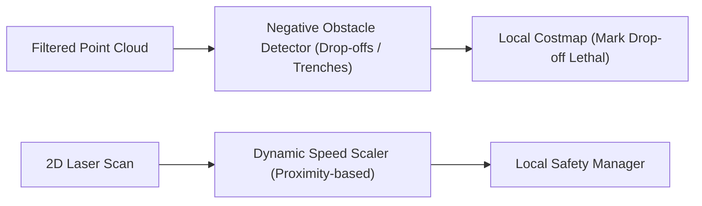

# Submodule 1.4.4: Obstacle Avoidance

## 1. Purpose
Provides active real-time obstacle detection, dynamic avoidance, and negative obstacle (pit/drop-off) edge prevention.

## 2. Responsibility
Identify dynamic obstacles (e.g., peer robots, collapsing rubble) and negative obstacles (e.g., drainage ditches, open shafts), updating local avoidance policies.

## 3. Scope
### In-Scope
Real-time laser obstacle tracking, 3D point cloud ground drop-off detection, dynamic safety bubble adjustment, and immediate velocity dampening.

### Out-of-Scope
Global replanning (handled by Nav2 Planner Server).

## 4. System Architecture

## 5. Internal Submodules
- **Negative Obstacle Detector**: Evaluates missing ground returns ahead of the robot to detect sudden drops > 0.15 m.
- **Dynamic Speed Scaler**: Scales maximum allowable velocity inversely with lateral rock wall proximity.

## 6. Functional Requirements
- **REQ-1.4-007**: Negative obstacles (drop-offs > 0.15m) shall be detected at a minimum lookahead distance of 1.5 meters.
- **REQ-1.4-008**: Velocity scaling shall reduce speed to <= 0.3 m/s when corridor width narrows below 2.0 meters.

## 7. Technical Approach
Implement a specialized point cloud analyzer that projects ground rays forward and checks for range discontinuities indicating pits or steep steps. Feed lethal cells directly into the local costmap.

## 8. Open-Source Resources
### nav2_costmap_2d::ObstacleLayer
- **What it provides**: Standard 2D raycasting obstacle insertion.
- **Why it is relevant**: Integrates positive obstacle returns.
- **What we can reuse**: Standard costmap layer.
- **What we must develop ourselves**: Negative obstacle cliff detection filter.

## 9. Prerequisites
Submodule 1.3.2 LiDAR Processing, Submodule 1.4.1 Map Management.

## 10. Dependencies
- **Upstream Dependencies**: Submodule 1.3.2 LiDAR Processing.
- **Downstream Dependencies**: Submodule 1.4.3 Local Planning, Submodule 1.5.5 Local Safety Manager.
- **Interfaces with Other Modules**: Updates local costmap layers.

## 11. Development Phases
### Phase 1: Cliff Detection Algorithm
- **Objective**: Implement ground discontinuity filter.
- **Activities**: Write C++ node detecting missing ground returns, test in Gazebo trench.
- **Required resources**: C++, PCL.
- **Input**: /lidar/points.
- **Output**: Cliff point cloud.
- **Dependencies**: None.
- **Validation**: Approach 0.3m pit; verify robot stops before edge.
- **Completion criteria**: Zero cliff falls during 20 approach trials.

## 12. Interfaces
### Topics
- `/robot_a/perception/dropoffs`: sensor_msgs/PointCloud2 detected pit edge points.

## 13. Testing Strategy
Drive robot at full speed toward a simulated drainage trench; verify vehicle stops with >= 0.3m buffer margin.

## 14. Known Challenges
- **Downward Slope vs Cliff Distinction**: Distinguishing between a traversable 15% downward ramp and a lethal vertical drop-off requires accurate pitch-compensated ground raycasting.

## 15. Implementation Status
`PLANNED`

## 16. References
- **Underground Mine Navigation & Cliff Detection**: NIOSH Mining Automation Reports
