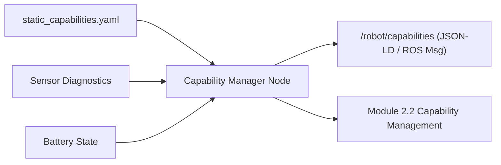

# Submodule 1.5.2: Capability Description

## 1. Purpose
Defines the declarative capability model that exposes each robot's mobility limits, sensor modalities, compute capacity, and battery budgets to Layer 2.

## 2. Responsibility
Serialize and publish machine-readable capability manifests (JSON/YAML) declaring sensor payloads, maximum velocities, obstacle climbing clearance, and operational status.

## 3. Scope
### In-Scope
Declarative capability schema parsing, dynamic capability updates (e.g. sensor degradation), and capability query service.

### Out-of-Scope
Algorithmic task-to-capability matching (handled by Layer 2).

## 4. System Architecture

## 5. Internal Submodules
- **Static Capability Parser**: Loads fixed physical parameters: track type, maximum velocity, installed sensor models.
- **Dynamic Capability Evaluator**: Updates available capabilities if a sensor fails or battery reserve falls below reserve threshold.

## 6. Functional Requirements
- **REQ-1.5-003**: Capability manifest shall declare all installed sensor modalities and operational payload actions.
- **REQ-1.5-004**: Dynamic capability changes (e.g., sensor failure) shall be broadcast within 1.0 second of occurrence.

## 7. Technical Approach
Define JSON schema for robot capabilities conforming to schema defined in `docs/06_interfaces_and_protocols/CAPABILITY_SCHEMA.md`. Implement ROS 2 node publishing capabilities at 1 Hz and on status mutation.

## 8. Open-Source Resources
### nlohmann/json
- **What it provides**: JSON for Modern C++.
- **Why it is relevant**: Fast, safe serialization of capability documents.
- **What we can reuse**: C++ JSON header-only library.
- **What we must develop ourselves**: Schema validation wrapper.

## 9. Prerequisites
Submodule 1.5.1 Identity, JSON schema.

## 10. Dependencies
- **Upstream Dependencies**: Submodule 1.5.1 Robot Identity.
- **Downstream Dependencies**: Module 2.2 Capability Management.
- **Interfaces with Other Modules**: Publishes `/robot/capabilities` and responds to capability query services.

## 11. Development Phases
### Phase 1: Capability Node Development
- **Objective**: Implement capability manager node.
- **Activities**: Parse YAML, validate against JSON schema, publish on ROS 2 topic.
- **Required resources**: C++, nlohmann/json.
- **Input**: capabilities.yaml.
- **Output**: Capability message.
- **Dependencies**: Submodule 1.5.1.
- **Validation**: Inspect published JSON against schema validator.
- **Completion criteria**: 100% schema compliance.

## 12. Interfaces
### Topics
- `/robot_a/capabilities`: std_msgs/String JSON string declaring active capabilities.

## 13. Testing Strategy
Simulate failure of thermal camera on Robot B; verify published capability JSON immediately revokes `THERMAL_INSPECTION` flag.

## 14. Known Challenges
- **Schema Version Evolution**: Adding new sensor types in future milestones must maintain backward compatibility with older autonomy decoders.

## 15. Implementation Status
`PLANNED`

## 16. References
- [JSON Schema Specification](https://json-schema.org)
