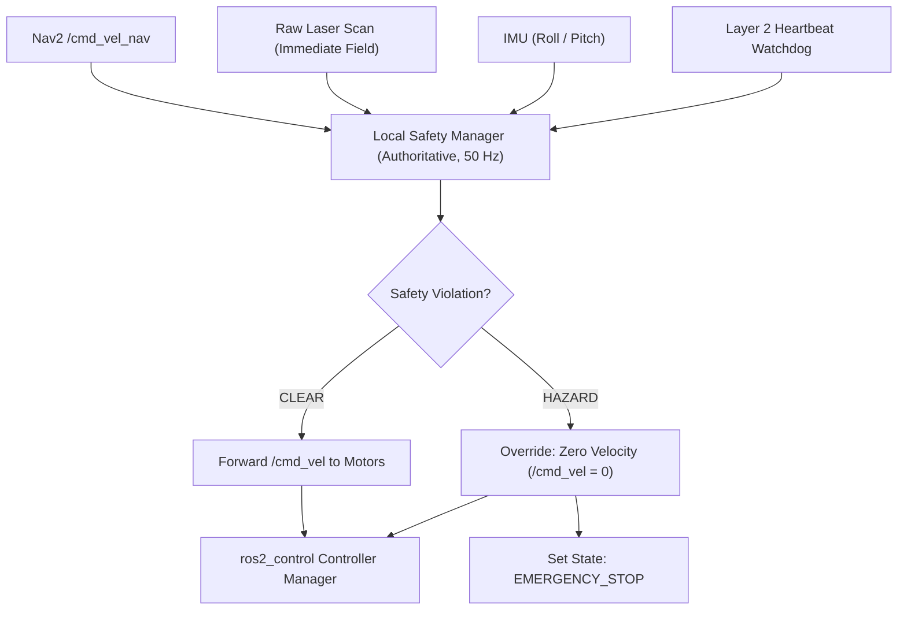

# Submodule 1.5.5: Local Safety Manager

## 1. Purpose
Enforces authoritative, un-preemptible local safety reflexes, establishing physical collision prevention, tip-over protection, and emergency stopping as core architectural safety objectives evaluated independently of upper layers.

## 2. Responsibility
Continuously monitor raw proximity sensors, IMU tilt angles, and motor drive health; intercept and override all velocity commands if safety bounds are violated.

## 3. Scope
### In-Scope
Subsumption safety override, emergency stop watchdog, roll/pitch limit monitor (max 25 deg), obstacle proximity thresholding (< 0.25 m), and heartbeat watchdog.

### Out-of-Scope
Global mission replanning.

## 4. System Architecture

## 5. Internal Submodules
- **Proximity Safety Reflex**: Evaluates raw LiDAR/sonar beams in immediate 0.3m vehicle safety envelope; halts motors if obstacle enters envelope.
- **Attitude & Rollover Monitor**: Monitors IMU roll and pitch; triggers immediate stop if platform tilt exceeds 25 degrees on rough mine ramps.
- **Heartbeat Watchdog**: Brings robot to controlled halt if Layer 2 autonomy fails to refresh its heartbeat within 1.0 second.

## 6. Functional Requirements
- **REQ-1.5-009**: The local safety manager shall execute deterministically at 50 Hz with reaction latency `[PROPOSED TARGET: < 50 ms]`.
- **REQ-1.5-010**: No software command from Layer 2, Layer 3, or network teleoperation can override an active safety stop reflex (Local Safety Autarchy).

## 7. Technical Approach
Implement a hard-real-time C++ node acting as the final gatekeeper before `ros2_control`. The node subscribes to `/cmd_vel_nav`, applies subsumption logic, and publishes to `/cmd_vel` only when all safety criteria evaluate to TRUE.

## 8. Open-Source Resources
### Subsumption Architecture Principles (Brooks)
- **What it provides**: Behavioral robotics safety arbitration.
- **Why it is relevant**: Architectural model guaranteeing low-level safety over high-level tasks.
- **What we can reuse**: Priority arbitration design pattern.
- **What we must develop ourselves**: C++ ROS 2 safety gatekeeper node.

## 9. Prerequisites
Submodule 1.2.4 Sensor Models, Submodule 1.2.5 Controllers.

## 10. Dependencies
- **Upstream Dependencies**: Submodule 1.2.4 Sensor Models.
- **Downstream Dependencies**: Submodule 1.2.5 Robot Controllers.
- **Interfaces with Other Modules**: Intercepts `/cmd_vel_nav` and outputs `/cmd_vel`.

## 11. Development Phases
### Phase 1: Safety Node Implementation
- **Objective**: Implement standalone safety reflex node.
- **Activities**: Code safety checks, benchmark execution latency, verify priority override.
- **Required resources**: C++, ROS 2.
- **Input**: Sensor streams, cmd_vel.
- **Output**: /cmd_vel.
- **Dependencies**: None.
- **Validation**: Publish 1.0 m/s command while triggering obstacle; verify output switches to 0.0 m/s within 50 ms.
- **Completion criteria**: Zero velocity output during active safety violation.

## 12. Interfaces
### Topics
- `/robot_a/safety/status`: Custom SafetyStatus message reporting proximity and tilt margins.
- `/robot_a/safety/override_active`: std_msgs/Bool flag indicating safety reflex is overriding commands.

## 13. Testing Strategy
Inject simulated rock obstacle at 0.15m while commanding full forward velocity; verify motors stop within 50 ms and vehicle stops before collision.

## 14. Known Challenges
- **False Positive Reflexes on Dust**: Dense dust clouds could trigger emergency stops; requires multi-beam consensus before asserting emergency braking.

## 15. Implementation Status
`PLANNED`

## 16. References
- **Brooks, A Robust Layered Control System For A Mobile Robot**: IEEE Journal of Robotics and Automation, 1986
