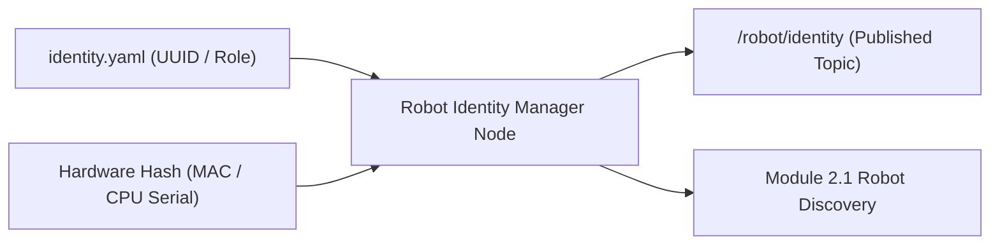

# Submodule 1.5.1: Robot Identity

## 1. Purpose
Provides persistent, unique identification, cryptographic credential management, and archetype categorization for each physical or simulated robot platform.

## 2. Responsibility
Generate and persist robot UUIDs, hardware archetype identifiers (`EXPLORATION_SCOUT` vs `INSPECTION_SPECIALIST`), and public authentication keys.

## 3. Scope
### In-Scope
UUIDv4 generation and storage, platform archetype tagging, MAC/hardware address binding, and local certificate generation.

### Out-of-Scope
Enterprise-wide PKI certificate authority infrastructure.

## 4. System Architecture

## 5. Internal Submodules
- **Identity Persistence Engine**: Stores immutable agent UUID in protected storage (`/etc/robot_id` or ROS 2 config).
- **Archetype Role Classifier**: Declares platform classification: `ROBOT_A_EXPLORER` or `ROBOT_B_INSPECTOR`.

## 6. Functional Requirements
- **REQ-1.5-001**: Each robot shall possess an immutable UUIDv4 identifier that persists across reboots.
- **REQ-1.5-002**: Identity manager shall broadcast identity beacon within 500 ms of system startup.

## 7. Technical Approach
Implement a lightweight C++ ROS 2 node that loads an identity configuration file. If no UUID exists, generate one via `uuid_generate_random()` and persist to local storage.

## 8. Open-Source Resources
### libuuid
- **What it provides**: Standard UUID generation library for Linux.
- **Why it is relevant**: Standard compliant UUIDv4 generation.
- **What we can reuse**: libuuid functions.
- **What we must develop ourselves**: ROS 2 lifecycle wrapper.

## 9. Prerequisites
Linux OS.

## 10. Dependencies
- **Upstream Dependencies**: None.
- **Downstream Dependencies**: Module 2.1 Robot Discovery, Submodule 1.5.2 Capability Description.
- **Interfaces with Other Modules**: Publishes `/robot_id` topic.

## 11. Development Phases
### Phase 1: Identity Node Implementation
- **Objective**: Create identity publisher node.
- **Activities**: Write C++ node publishing UUID, archetype string, and hostname.
- **Required resources**: C++, ROS 2.
- **Input**: identity.yaml.
- **Output**: Identity topic.
- **Dependencies**: None.
- **Validation**: Echo `/robot_a/identity`; verify UUID format.
- **Completion criteria**: Matches standard 36-character UUIDv4 format.

## 12. Interfaces
### Topics
- `/robot_a/identity`: Custom message containing UUID, archetype, and boot timestamp.

## 13. Testing Strategy
Verify two spawned robots always possess distinct UUIDs and correct archetypes.

## 14. Known Challenges
- **Simulation Instance Collision**: Launching multiple robot simulation nodes from identical launch scripts can accidentally duplicate default UUIDs; solve by namespacing launch parameters.

## 15. Implementation Status
`PLANNED`

## 16. References
- **RFC 4122: A Universally Unique IDentifier (UUID) URN Namespace**: IETF
