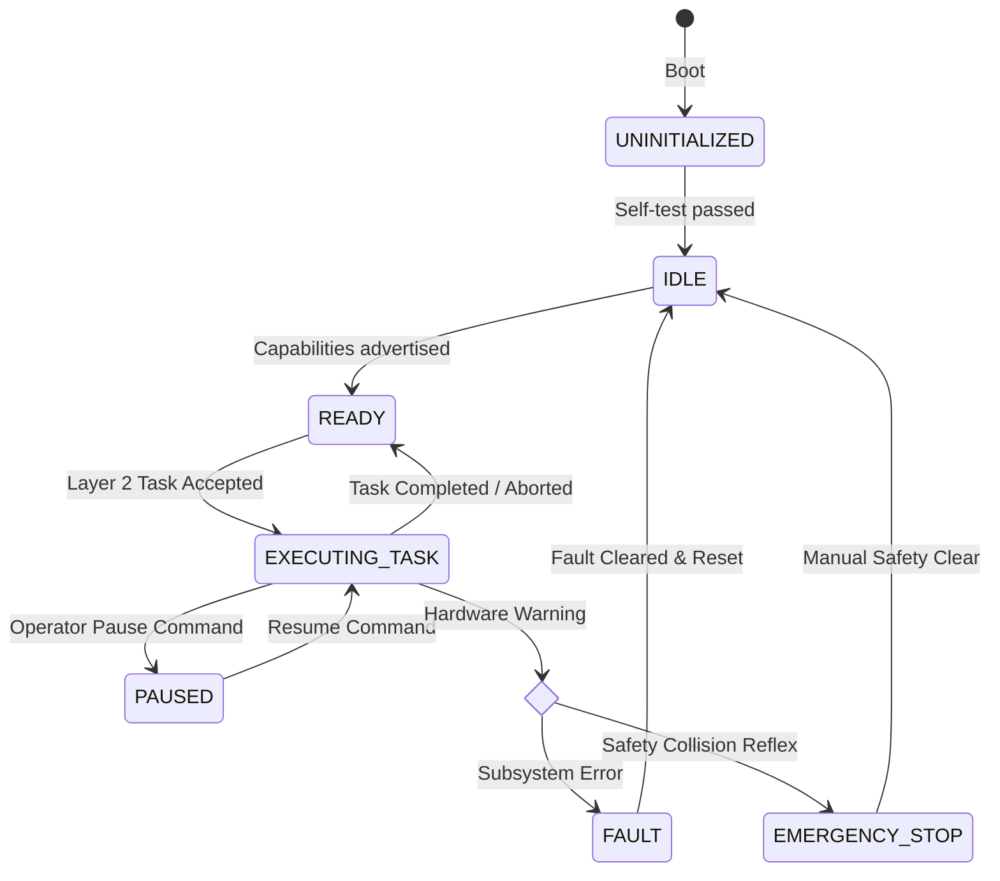

# Submodule 1.5.3: Robot State Manager

## 1. Purpose
Maintains the primary operational lifecycle Finite State Machine (FSM) for the local robot agent.

## 2. Responsibility
Govern transitions between operational states: `UNINITIALIZED`, `IDLE`, `READY`, `EXECUTING_TASK`, `PAUSED`, `FAULT`, and `EMERGENCY_STOP`.

## 3. Scope
### In-Scope
Finite state machine transitions, state change event broadcasting, transition guard conditions, and heartbeat telemetry embedding.

### Out-of-Scope
Distributed multi-robot state synchronization (handled by Layer 2 CRDTs).

## 4. System Architecture

## 5. Internal Submodules
- **Lifecycle FSM Engine**: Deterministic state transition manager ensuring invalid state transitions are rejected.
- **State Event Broadcaster**: Publishes state change events with transition reason and timestamp.

## 6. Functional Requirements
- **REQ-1.5-005**: The state manager shall reject task execution commands if the robot is not in the `READY` state.
- **REQ-1.5-006**: Transition into `EMERGENCY_STOP` shall execute within `[PROPOSED TARGET: < 10 ms]` of safety trigger.

## 7. Technical Approach
Implement state machine using modern C++ state pattern or ROS 2 LifecycleNode conventions. Expose state as an enumerated ROS 2 message.

## 8. Open-Source Resources
### rclcpp_lifecycle
- **What it provides**: Managed lifecycle nodes for ROS 2.
- **Why it is relevant**: Provides standardized state management infrastructure.
- **What we can reuse**: LifecycleNode state transitions.
- **What we must develop ourselves**: Mine-specific state extensions (EMERGENCY_STOP, PAUSED).

## 9. Prerequisites
ROS 2 Humble.

## 10. Dependencies
- **Upstream Dependencies**: Submodule 1.5.1 Robot Identity.
- **Downstream Dependencies**: Submodule 1.5.4 Task Execution Interface, Module 1.6 Communication.
- **Interfaces with Other Modules**: Publishes `/robot/state` topic.

## 11. Development Phases
### Phase 1: FSM Implementation
- **Objective**: Implement C++ FSM node with lifecycle transitions.
- **Activities**: Code state transitions, unit test all valid and invalid transitions.
- **Required resources**: C++, GTest.
- **Input**: Transition table.
- **Output**: RobotStateManager node.
- **Dependencies**: None.
- **Validation**: Run GTest suite verifying transition guards.
- **Completion criteria**: 100% test pass rate for all FSM branches.

## 12. Interfaces
### Topics
- `/robot_a/state`: Custom RobotState message reporting current enum state and uptime.

## 13. Testing Strategy
Unit test invalid transition (e.g., `UNINITIALIZED` directly to `EXECUTING_TASK`); verify transition is blocked with appropriate error code.

## 14. Known Challenges
- **Deadlock in Intermediate States**: Unhandled exceptions during task execution must guarantee transition to `FAULT` rather than freezing in `EXECUTING_TASK`.

## 15. Implementation Status
`PLANNED`

## 16. References
- [ROS 2 Managed Nodes / Lifecycle](https://design.ros2.org/articles/node_lifecycle.html)
