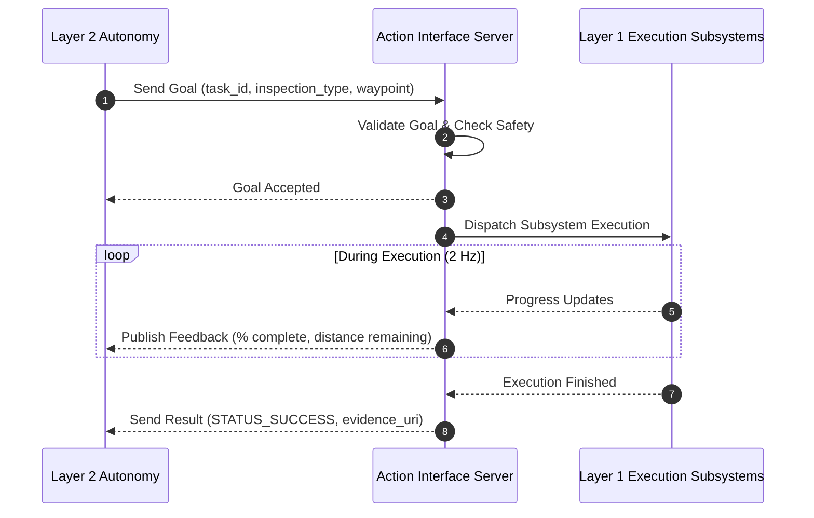

# Submodule 1.6.4: Action Interface

## 1. Purpose
Defines and exposes formal ROS 2 Action interfaces for long-running, feedback-rich, preemptible robotic operations.

## 2. Responsibility
Manage the lifecycle of actions: `ExecuteInspectionTask.action`, `ExploreFrontier.action`, and `RendezvousWithPeer.action`.

## 3. Scope
### In-Scope
Action IDL definitions, action server state handling, periodic feedback loops, result encapsulation, and cancel callbacks.

### Out-of-Scope
Low-level path tracking algorithms.

## 4. System Architecture

## 5. Internal Submodules
- **Goal Acceptance Guard**: Validates goal parameters and robot operational readiness before accepting action.
- **Feedback Aggregator**: Computes standardized percent-complete and remaining time estimates.

## 6. Functional Requirements
- **REQ-1.6-007**: All long-running operations (> 1.0 s duration) shall be implemented as ROS 2 Actions, not Services.
- **REQ-1.6-008**: Action feedback shall publish at a steady rate of 2 Hz during active execution.

## 7. Technical Approach
Define action interfaces in `interfaces/action/` package. Implement C++ action servers utilizing `rclcpp_action::create_server`.

## 8. Open-Source Resources
### rclcpp_action
- **What it provides**: Core ROS 2 Action server framework.
- **Why it is relevant**: Standard mechanism for long-duration task tracking.
- **What we can reuse**: Action server base classes.
- **What we must develop ourselves**: Inspection and frontier exploration action servers.

## 9. Prerequisites
`interfaces` package, Submodule 1.5.4 Task Execution Interface.

## 10. Dependencies
- **Upstream Dependencies**: Submodule 1.5.4 Task Execution Interface.
- **Downstream Dependencies**: Module 2.8 Distributed Runtime Interface.
- **Interfaces with Other Modules**: ROS 2 Action definitions.

## 11. Development Phases
### Phase 1: Action Interface Definitions
- **Objective**: Define ROS 2 Action IDL files and generate types.
- **Activities**: Write ExecuteInspectionTask.action, build interface package.
- **Required resources**: rosidl, CMake.
- **Input**: Action specifications.
- **Output**: Compiled C++/Python action headers.
- **Dependencies**: None.
- **Validation**: Verify generation with `ros2 interface show`.
- **Completion criteria**: All actions compile cleanly.

## 12. Interfaces
### Actions
- `/robot_b/execute_inspection_task`: Executes waypoint navigation and thermal capture, returning evidence metadata.

## 13. Testing Strategy
Execute complete action lifecycle test using CLI action client; test goal submission, feedback reception, and clean result return.

## 14. Known Challenges
- **Action Server Thread Safety**: Handling concurrent cancel requests while reading sensor feedback requires explicit reentrant mutex locking.

## 15. Implementation Status
`PLANNED`

## 16. References
- [ROS 2 Action Design Document](https://design.ros2.org/articles/actions.html)
