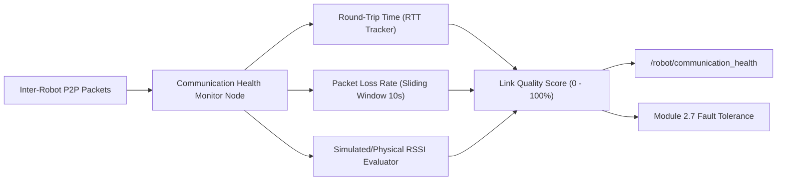

# Submodule 1.6.5: Communication Health

## 1. Purpose
Monitors local network link quality, wireless mesh round-trip time (RTT), packet drop rates, and interface throughput in real time.

## 2. Responsibility
Compute connection health metrics per active peer link, estimate channel bandwidth, and warn autonomy layers when link quality deteriorates.

## 3. Scope
### In-Scope
Ping-RTT estimation, moving average packet loss tracking, RSSI signal strength monitoring, and link degradation event triggering.

### Out-of-Scope
Physical radio frequency amplification.

## 4. System Architecture

## 5. Internal Submodules
- **Sliding Window Loss Estimator**: Computes packet drop percentage over rolling 10-second sequence intervals.
- **Link Quality Score Generator**: Computes composite metric: $Q_{link} = w_1 (1 - P_{loss}) + w_2 (1 - RTT/RTT_{max}) + w_3 (RSSI/RSSI_{max})$.

## 6. Functional Requirements
- **REQ-1.6-009**: Communication health monitor shall update link metrics at >= 1 Hz.
- **REQ-1.6-010**: A warning event shall be published when link packet loss exceeds 50% or RTT exceeds 300 ms.

## 7. Technical Approach
Deploy a lightweight C++ monitoring node that tracks sequence numbers in peer heartbeat gossip and calculates round-trip delays. Publish diagnostic status conforming to `diagnostic_msgs/DiagnosticStatus`.

## 8. Open-Source Resources
### diagnostic_updater
- **What it provides**: ROS 2 diagnostics update framework.
- **Why it is relevant**: Standardized diagnostic reporting for hardware and communication links.
- **What we can reuse**: DiagnosticUpdater class.
- **What we must develop ourselves**: Composite subterranean link quality scoring function.

## 9. Prerequisites
Module 1.6 ROS 2 Interface.

## 10. Dependencies
- **Upstream Dependencies**: Module 1.6.1 ROS 2 Interface.
- **Downstream Dependencies**: Module 2.1 Robot Discovery, Module 2.7 Fault Tolerance.
- **Interfaces with Other Modules**: Publishes `/robot_a/communication_health`.

## 11. Development Phases
### Phase 1: Health Monitor Implementation
- **Objective**: Implement link quality estimation node.
- **Activities**: Code sequence tracking, sliding window loss calculation, and diagnostic publishing.
- **Required resources**: C++, ROS 2.
- **Input**: Heartbeat packets.
- **Output**: CommunicationHealth topic.
- **Dependencies**: None.
- **Validation**: Inject simulated packet drop; verify loss metric tracks drop accurately.
- **Completion criteria**: Reported loss matches injected drop within +/- 3%.

## 12. Interfaces
### Topics
- `/robot_a/communication_health`: Custom CommunicationHealth message reporting RTT, packet loss (%), RSSI, and quality score.

## 13. Testing Strategy
Inject 40% synthetic packet drop using Submodule 1.1.5; verify health monitor reports packet loss >= 38% within 5 seconds.

## 14. Known Challenges
- **Asymmetric Subterranean RF Links**: Underground tunnels often exhibit asymmetric propagation where Robot A hears Robot B, but Robot B cannot hear Robot A; requires bidirectional handshake tracking.

## 15. Implementation Status
`PLANNED`

## 16. References
- **RFC 9000: QUIC Loss Detection and Congestion Control**: IETF
