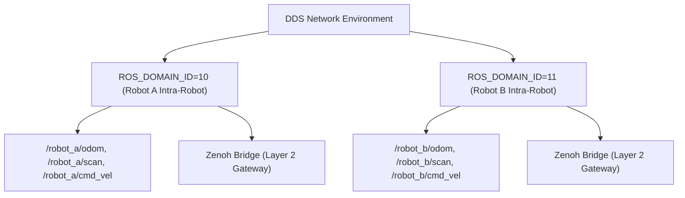

# Submodule 1.6.1: ROS 2 Interface

## 1. Purpose
Defines ROS 2 namespace isolation, topic hierarchy, ROS Domain IDs, and Quality-of-Service (QoS) policies across heterogeneous robots.

## 2. Responsibility
Enforce strict naming conventions (`/<robot_name>/...`), prevent cross-talk between intra-robot DDS domains, and configure DDS transport profiles.

## 3. Scope
### In-Scope
Namespace conventions, ROS_DOMAIN_ID allocation, QoS profile definitions (Reliable vs Best Effort, Transient Local), and CycloneDDS/FastDDS XML configurations.

### Out-of-Scope
Inter-robot wireless mesh routing (handled by Layer 2).

## 4. System Architecture

## 5. Internal Submodules
- **Namespace & Remapping Manager**: Ensures all nodes launch inside designated robot namespace without hardcoded absolute topic names.
- **QoS Profile Library**: Provides standard QoS structs: SensorData (Best Effort, Volatile), StateData (Reliable, Transient Local).

## 6. Functional Requirements
- **REQ-1.6-001**: All Layer 1 topics, services, and actions shall be strictly scoped within the robot's assigned namespace.
- **REQ-1.6-002**: Sensor streams shall use `sensor_data` QoS profile to prevent network buffering lag under bandwidth drops.

## 7. Technical Approach
Establish launch file templates with dynamic `<group>` namespacing and push_ros_namespace. Define shared C++ QoS header library.

## 8. Open-Source Resources
### rclcpp::QoS
- **What it provides**: Standard ROS 2 Quality of Service library.
- **Why it is relevant**: Fine-grained control over reliability, durability, and history.
- **What we can reuse**: Built-in QoS profiles.
- **What we must develop ourselves**: Mine-tailored QoS definitions.

## 9. Prerequisites
ROS 2 Humble.

## 10. Dependencies
- **Upstream Dependencies**: None.
- **Downstream Dependencies**: All Layer 1 and Layer 2 nodes.
- **Interfaces with Other Modules**: Topic naming standards.

## 11. Development Phases
### Phase 1: QoS & Namespace Architecture
- **Objective**: Define standard namespaces and QoS headers.
- **Activities**: Create qos_profiles.hpp, test with multi-robot launch.
- **Required resources**: C++, ROS 2.
- **Input**: Topic hierarchy spec.
- **Output**: Standardized headers.
- **Dependencies**: None.
- **Validation**: Launch Robot A and B together; verify zero topic collisions.
- **Completion criteria**: All topics namespaced under `/robot_a` or `/robot_b`.

## 12. Interfaces
### Headers
- `interfaces/qos_profiles.hpp`: C++ header defining standard platform QoS profiles.

## 13. Testing Strategy
Launch 2 robots simultaneously; verify topics list cleanly divides into `/robot_a/*` and `/robot_b/*` without cross-contamination.

## 14. Known Challenges
- **DDS Multicast Saturation**: Running multiple robots on the same DDS domain causes high discovery multicast traffic; solved by domain ID partitioning.

## 15. Implementation Status
`PLANNED`

## 16. References
- [ROS 2 About Quality of Service Settings](https://docs.ros.org/en/humble/Concepts/Intermediate/About-Quality-of-Service-Settings.html)
