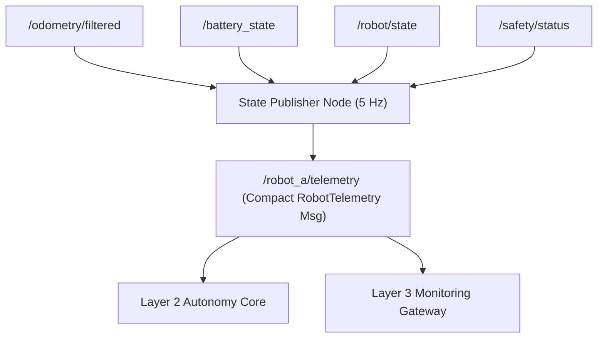

# Submodule 1.6.2: State Publisher

## 1. Purpose
Aggregates and broadcasts high-frequency robot telemetry, kinematic states, operational status, and battery health for consumption by Layer 2 and Layer 3.

## 2. Responsibility
Collate pose from EKF, velocities, battery percentage, active task ID, and FSM lifecycle state into a single cohesive telemetry packet.

## 3. Scope
### In-Scope
Telemetry aggregation node, compact serialization, configurable publish rate (1-10 Hz), and diagnostic state inclusion.

### Out-of-Scope
Long-term historical telemetry database storage (handled by Layer 3).

## 4. System Architecture

## 5. Internal Submodules
- **Telemetry Aggregator**: Subscribes to internal odometry, battery, and safety topics, compiling a consolidated struct.
- **Bandwidth Throttler**: Adapts publishing rate dynamically based on network link quality (1 Hz in low-bandwidth, 5 Hz in good RF).

## 6. Functional Requirements
- **REQ-1.6-003**: Telemetry message payload shall not exceed 512 bytes per packet to conserve wireless mesh bandwidth.
- **REQ-1.6-004**: Publishing rate shall be dynamically configurable between 0.5 Hz and 10 Hz.

## 7. Technical Approach
Implement a C++ node publishing a custom compact message `RobotTelemetry.msg`. Use dynamic parameter callbacks to allow runtime rate adjustment.

## 8. Open-Source Resources
### rclcpp::ParameterEventHandler
- **What it provides**: Dynamic parameter management.
- **Why it is relevant**: Enables runtime throttling of telemetry rates.
- **What we can reuse**: Standard ROS 2 API.
- **What we must develop ourselves**: Adaptive rate controller.

## 9. Prerequisites
Submodule 1.5.3 State Manager, Submodule 1.3.5 Localization.

## 10. Dependencies
- **Upstream Dependencies**: Submodule 1.3.5 Localization, Submodule 1.5.3 State Manager.
- **Downstream Dependencies**: Module 2.1 Robot Discovery, Module 3.4 Monitoring.
- **Interfaces with Other Modules**: Publishes `/robot_a/telemetry`.

## 11. Development Phases
### Phase 1: Telemetry Node Implementation
- **Objective**: Implement state aggregator node.
- **Activities**: Write node, integrate message callbacks, verify output rate.
- **Required resources**: C++, ROS 2.
- **Input**: Odometry, battery, FSM states.
- **Output**: RobotTelemetry topic.
- **Dependencies**: None.
- **Validation**: Echo `/robot_a/telemetry`; verify all fields populated.
- **Completion criteria**: Payload size < 512 bytes.

## 12. Interfaces
### Topics
- `/robot_a/telemetry`: Custom RobotTelemetry message reporting pose, battery, state, and active task.

## 13. Testing Strategy
Run Wireshark/tcpdump on telemetry topic; verify bandwidth consumption remains strictly below 3 kbps per robot.

## 14. Known Challenges
- **Telemetry Serialization Overhead**: Standard JSON serialization is too verbose for subterranean radio; resolved using compact binary ROS 2 IDL messages.

## 15. Implementation Status
`PLANNED`

## 16. References
- [ROS 2 Custom Messages Tutorial](https://docs.ros.org/en/humble/Tutorials/Beginner-Client-Libraries/Custom-ROS2-Interfaces.html)
