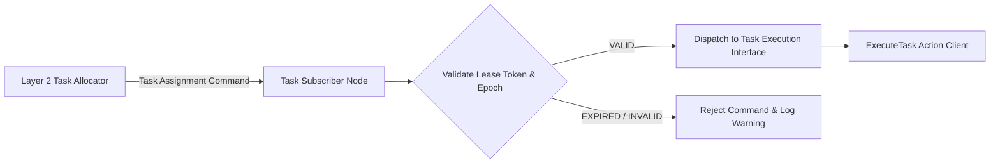

# Submodule 1.6.3: Task Subscriber

## 1. Purpose
Listens for high-level mission task assignments from Layer 2, validates task lease cryptographic tokens, and initiates execution pipelines.

## 2. Responsibility
Subscribe to task dispatch topics, verify lease token authenticity and expiration deadlines, prevent stale task execution, and dispatch commands to the action interface.

## 3. Scope
### In-Scope
Task command ingestion, lease verification, preemption triggers, and emergency abort listeners.

### Out-of-Scope
Task allocation bidding algorithms (handled by Layer 2).

## 4. System Architecture

## 5. Internal Submodules
- **Lease Token Validator**: Checks lease expiration timestamp against local clock to reject expired or revoked tasks.
- **Emergency Abort Listener**: High-priority callback that instantly cancels active tasks upon receipt of global abort message.

## 6. Functional Requirements
- **REQ-1.6-005**: Task subscriber shall reject any task whose lease expiration timestamp is < current epoch time.
- **REQ-1.6-006**: Emergency abort commands shall be processed within `[PROPOSED TARGET: < 10 ms]`.

## 7. Technical Approach
Deploy a dedicated ROS 2 node using `rclcpp::QoS(rclcpp::KeepLast(1)).reliable()` for mission-critical command ingestion. Maintain lease state machine.

## 8. Open-Source Resources
### rclcpp::Subscription
- **What it provides**: Reliable ROS 2 topic subscriber.
- **Why it is relevant**: Ingesting task assignments without message loss.
- **What we can reuse**: Standard ROS 2 subscription.
- **What we must develop ourselves**: Lease token validation logic.

## 9. Prerequisites
Submodule 1.5.4 Task Execution Interface.

## 10. Dependencies
- **Upstream Dependencies**: Module 2.4 Distributed Task Allocation.
- **Downstream Dependencies**: Submodule 1.5.4 Task Execution Interface.
- **Interfaces with Other Modules**: Subscribes `/robot_a/task_command`.

## 11. Development Phases
### Phase 1: Task Subscriber Node
- **Objective**: Implement task listener and lease validator.
- **Activities**: Code subscriber, test valid and expired lease scenarios.
- **Required resources**: C++, ROS 2.
- **Input**: TaskAssignment.msg.
- **Output**: Validated task dispatch.
- **Dependencies**: None.
- **Validation**: Send expired lease; verify rejection log.
- **Completion criteria**: Zero expired tasks dispatched to action interface.

## 12. Interfaces
### Topics
- `/robot_a/task_command`: Custom TaskAssignment message containing task_id, params, and lease_token.
- `/robot_a/emergency_abort`: std_msgs/Empty instant abort command.

## 13. Testing Strategy
Send valid task assignment followed immediately by an emergency abort message; verify execution stops immediately.

## 14. Known Challenges
- **Clock Skew Across Partitioned Robots**: Clock drift between robots can cause valid leases to appear expired; requires relative lease duration offsets rather than absolute wall-clock checks.

## 15. Implementation Status
`PLANNED`

## 16. References
- **Lease-Based Distributed Locks**: Gray & Cheriton, SOSP 1989
