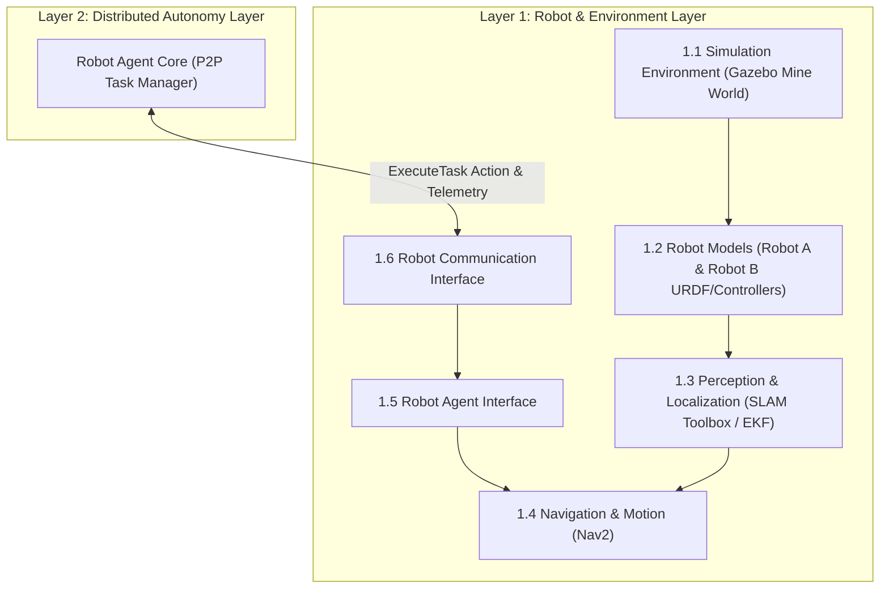

# Layer 1: Robot and Environment Layer

## 1. Overview
The **Robot and Environment Layer** serves as the foundational substrate of the Decentralized Multi-Robot Mine Inspection Platform. It manages all physics interactions, simulation assets, low-level actuator control, sensor processing, Simultaneous Localization and Mapping (SLAM), autonomous local path planning, and autonomous safety reflexes.

---

## 2. Architectural Position
Layer 1 operates on each physical or simulated robot platform independently. It interfaces with the upper **Layer 2 (Distributed Autonomy Layer)** exclusively through standardized ROS 2 topics, services, and action servers exposed by the Robot Agent Gateway.

---

## 3. Module Index

| Module | Description | Directory Link |
|---|---|---|
| **1.1 Simulation Environment** | Mine tunnel models, terrain mesh, obstacles, dust/fog, and RF loss simulation | [1.1 Simulation Environment](1.1_simulation_environment/README.md) |
| **1.2 Robot Models** | Kinematic, dynamic, sensor, and controller specifications for Robot A and B | [1.2 Robot Models](1.2_robot_models/README.md) |
| **1.3 Perception & Localization** | Point cloud filtering, camera vision, subterranean 2D/3D SLAM, EKF fusion | [1.3 Perception & Localization](1.3_perception_localization/README.md) |
| **1.4 Navigation & Motion** | Layered costmaps, Smac global planning, MPPI local controller, recovery | [1.4 Navigation & Motion](1.4_navigation_motion/README.md) |
| **1.5 Robot Agent Interface** | Identity, declarative capability descriptors, state machine, authoritative safety | [1.5 Robot Agent Interface](1.5_robot_agent/README.md) |
| **1.6 Robot Communication** | Namespaced ROS 2 interfaces, state publishers, action servers, and link metrics | [1.6 Robot Communication](1.6_robot_communication/README.md) |
