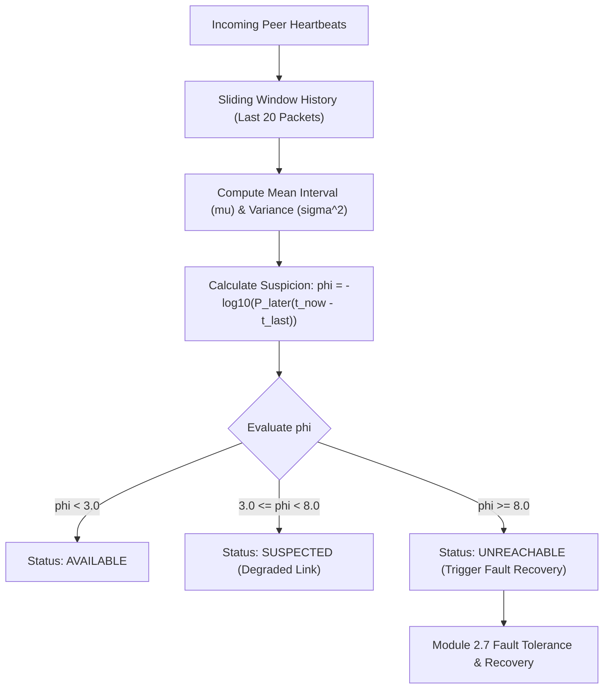

# Submodule 2.1.4: Agent Availability

## 1. Purpose
Monitors peer liveliness, calculates continuous suspicion scores using a $\phi$-accrual failure detector, and flags robot disconnection or failure.

## 2. Responsibility
Track inter-arrival times of peer heartbeats, compute adaptive suspicion threshold $\phi$, and classify peer status as `AVAILABLE`, `SUSPECTED`, or `UNREACHABLE`.

## 3. Scope
### In-Scope
$\phi$-accrual mathematical model implementation, sliding window heartbeat history, availability score calculation, and transition alerting.

### Out-of-Scope
Task reassignment execution (handled by Module 2.7).

## 4. System Architecture

## 5. Internal Submodules
- **Statistical Heartbeat Profiler**: Maintains moving mean $\mu$ and standard deviation $\sigma$ of heartbeat arrival intervals.
- **Phi Accrual Evaluator**: Calculates suspicion level $\phi$ dynamically, adjusting to varying subterranean network conditions.

## 6. Functional Requirements
- **REQ-2.1-007**: The availability module shall adapt its timeout window to network jitter without manual recalibration.
- **REQ-2.1-008**: A dead robot shall be declared `UNREACHABLE` within `[PROPOSED TARGET: < 5.0 s]` under nominal mesh conditions.

## 7. Technical Approach
Implement the classic $\phi$-accrual failure detector algorithm. Assuming a normal distribution over heartbeat arrival intervals, compute $\phi = -\log_{10}(P_{later}(t - t_{last}))$. If $\phi \ge 8.0$ (probability $10^{-8}$), transition peer to `UNREACHABLE`.

## 8. Open-Source Resources
### Phi Accrual Algorithm Papers
- **What it provides**: Proven adaptive failure detection math.
- **Why it is relevant**: Used in Cassandra, Akka, and distributed systems.
- **What we can reuse**: Mathematical equations.
- **What we must develop ourselves**: C++ implementation optimized for robotics heartbeat rates.

## 9. Prerequisites
Submodule 2.1.3 Heartbeat.

## 10. Dependencies
- **Upstream Dependencies**: Submodule 2.1.3 Heartbeat.
- **Downstream Dependencies**: Module 2.4 Task Allocation, Module 2.7 Fault Tolerance.
- **Interfaces with Other Modules**: Publishes peer availability events.

## 11. Development Phases
### Phase 1: Phi Detector Implementation
- **Objective**: Implement C++ Phi Accrual class.
- **Activities**: Write sliding window statistical accumulator, unit test with synthetic packet arrivals.
- **Required resources**: C++, GTest.
- **Input**: Arrival timestamps.
- **Output**: Availability state.
- **Dependencies**: None.
- **Validation**: Simulate sudden packet freeze; measure time until phi >= 8.0.
- **Completion criteria**: Detects freeze in 4.5s +/- 0.5s.

## 12. Interfaces
### Events
- `PeerStatusChanged(uuid, old_status, new_status, phi)`: Internal event fired on peer status change.

## 13. Testing Strategy
Feed recorded mesh jitter log with 15% random packet drops; verify detector does not trigger false positive `UNREACHABLE` alarms during transient spikes.

## 14. Known Challenges
- **Tuning Phi for Mesh Jitter**: Setting threshold too low causes false task reassignments; setting too high delays failure recovery; requires empirical calibration in simulation.

## 15. Implementation Status
`PLANNED`

## 16. References
- **Hayashibara et al., The Phi Accrual Failure Detector**: IEEE Transactions on Computers, 2004
