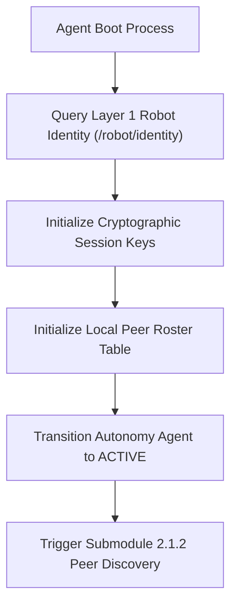

# Submodule 2.1.1: Agent Registration

## 1. Purpose
Initializes the Layer 2 autonomy agent instance on startup, binds it to the underlying Layer 1 robot platform, and registers it into the local mesh table.

## 2. Responsibility
Read platform identity and capabilities from Layer 1, instantiate internal data stores, initialize cryptographic signing keys, and prepare discovery beacons.

## 3. Scope
### In-Scope
Agent boot orchestration, Layer 1 gateway handshake, local peer table initialization, and bootstrap self-registration.

### Out-of-Scope
Network-wide peer consensus.

## 4. System Architecture

## 5. Internal Submodules
- **Bootstrap Orchestrator**: Sequences initialization checks: verifies Layer 1 gateway readiness before activating autonomy loops.
- **Local Peer Roster Table**: Thread-safe in-memory table storing known peer UUIDs, roles, IP/mesh endpoints, and last-seen timestamps.

## 6. Functional Requirements
- **REQ-2.1-001**: Agent registration shall complete within `[PROPOSED TARGET: < 1.0 s]` of Layer 1 identity availability.
- **REQ-2.1-002**: Agent shall register a valid UUIDv4 and role type (`EXPLORER` or `INSPECTOR`).

## 7. Technical Approach
Develop a C++/Python node using Eclipse Zenoh session management. Query Layer 1 via ROS 2 topic `/robot_id`, populate local Zenoh session info, and transition the agent into discovery mode.

## 8. Open-Source Resources
### Eclipse Zenoh (zenoh-c / zenoh-python)
- **What it provides**: Zero-overhead publish/subscribe/query protocol.
- **Why it is relevant**: Underlying peer-to-peer communication fabric for Layer 2.
- **What we can reuse**: Zenoh session and scouting API.
- **What we must develop ourselves**: Robotics agent registration wrapper.

## 9. Prerequisites
Submodule 1.5.1 Robot Identity, Eclipse Zenoh runtime.

## 10. Dependencies
- **Upstream Dependencies**: Submodule 1.5.1 Robot Identity.
- **Downstream Dependencies**: Submodule 2.1.2 Peer Discovery, Module 2.2 Capability Management.
- **Interfaces with Other Modules**: ROS 2 subscriber `/robot/identity`, Zenoh session handle.

## 11. Development Phases
### Phase 1: Registration Engine
- **Objective**: Implement agent bootstrap node.
- **Activities**: Code boot sequence, connect to Layer 1 identity topic, test initialization.
- **Required resources**: Zenoh, Python 3 / C++.
- **Input**: Robot identity.
- **Output**: Initialized agent handle.
- **Dependencies**: None.
- **Validation**: Verify agent enters ACTIVE state with correct UUID.
- **Completion criteria**: Agent registered in < 1.0 s.

## 12. Interfaces
### APIs
- `agent::initialize(uuid, role)`: C++/Python API initializing local agent instance.

## 13. Testing Strategy
Launch agent without Layer 1; verify agent waits gracefully; launch Layer 1; verify agent completes registration cleanly.

## 14. Known Challenges
- **Startup Race Conditions**: Layer 2 autonomy nodes starting before Layer 1 hardware nodes are ready; requires robust asynchronous retry polling.

## 15. Implementation Status
`PLANNED`

## 16. References
- [Eclipse Zenoh Documentation](https://zenoh.io/docs)
