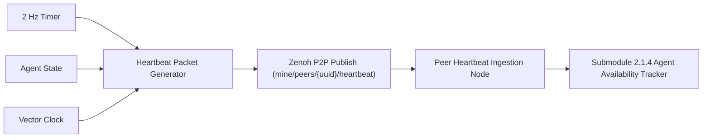

# Submodule 2.1.3: Heartbeat

## 1. Purpose
Maintains continuous mutual liveliness awareness between connected robot peers through periodic, ultra-lightweight gossip heartbeats.

## 2. Responsibility
Broadcast compact heartbeat packets containing sender UUID, sequence number, operational status, and vector clock epoch at 2 Hz.

## 3. Scope
### In-Scope
Heartbeat packet formatting, transmission scheduling, sequence tracking, and clock drift compensation.

### Out-of-Scope
Failure escalation actions (handled by Submodule 2.1.4 and Module 2.7).

## 4. System Architecture

## 5. Internal Submodules
- **Heartbeat Broadcaster**: Schedules 2 Hz heartbeats with sequence IDs and monotonic timestamp.
- **Heartbeat Ingestion Pipeline**: Processes incoming peer heartbeats, updating last-seen timestamps and causal vector clocks.

## 6. Functional Requirements
- **REQ-2.1-005**: Heartbeat transmission rate shall be 2 Hz with jitter < 50 ms.
- **REQ-2.1-006**: Heartbeat payload shall not exceed 64 bytes in binary format.

## 7. Technical Approach
Pack heartbeat fields into a 32-byte binary struct (UUID: 16 bytes, Sequence: 4 bytes, Status: 1 byte, Battery: 1 byte, Clock Epoch: 8 bytes, Padding: 2 bytes). Broadcast over Zenoh P2P topic.

## 8. Open-Source Resources
### Zenoh Pub/Sub
- **What it provides**: Low-overhead messaging.
- **Why it is relevant**: Transmits heartbeats with minimal wire overhead.
- **What we can reuse**: zenoh::put API.
- **What we must develop ourselves**: Binary heartbeat struct definition.

## 9. Prerequisites
Submodule 2.1.2 Peer Discovery.

## 10. Dependencies
- **Upstream Dependencies**: Submodule 2.1.2 Peer Discovery.
- **Downstream Dependencies**: Submodule 2.1.4 Agent Availability, Module 2.6 State Management.
- **Interfaces with Other Modules**: Zenoh key `mine/peers/<uuid>/heartbeat`.

## 11. Development Phases
### Phase 1: Heartbeat Transmission Pipeline
- **Objective**: Implement binary heartbeat publisher and receiver.
- **Activities**: Code binary packing, test round-trip transmission.
- **Required resources**: C++/Python, Zenoh.
- **Input**: Agent status.
- **Output**: Heartbeat stream.
- **Dependencies**: None.
- **Validation**: Measure wire packet size using Wireshark.
- **Completion criteria**: Packet payload <= 64 bytes.

## 12. Interfaces
### Topics
- `mine/peers/{uuid}/heartbeat`: Binary 32-byte heartbeat packet broadcast at 2 Hz.

## 13. Testing Strategy
Stream heartbeats over simulated lossy link (20% loss); verify receiver properly accounts for dropped sequence IDs.

## 14. Known Challenges
- **Jitter over Multi-Hop Mesh**: Mesh re-transmissions cause bursty packet arrival; liveliness estimators must account for variance rather than using rigid timeout thresholds.

## 15. Implementation Status
`PLANNED`

## 16. References
- **Hayashibara et al., The Phi Accrual Failure Detector**: IEEE SRDS 2004
