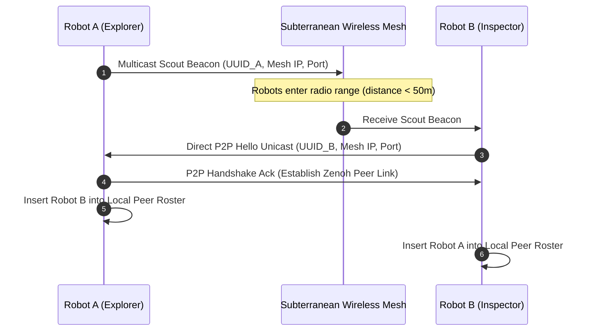

# Submodule 2.1.2: Peer Discovery

## 1. Purpose
Discovers neighboring robot agents dynamically across the subterranean wireless mesh without requiring a centralized discovery server.

## 2. Responsibility
Broadcast discovery scout beacons over Zenoh/UDP multicast, parse peer discovery responses, authenticate peer signatures, and establish direct P2P communication links.

## 3. Scope
### In-Scope
Zenoh scouting protocol, link-local UDP multicast beaconing, peer endpoint discovery, and connection handshake management.

### Out-of-Scope
High-level capability exchange (handled by Module 2.2).

## 4. System Architecture

## 5. Internal Submodules
- **Scout Beacon Generator**: Transmits periodic (1 Hz) compact discovery packets containing agent UUID and Zenoh listening locator.
- **Handshake Authenticator**: Verifies peer protocol version and prevents duplicate connection links.

## 6. Functional Requirements
- **REQ-2.1-003**: Peer discovery shall detect and establish connection with a new peer within `[PROPOSED TARGET: < 2.0 s]` of entering RF range.
- **REQ-2.1-004**: Discovery beacon overhead shall not exceed 128 bytes per beacon.

## 7. Technical Approach
Leverage Zenoh native scouting protocol (`zenoh::scout`) combined with link-local UDP multicast. Upon receiving a scout message, establish direct P2P Zenoh session peering.

## 8. Open-Source Resources
### Zenoh Scouting Protocol
- **What it provides**: Zero-configuration P2P peer discovery.
- **Why it is relevant**: Eliminates need for ROS 2 DDS discovery multicast floods over mesh.
- **What we can reuse**: Native Zenoh scout API.
- **What we must develop ourselves**: Subterranean keep-alive and retry parameters.

## 9. Prerequisites
Submodule 2.1.1 Agent Registration.

## 10. Dependencies
- **Upstream Dependencies**: Submodule 2.1.1 Agent Registration.
- **Downstream Dependencies**: Submodule 2.1.3 Heartbeat, Module 2.2 Capability Management.
- **Interfaces with Other Modules**: Zenoh key expression `mine/discovery/scout`.

## 11. Development Phases
### Phase 1: P2P Scouting Integration
- **Objective**: Implement Zenoh scout listener and beacon publisher.
- **Activities**: Configure scouting, test connection establishment between two nodes.
- **Required resources**: Zenoh SDK.
- **Input**: Agent locator.
- **Output**: Connected peer session.
- **Dependencies**: Submodule 2.1.1.
- **Validation**: Bring two simulated nodes online; verify discovery timestamp.
- **Completion criteria**: Discovery handshake completed in < 2.0 s.

## 12. Interfaces
### Zenoh Keys
- `mine/discovery/**`: Discovery multicast scout key expression.

## 13. Testing Strategy
Simulate Robot A and B starting separated; move them into communication range in Gazebo; verify peer connection event fires within 2 seconds.

## 14. Known Challenges
- **Multicast Storms over Mesh**: Excessive discovery beaconing can saturate low-bandwidth mesh radios; requires exponential backoff after initial peer contact.

## 15. Implementation Status
`PLANNED`

## 16. References
- [Zenoh Scouting Architecture](https://zenoh.io/docs/manual/scouting/)
