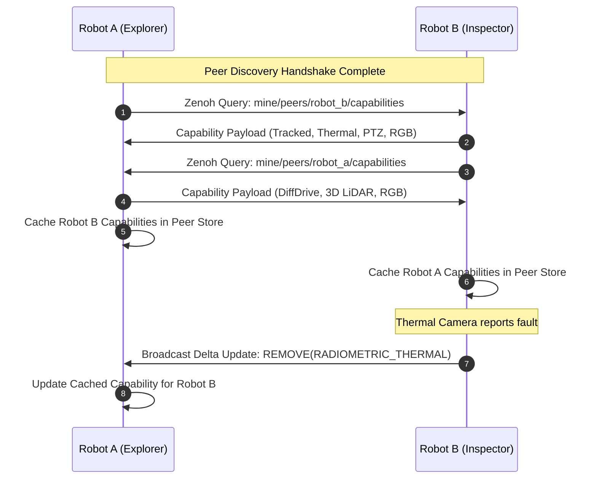

# Submodule 2.2.2: Capability Exchange

## 1. Purpose
Enables newly discovered robot peers to exchange their capability models over the P2P mesh and maintain synchronized local caches of peer abilities.

## 2. Responsibility
Publish local capability profile upon peer discovery handshake, cache peer capability profiles, and broadcast delta updates when capabilities degrade.

## 3. Scope
### In-Scope
P2P capability querying, response caching, cache expiration policies, and delta change broadcasts.

### Out-of-Scope
Physical sensor calibration.

## 4. System Architecture

## 5. Internal Submodules
- **Capability Query Client/Server**: Handles Zenoh queryable requests for capability manifests.
- **Distributed Capability Cache**: Thread-safe cache storing verified capability manifests indexed by peer UUID.

## 6. Functional Requirements
- **REQ-2.2-003**: Capability exchange between newly discovered peers shall complete within `[PROPOSED TARGET: < 1.0 s]` of initial contact.
- **REQ-2.2-004**: Capability delta updates shall propagate to all connected peers within 500 ms.

## 7. Technical Approach
Utilize Zenoh Queryables (`zenoh::Queryable`). When Robot A needs Robot B's capabilities, it performs a Zenoh `get('mine/peers/robot_b/capabilities')`. Cache result locally with time-to-live (TTL).

## 8. Open-Source Resources
### Zenoh Queryables
- **What it provides**: Distributed query/reply mechanism.
- **Why it is relevant**: Efficient on-demand state retrieval over P2P networks.
- **What we can reuse**: zenoh::queryable API.
- **What we must develop ourselves**: Capability query handler and cache.

## 9. Prerequisites
Submodule 2.1.2 Peer Discovery, Submodule 2.2.1 Capability Model.

## 10. Dependencies
- **Upstream Dependencies**: Submodule 2.1.2 Peer Discovery.
- **Downstream Dependencies**: Submodule 2.2.3 Capability Matching, Module 2.4 Task Allocation.
- **Interfaces with Other Modules**: Zenoh queryable key `mine/peers/<uuid>/capabilities`.

## 11. Development Phases
### Phase 1: Queryable Capability Store
- **Objective**: Implement Zenoh queryable capability server.
- **Activities**: Register queryable callback, implement local cache with TTL.
- **Required resources**: Zenoh SDK.
- **Input**: Capability JSON.
- **Output**: Queryable capability service.
- **Dependencies**: None.
- **Validation**: Query peer capabilities across simulated network; measure latency.
- **Completion criteria**: Exchange latency < 1.0 s.

## 12. Interfaces
### Zenoh Keys
- `mine/peers/{uuid}/capabilities`: Zenoh queryable endpoint for peer capability descriptors.

## 13. Testing Strategy
Simulate Robot B joining network; verify Robot A fetches and stores Robot B's capability manifest in local cache.

## 14. Known Challenges
- **Cache Invalidation on Partial Reconnection**: A robot whose sensor failed while out of communication range must invalidate stale cached capabilities upon rejoining the cluster.

## 15. Implementation Status
`PLANNED`

## 16. References
- [Zenoh Queryables Guide](https://zenoh.io/docs/manual/queryables/)
