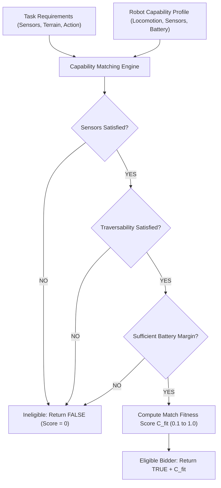

# Submodule 2.2.3: Capability Matching

## 1. Purpose
Evaluates whether a candidate robot possesses the necessary mobility, sensor payloads, and operational actions to execute a specific task.

## 2. Responsibility
Match task requirement constraints against robot capability profiles; filter eligible bidders during task auctions; return Boolean eligibility and match score.

## 3. Scope
### In-Scope
Constraint satisfaction logic, sensor requirement filtering, locomotion traversability checks, and capability match scoring ($0.0 \le C_{fit} \le 1.0$).

### Out-of-Scope
Path planning cost evaluation (handled by Module 2.4).

## 4. System Architecture

## 5. Internal Submodules
- **Boolean Constraint Evaluator**: Verifies hard requirements: e.g. task requires `RADIOMETRIC_THERMAL`; rejects robot if missing.
- **Fitness Scorer**: Computes affinity score $C_{fit}$ based on sensor resolution, payload margin, and operational suitability.

## 6. Functional Requirements
- **REQ-2.2-005**: Tasks requiring thermal inspection shall be matched exclusively to platforms possessing calibrated radiometric sensors (Robot B).
- **REQ-2.2-006**: Matching evaluation for a batch of 50 tasks against 5 robots shall execute in `[PROPOSED TARGET: < 5 ms]`.

## 7. Technical Approach
Implement a lightweight bitmask and set-intersection constraint solver in C++. Represent sensor modalities and actions as bitmasks for ultra-fast bitwise AND evaluation ($Mask_{req} \& Mask_{robot} == Mask_{req}$).

## 8. Open-Source Resources
### Fast Bitset / std::bitset
- **What it provides**: Standard C++ bit array.
- **Why it is relevant**: Ultra-fast constraint satisfaction via bitwise logic.
- **What we can reuse**: std::bitset<64>.
- **What we must develop ourselves**: Taxonomy-to-bitmask mapping engine.

## 9. Prerequisites
Submodule 2.2.1 Capability Model.

## 10. Dependencies
- **Upstream Dependencies**: Submodule 2.2.1 Capability Model.
- **Downstream Dependencies**: Module 2.4 Distributed Task Allocation.
- **Interfaces with Other Modules**: C++ API `bool evaluate_match(TaskRequirements, RobotCapability, float& score)`.

## 11. Development Phases
### Phase 1: Bitmask Matcher Engine
- **Objective**: Implement C++ bitmask constraint matcher.
- **Activities**: Code matcher, benchmark throughput with synthetic task sets.
- **Required resources**: C++, GTest.
- **Input**: Task requirements, robot profiles.
- **Output**: Match results.
- **Dependencies**: None.
- **Validation**: Evaluate 10,000 matches; check timing.
- **Completion criteria**: Average match time < 10 microseconds.

## 12. Interfaces
### APIs
- `capability_matcher::is_eligible(task, capability)`: Evaluates candidate robot eligibility for task.

## 13. Testing Strategy
Test thermal inspection task against Robot A (fails matching) and Robot B (passes with $C_{fit} = 1.0$); verify deterministic filtering.

## 14. Known Challenges
- **Soft vs Hard Constraints**: Some requirements are negotiable (e.g., preference for high-resolution camera vs acceptable standard camera); requires separating hard filters from continuous scoring.

## 15. Implementation Status
`PLANNED`

## 16. References
- **Russell & Norvig, Artificial Intelligence: A Modern Approach (Constraint Satisfaction)**: Pearson
