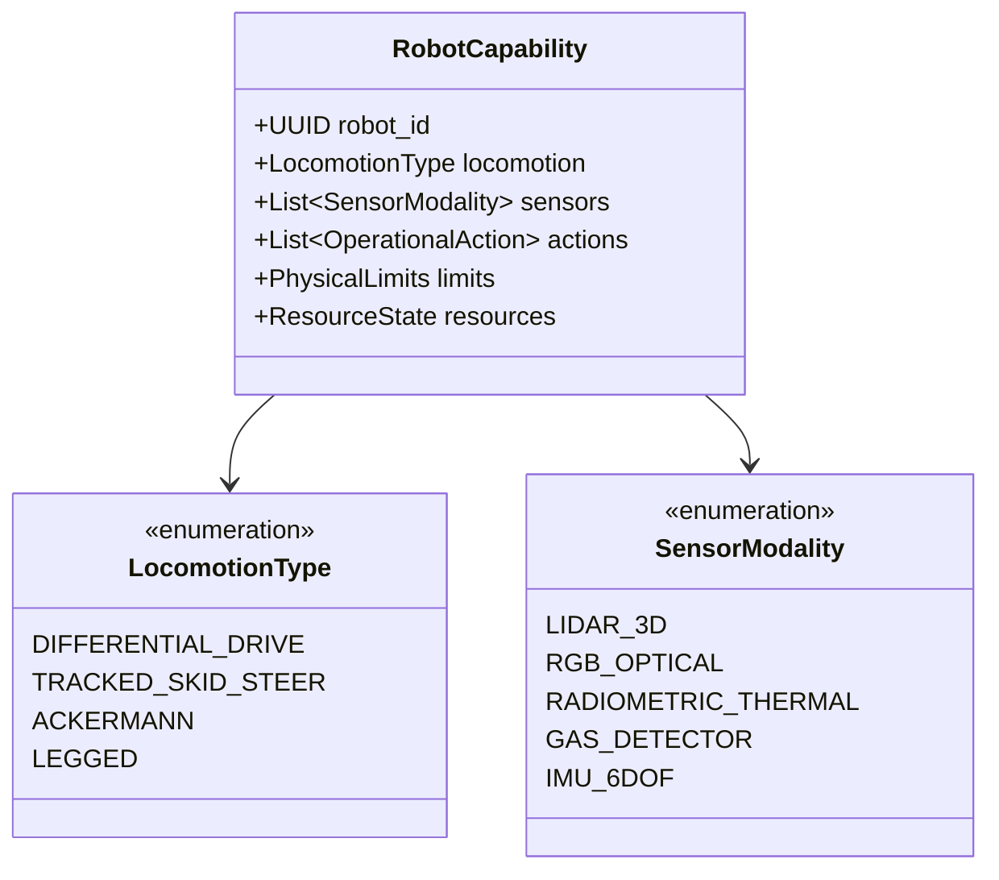

# Submodule 2.2.1: Capability Model

## 1. Purpose
Defines the formal semantic data model and taxonomy used to describe heterogeneous robot platforms, their physical locomotion, sensor suites, and operational actions.

## 2. Responsibility
Provide structured data structures, validation schemas, and serialization formats for robot capabilities conforming to `CAPABILITY_SCHEMA.md`.

## 3. Scope
### In-Scope
Capability taxonomy definition, JSON/YAML schema validation, capability hashing, and semantic tagging.

### Out-of-Scope
Hardware driver execution.

## 4. System Architecture

## 5. Internal Submodules
- **Capability Schema Validator**: Ensures all capability descriptors conform to JSON Schema definitions.
- **Taxonomy Serialization Library**: C++ and Python data classes for fast encoding and decoding.

## 6. Functional Requirements
- **REQ-2.2-001**: The capability model shall differentiate between Robot A (Explorer) and Robot B (Inspector) capabilities without ambiguity.
- **REQ-2.2-002**: Schema validation shall reject capability files missing required sensor or locomotion specifications.

## 7. Technical Approach
Define JSON Schema in `docs/06_interfaces_and_protocols/CAPABILITY_SCHEMA.md`. Implement C++ representation using `nlohmann/json` with automated serialization/deserialization macros.

## 8. Open-Source Resources
### nlohmann/json-schema-validator
- **What it provides**: JSON Schema validation for modern C++.
- **Why it is relevant**: Validates capability documents at runtime.
- **What we can reuse**: Header-only validator library.
- **What we must develop ourselves**: Robotics capability schema rules.

## 9. Prerequisites
JSON Schema specification.

## 10. Dependencies
- **Upstream Dependencies**: Submodule 1.5.2 Capability Description.
- **Downstream Dependencies**: Submodule 2.2.2 Capability Exchange, Submodule 2.2.3 Capability Matching.
- **Interfaces with Other Modules**: JSON Schema `schemas/capability_schema.json`.

## 11. Development Phases
### Phase 1: Schema & Class Generation
- **Objective**: Define schema and implement C++/Python bindings.
- **Activities**: Write JSON schema, generate data classes, test serialization.
- **Required resources**: C++, Python, nlohmann/json.
- **Input**: Capability taxonomy.
- **Output**: Compiled capability library.
- **Dependencies**: None.
- **Validation**: Validate Robot A and Robot B JSON files against schema.
- **Completion criteria**: 100% schema validation pass.

## 12. Interfaces
### Schemas
- `interfaces/schemas/capability_schema.json`: Formal JSON schema defining robot capabilities.

## 13. Testing Strategy
Validate 10 valid and 10 intentionally malformed capability descriptors; verify all valid pass and all malformed are rejected with descriptive errors.

## 14. Known Challenges
- **Schema Extensibility**: Allowing future aerial drones or legged platforms to join the platform without breaking existing ground robot schemas.

## 15. Implementation Status
`PLANNED`

## 16. References
- [W3C Web of Things (WoT) Thing Description](https://www.w3.org/TR/wot-thing-description/)
