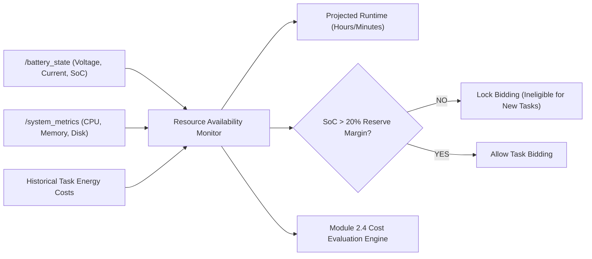

# Submodule 2.2.4: Resource Availability

## 1. Purpose
Tracks dynamic onboard resources including battery state of charge (SoC), power draw, compute CPU/GPU headroom, and storage disk capacity.

## 2. Responsibility
Monitor live resource metrics, project remaining operational endurance, and enforce energy reserve thresholds for safe task commitment.

## 3. Scope
### In-Scope
Battery state ingestion, power consumption modeling, remaining mission runtime estimation, and low-resource warning generation.

### Out-of-Scope
Battery BMS hardware circuitry.

## 4. System Architecture

## 5. Internal Submodules
- **Energy Budget Estimator**: Computes expected energy consumption for prospective travel distances based on platform weight and incline.
- **Compute & Storage Monitor**: Monitors onboard SSD storage space for inspection evidence; warns when free space < 5 GB.

## 6. Functional Requirements
- **REQ-2.2-007**: Robots with battery SoC <= 20% shall be automatically barred from bidding on non-emergency exploration tasks.
- **REQ-2.2-008**: Resource monitor shall update projected endurance at 0.5 Hz.

## 7. Technical Approach
Subscribe to ROS 2 standard `sensor_msgs/BatteryState`. Apply an empirical power model: $P_{total} = P_{base} + P_{motion}(v, \theta) + P_{sensors}$. Compute required return-to-portal energy reserve before allowing bids.

## 8. Open-Source Resources
### sensor_msgs/BatteryState
- **What it provides**: Standard ROS 2 battery interface.
- **Why it is relevant**: Universal representation of power telemetry.
- **What we can reuse**: Standard message type.
- **What we must develop ourselves**: Underground drift energy prediction model.

## 9. Prerequisites
Submodule 1.6.2 State Publisher.

## 10. Dependencies
- **Upstream Dependencies**: Submodule 1.6.2 State Publisher.
- **Downstream Dependencies**: Submodule 2.4.2 Cost Evaluation.
- **Interfaces with Other Modules**: Subscribes `/battery_state`.

## 11. Development Phases
### Phase 1: Resource Tracker Implementation
- **Objective**: Implement resource monitoring class.
- **Activities**: Code power projection math, implement reserve check guards.
- **Required resources**: C++, ROS 2.
- **Input**: Battery state telemetry.
- **Output**: Resource status struct.
- **Dependencies**: None.
- **Validation**: Simulate battery drain; verify bidding locks at 20% threshold.
- **Completion criteria**: Bidding cleanly disabled when SoC <= 20%.

## 12. Interfaces
### Topics
- `/robot_a/resources/status`: Custom ResourceStatus message reporting runtime, reserves, and bidding clearance.

## 13. Testing Strategy
Inject battery discharge down to 18%; verify agent submits infinite cost bids ($Cost = \infty$) for new tasks to decline assignment.

## 14. Known Challenges
- **Uphill Drift Power Spikes**: Climbing 15% ramps consumes 3x nominal battery power; energy projection must integrate costmap elevation profiles.

## 15. Implementation Status
`PLANNED`

## 16. References
- **Mobile Robot Energy Estimation Models**: IEEE Transactions on Robotics
